# Dreamer 4: Training Agents Inside of Scalable World Models

!!! info "Information"
    - **Title:** Training Agents Inside of Scalable World Models (Dreamer 4)
    - **Authors:** Danijar Hafner, Wilson Yan, Timothy Lillicrap (Google DeepMind)
    - **Venue:** arXiv 2025
    - **Paper:** [arXiv](https://arxiv.org/abs/2509.24527)
    - **Presenter:** [유정화](https://github.com/jeongHwarr)
    - **Last updated:** 2026-10-14

## 0. Summary

**Dreamer 4는 대규모 월드 모델을 비디오 생성기가 아니라, 에이전트가 그 안에서 강화학습하는 시뮬레이터로 확장한 에이전트다.** 실제 게임에 한 번도 접속하지 않고 녹화 데이터 2,541시간만으로 월드 모델을 배우고, 그 월드 모델 안의 상상으로 정책까지 학습해 Minecraft에서 다이아몬드를 얻었다. 오프라인 데이터만으로 다이아몬드를 얻은 첫 에이전트다.

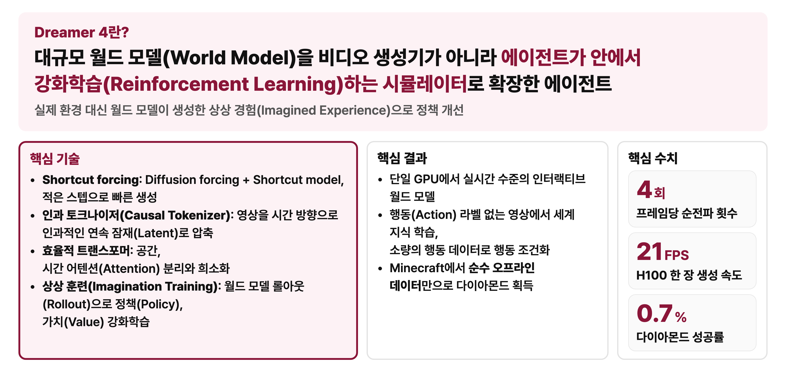

상상 속에서 연습한다는 아이디어는 Dreamer 1부터 있었다. Dreamer 4가 풀어야 했던 것은 그 연습장, 즉 월드 모델이다. 복잡한 세계를 정확히 흉내 낼 만큼 크면서도 연습을 수없이 돌릴 만큼 빨라야 한다. 이를 위해 세 가지를 조합했다.

- **인과 토크나이저(Causal Tokenizer):** 영상을 시간 방향으로 인과적인 연속 잠재로 압축한다.
- **Shortcut forcing:** Diffusion forcing과 Shortcut model을 합쳐, 한 프레임을 모델 4번 통과만으로 생성한다.
- **효율적 트랜스포머:** 공간 어텐션과 시간 어텐션을 나누고 시간 어텐션을 줄여, 2B 모델이 H100 한 장에서 초당 21프레임으로 돌아간다.

이렇게 만든 월드 모델 위에 에이전트 토큰을 붙여 행동 복제로 정책을 초기화하고, 상상 롤아웃에서 PMPO로 강화학습한다. 결과는 철 곡괭이 성공률 29.0%, 다이아몬드 0.7%이며, 비교한 다른 오프라인 기준선의 다이아몬드 성공률은 모두 0%다.

1절에서 문제 설정을, 2절에서 Shortcut forcing의 배경 세 가지를 본다. 3절부터 7절까지는 학습 세 단계와 월드 모델의 각 부품, 상상 훈련, 효율적 트랜스포머를 차례로 보고, 8절에서 실험, 9절에서 결론과 한계를 정리한다. 수식 유도는 마지막 부록에 따로 두었다.

---

## 1. 문제: 녹화 데이터만으로 상상 속에서 행동을 배운다

### 오프라인 월드 모델

**에이전트가 복잡한 환경에서 행동하려면 세계가 어떻게 작동하는지 이해하고, 특정 행동이 어떤 미래를 만들지 예측해야 한다.** 이 두 능력을 맡는 모델이 월드 모델이다. 월드 모델이 있으면 실제 환경을 쓰지 않고도 계획과 강화학습을 상상 안에서 할 수 있다.

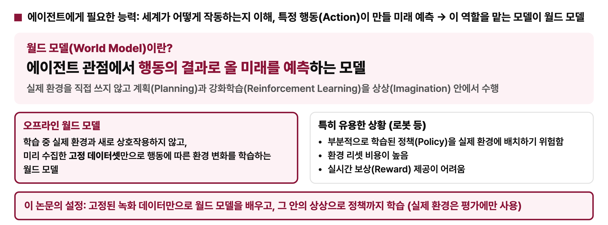

이 논문은 그중에서도 **오프라인 월드 모델**을 다룬다. 학습하는 동안 실제 환경과 새로 상호작용하지 않고, 미리 수집한 고정 데이터셋만으로 행동에 따른 환경 변화를 배우는 월드 모델이다. 로봇을 생각하면 왜 필요한지 분명해진다. 반쯤 학습된 정책을 실제 로봇에 올리는 것은 위험하고, 실험할 때마다 장면을 되돌리는 비용이 크며, 사람이 실시간으로 보상을 매기기도 어렵다.

!!! example "비유: 녹화 영상만 받은 조종 훈련생"
    진짜 비행기는 비싸고 위험해서 마음대로 태워 줄 수 없고, 훈련생에게 주어진 것은 선배 조종사들의 조종석 녹화 영상과 조작 기록뿐이다. 이 녹화로 비행 시뮬레이터를 먼저 만들고, 그 시뮬레이터 안에서만 연습한 뒤 실제 비행은 시험 볼 때만 한다. Dreamer 4의 설정이 이렇다.

### 기존 접근의 한계

**기존에는 작지만 정확한 월드 모델 에이전트와, 크지만 부정확한 비디오 모델이라는 두 갈래가 있었다.**

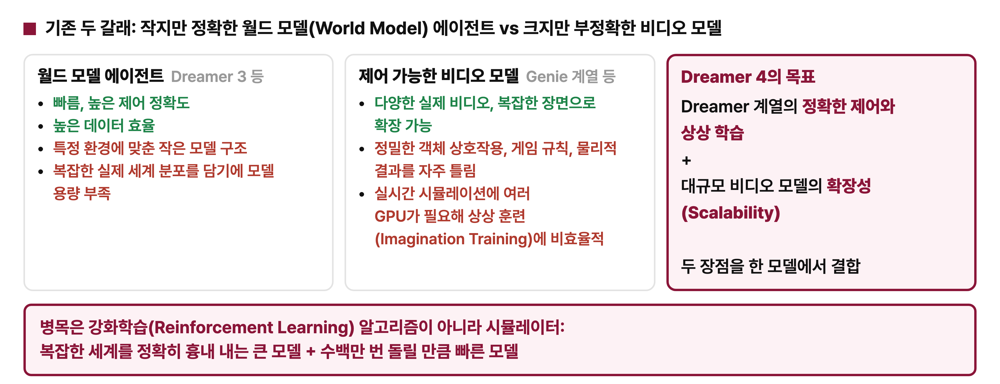

Dreamer 3 같은 월드 모델 에이전트는 빠르고 제어 정확도와 데이터 효율이 높다. 하지만 특정 환경에 맞춘 작은 모델이라 복잡한 실제 세계의 분포를 담기에는 용량이 부족하다. Genie 계열 같은 제어 가능한 비디오 모델은 다양한 영상과 복잡한 장면으로 규모를 키울 수 있지만, 블록을 놓거나 도구를 쓰는 정밀한 물체 상호작용, 게임 규칙, 물리적 결과를 자주 틀린다. 실시간으로 돌리는 데 GPU가 여러 장 필요하기도 해서 상상 훈련에 쓰기에는 비효율적이다.

**Dreamer 4의 목표는 Dreamer 계열의 정확한 제어와 상상 학습에 대규모 비디오 모델의 확장성을 결합하는 것이다.** 병목은 강화학습 알고리즘이 아니라 시뮬레이터였다. 시뮬레이터가 엉성하면 엉뚱한 습관이 들고, 너무 느리면 연습량이 부족하다.

### 주요 기여

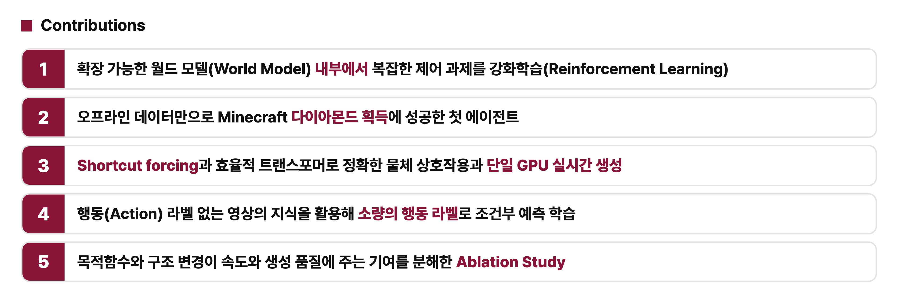

논문이 주장하는 기여는 다섯 가지다. 확장 가능한 월드 모델 내부에서 복잡한 제어 과제를 강화학습했고, 오프라인 데이터만으로 Minecraft 다이아몬드를 얻었다. Shortcut forcing과 효율적 트랜스포머로 정확한 물체 상호작용과 단일 GPU 실시간 생성을 함께 달성했다. 행동 라벨 없는 영상의 지식을 활용해 적은 행동 라벨만으로 행동 조건부 예측을 배웠고, 목적함수와 구조 변경이 속도와 품질에 주는 기여를 Ablation으로 분해했다.

### 상상 훈련의 전체 흐름

**영상과 행동 기록으로 월드 모델을 사전학습하고, 월드 모델이 그린 미래 위에서 정책을 강화학습한 뒤, 실제 게임에서는 평가만 한다.**

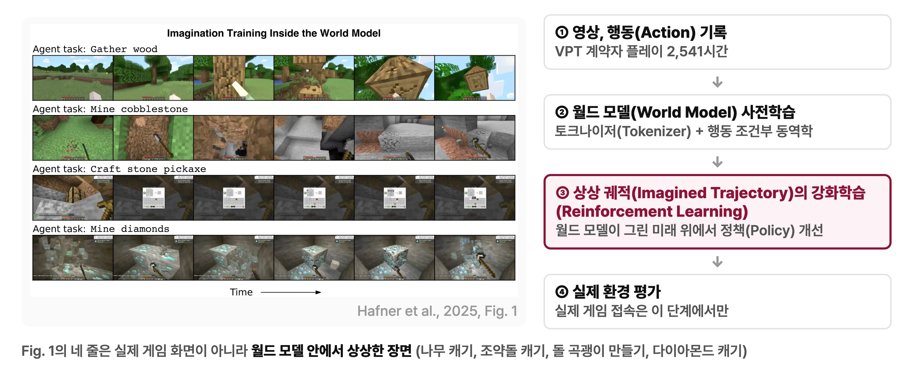

왼쪽 원문 Figure 1의 네 줄은 실제 게임 화면이 아니라 월드 모델 안에서 상상한 장면이다. 나무 캐기, 조약돌 캐기, 돌 곡괭이 만들기, 다이아몬드 캐기 과제이며, 작업대 화면에서 돌 곡괭이를 만드는 장면까지 모델이 직접 그려 냈다.

학습 데이터는 VPT 계약자 플레이 2,541시간이다. VPT(Video PreTraining)는 OpenAI가 2022년에 발표한 Minecraft 에이전트 연구이고, 계약자는 그 연구를 위해 고용된 사람 플레이어다. 이들이 게임을 하는 동안 화면과 함께 키보드, 마우스 입력을 녹화했기 때문에 화면과 행동이 짝지어진 데이터가 된다. 인터넷의 일반 게임 영상에는 어떤 키를 눌렀는지 기록이 없다는 점과 다르다.

---

## 2. 배경: Shortcut forcing의 세 가지 재료

Dreamer 4의 핵심 목적함수인 Shortcut forcing은 Flow matching, Shortcut model, Diffusion forcing을 조립한 것이다. 세 방법을 차례로 본다.

### 2-1. Flow matching: 잡음에서 데이터로 가는 속도를 배운다

**Flow matching은 잡음과 데이터를 직선으로 잇고, 직선 위 임의의 점에서 데이터 쪽으로 가는 속도를 예측하는 생성 방법이다.** Dreamer 4의 월드 모델은 디퓨전 모델 계열이며, 그중 Flow matching 방식을 쓴다.

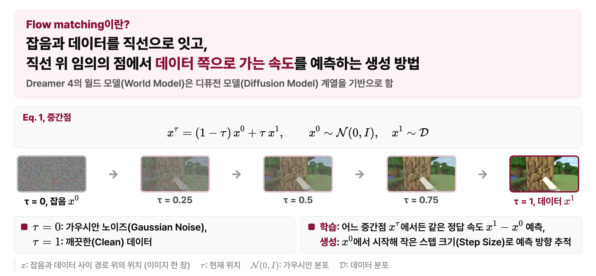

순수 잡음 $x^0$과 깨끗한 데이터 $x^1$을 신호 수준 $\tau$로 섞어 중간점을 만든다.

$$
x^\tau = (1-\tau)\,x^0 + \tau\,x^1, \qquad x^0 \sim \mathcal{N}(0, I),\quad x^1 \sim \mathcal{D}
$$

이 논문에서는 $\tau = 0$이 순수 잡음, $\tau = 1$이 깨끗한 데이터다. 많은 디퓨전 논문과 방향이 반대라서 헷갈리기 쉬운데, $\tau$는 신호가 얼마나 남아 있는지를 나타낸다. 직선으로 섞었기 때문에 어느 중간점에서 출발하든 데이터로 가는 정답 속도는 $x^1 - x^0$으로 같다.

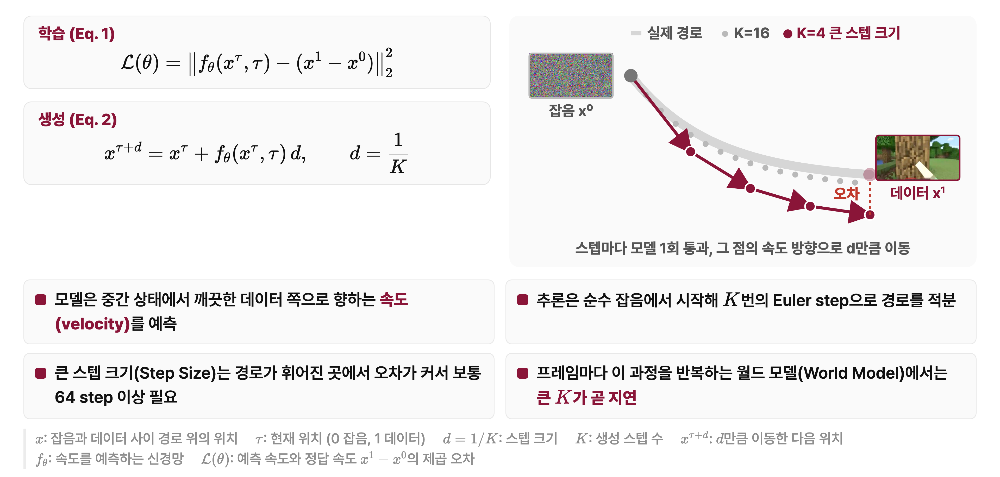

학습할 때는 신경망 $f_\theta$가 중간점과 $\tau$를 받아 이 정답 속도를 맞히도록 제곱 오차를 줄인다. 생성할 때는 잡음에서 출발해 예측 속도에 스텝 크기 $d$를 곱한 만큼씩 이동한다. 스텝 크기를 $1/K$로 두면 $K$번 이동해 데이터에 도착하며, 이것을 Euler step이라고 부른다.

$$
\mathcal{L}(\theta) = \left\| f_\theta(x^\tau, \tau) - (x^1 - x^0) \right\|_2^2, \qquad x^{\tau+d} = x^\tau + f_\theta(x^\tau, \tau)\,d, \quad d = \frac{1}{K}
$$

**문제는 생성에 필요한 스텝 수다.** 원문은 일반적인 디퓨전 모델이 64스텝 이상을 써야 한다고 설명한다. 스텝마다 신경망을 한 번 통과하므로, 프레임마다 생성을 반복하는 월드 모델에서는 스텝 수 $K$가 곧 속도를 정한다. 원문 Table 2에서 Diffusion forcing 트랜스포머는 초당 0.8프레임을 생성한다. 스텝 수만 $K = 4$로 줄이면 초당 9.1프레임으로 빨라지지만, 생성 품질을 나타내는 FVD가 306에서 875로 크게 나빠진다.

!!! example "비유: 지금 방향만 알려 주는 내비게이션"
    Flow matching은 "지금 이 순간 어느 쪽으로 핸들을 꺾어라"만 알려 주는 내비게이션이다. 길이 굽어 있으면 자주 물어봐야 하고, 한 번 듣고 너무 오래 직진하면 길을 벗어난다.

### 2-2. Shortcut model: 스텝 크기까지 입력으로 받는다

**Shortcut model은 Flow matching의 입력에 원하는 스텝 크기 $d$를 조건으로 더한 모델이다.** 같은 모델이 작은 스텝과 큰 스텝을 모두 처리하고, 추론할 때 $d = 1/K$를 넣어 몇 스텝으로 생성할지 정한다.

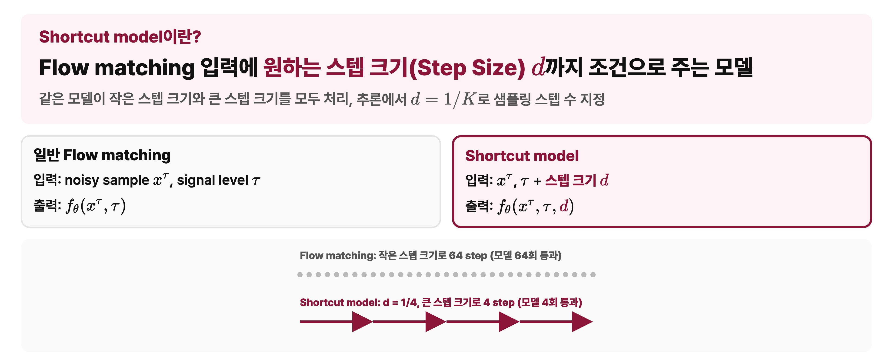

일반 Flow matching은 $f_\theta(x^\tau, \tau)$처럼 현재 위치와 신호 수준만 받는다. Shortcut model은 $f_\theta(x^\tau, \tau, d)$처럼 스텝 크기까지 받는다. 같은 위치라도 크게 갈 때 맞는 평균 방향과 조금 갈 때의 방향은 다르기 때문에, 이번에 얼마나 갈지 알려 주는 것이다. 그 결과 64번 대신 4번만 모델을 통과해도 된다. 앞의 내비게이션으로 말하면 "5km 간다면 이 방향으로 가라"처럼 갈 거리까지 함께 묻는 내비게이션이다.

**큰 스텝의 정답은 작은 스텝 두 번으로 만든다.**

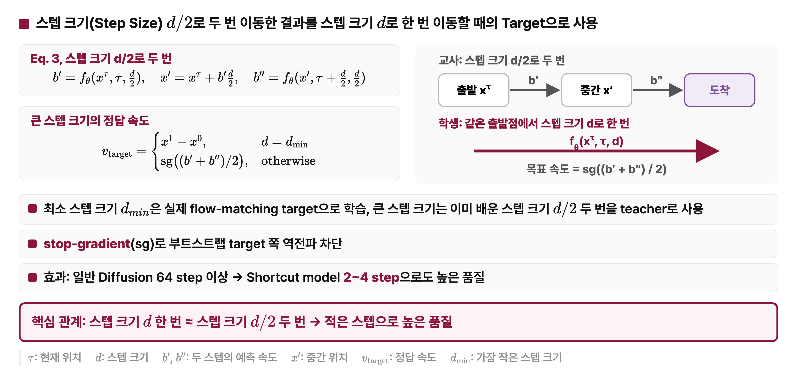

$f_\theta$의 괄호에는 세 가지가 들어간다. 첫째는 지금 서 있는 위치, 둘째는 그 위치의 신호 수준, 셋째는 이번에 갈 스텝 크기다. 이 순서에 맞춰 스텝 크기 $d/2$로 두 번 이동해 본다.

1. 출발점 $x^\tau$, 신호 수준 $\tau$, 스텝 크기 $d/2$로 첫 번째 속도 $b'$을 구한다.
2. 그 속도로 $d/2$만큼 이동한 중간 위치 $x' = x^\tau + b'\,d/2$를 구한다. $\tau$가 경로 위의 위치 눈금이기도 하므로, 중간 위치의 신호 수준은 $\tau + d/2$다.
3. 중간 위치 $x'$, 신호 수준 $\tau + d/2$, 스텝 크기 $d/2$로 두 번째 속도 $b''$을 구한다.

$$
b' = f_\theta(x^\tau, \tau, \tfrac{d}{2}), \qquad x' = x^\tau + b'\tfrac{d}{2}, \qquad b'' = f_\theta(x', \tau + \tfrac{d}{2}, \tfrac{d}{2})
$$

두 번 이동한 양은 $(d/2)b' + (d/2)b''$이므로, 같은 출발점에서 스텝 크기 $d$로 한 번에 같은 곳에 가려면 속도가 두 속도의 평균이어야 한다. 가장 작은 스텝 크기 $d_{\min}$은 더 쪼갤 수 없으니 실제 데이터의 정답 속도로 배운다.

$$
v_{\rm target} = \begin{cases} x^1 - x^0, & d = d_{\min} \\ \mathrm{sg}\big((b' + b'')/2\big), & \text{otherwise} \end{cases}
$$

$\mathrm{sg}$는 stop-gradient로, 정답 쪽 값을 상수로 고정해 기울기가 흐르지 않게 한다. 예를 들어 $\tau = 0.25$에서 스텝 크기 $d = 0.5$로 가면 도착 위치는 $\tau = 0.75$다. 두 번 나눠 가는 쪽은 0.25만큼 이동해 $\tau = 0.5$를 거쳐 $\tau = 0.75$에 도착하고, 한 번에 가는 쪽은 0.5짜리 한 스텝으로 같은 지점에 도착하도록 배운다. 0.25짜리 스텝은 다시 0.125짜리 두 번으로 배우므로, 가장 작은 스텝부터 큰 스텝까지 정답이 차례로 쌓인다. 그 결과 일반 디퓨전이 64스텝 이상 필요한 품질을 2~4스텝으로 낸다.

!!! note "교사와 학생은 서로 다른 네트워크가 아니다"
    작은 스텝 두 번을 교사, 큰 스텝 한 번을 학생이라고 부르지만, 일반적인 지식 증류처럼 모델이 두 개 있는 것이 아니다. 같은 $f_\theta$에 스텝 크기만 다르게 물어본 것이고, 교사 쪽 출력은 stop-gradient로 고정해 학생 쪽 예측만 정답에 맞추도록 가중치를 고친다. 가중치가 좋아지면 다음 학습 스텝에서는 교사의 답도 함께 좋아진다.

### 2-3. Diffusion forcing: 프레임마다 잡음 수준을 다르게

**Diffusion forcing은 시퀀스의 각 시간 스텝마다 서로 다른 신호 수준 $\tau_t$를 주는 학습 방법이다.** 일반적인 영상 디퓨전은 모든 프레임에 같은 잡음 수준을 주지만, Diffusion forcing은 프레임마다 따로 준다.

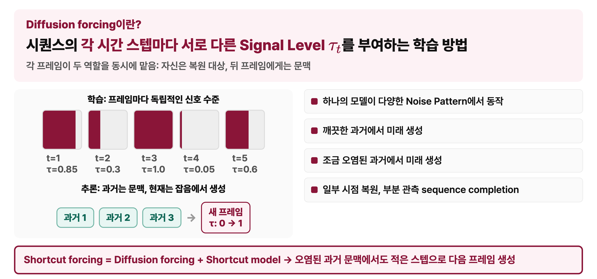

그 결과 각 프레임이 두 역할을 동시에 맡는다. 자기 자신은 복원해야 할 대상이고, 뒤에 오는 프레임에게는 참고할 문맥이다. 학습할 때 깨끗한 프레임과 많이 오염된 프레임을 섞어 두고 모두 복원하게 하면, 모델은 깨끗한 과거를 볼 때도 흐린 과거를 볼 때도 다음 프레임을 만드는 연습을 한다. 추론할 때는 이미 만든 과거 프레임을 문맥으로 두고 새 프레임 하나만 잡음에서 출발해 만든다.

!!! example "비유: 칸마다 다르게 지워진 연속 만화"
    첫 칸은 거의 그대로, 둘째 칸은 많이 지워지고, 셋째 칸은 완전히 남아 있는 연속 만화를 복원하는 연습과 같다. 모델은 각 칸을 맞히기 위해 앞 칸만 참고할 수 있다.

**Dreamer 4의 Shortcut forcing은 Diffusion forcing과 Shortcut model을 합친 것이다.** 프레임마다 신호 수준을 따로 주고, 동시에 스텝 크기도 함께 준다. 그래서 약간 오염된 과거 문맥에서도 적은 스텝으로 다음 프레임을 만들 수 있다.

---

## 3. 학습 세 단계와 월드 모델 구조

### 3-1. Algorithm 1: 세 단계 학습

**Dreamer 4는 월드 모델 사전학습, 에이전트 미세조정, 상상 훈련의 세 단계로 학습하며, 세 단계 모두 실제 환경에 접속하지 않는다.**

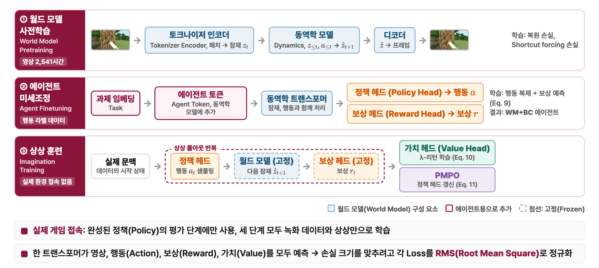

1. **월드 모델 사전학습:** 영상 2,541시간으로 토크나이저와 동역학 모델을 학습한다. 토크나이저는 복원 손실로, 동역학 모델은 Shortcut forcing 손실로 배운다.
2. **에이전트 미세조정:** 행동 라벨이 있는 데이터로, 과제 임베딩을 받는 에이전트 토큰을 동역학 모델에 추가하고 정책 헤드와 보상 헤드를 학습한다. 녹화된 사람의 행동을 따라 하므로 행동 복제이고, 이 단계를 마친 에이전트를 실험에서는 WM+BC라고 부른다.
3. **상상 훈련:** 고정한 월드 모델 안에서 상상 롤아웃을 만들고, 그 위에서 가치 헤드와 정책 헤드를 강화학습한다.

실제 게임에 접속하는 것은 완성된 정책을 평가할 때뿐이다. 한 트랜스포머가 영상, 행동, 보상, 가치를 모두 예측하다 보니 손실마다 크기가 크게 다르다. 그래서 각 손실을 실행 중 추정한 RMS(Root Mean Square)로 나눠 정규화해, 어느 한 손실이 학습을 독차지하지 않게 한다.

### 3-2. 월드 모델의 데이터 흐름

**월드 모델은 프레임을 토크나이저로 잠재로 압축하고, 동역학 모델이 다음 잠재를 예측한 뒤, 디코더가 다시 프레임으로 복원하는 구조다.**

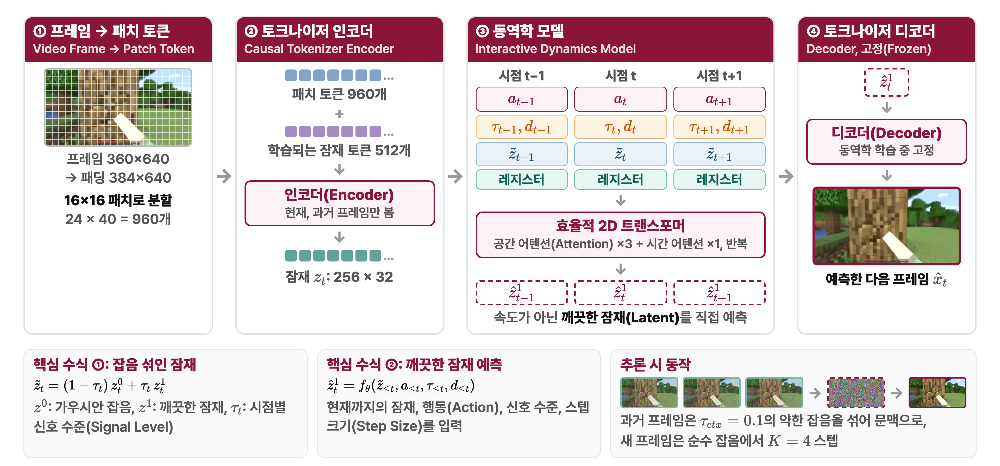

360×640 프레임을 384×640으로 패딩해 16×16 패치로 자르면 한 프레임에서 960개의 패치 토큰이 나온다. 토크나이저 인코더는 여기에 학습되는 잠재 토큰 512개를 더해, 현재와 과거 프레임만 보면서 잠재 $z_t$로 압축한다. 동역학 모델은 시점마다 행동 $a$, 신호 수준과 스텝 크기 $(\tau, d)$, 잡음 섞인 잠재 $\tilde z$, 레지스터 토큰을 한 묶음으로 받아, 속도가 아닌 깨끗한 잠재 $\hat z^1$을 직접 예측한다. 디코더는 동역학 모델을 학습하는 동안 고정되어 있고, 예측한 잠재를 다음 프레임 화면으로 복원한다.

추론할 때는 과거 프레임에 $\tau_{ctx} = 0.1$의 약한 잡음을 섞어 문맥으로 쓰고, 새 프레임은 순수 잡음에서 $K = 4$스텝으로 만든다.

### 3-3. 토크나이저와 동역학 모델

**Dreamer 4는 인과 토크나이저와 인터랙티브 동역학 모델이라는 두 부품으로 이루어지며, 두 부품 모두 블록 인과 트랜스포머를 쓴다.**

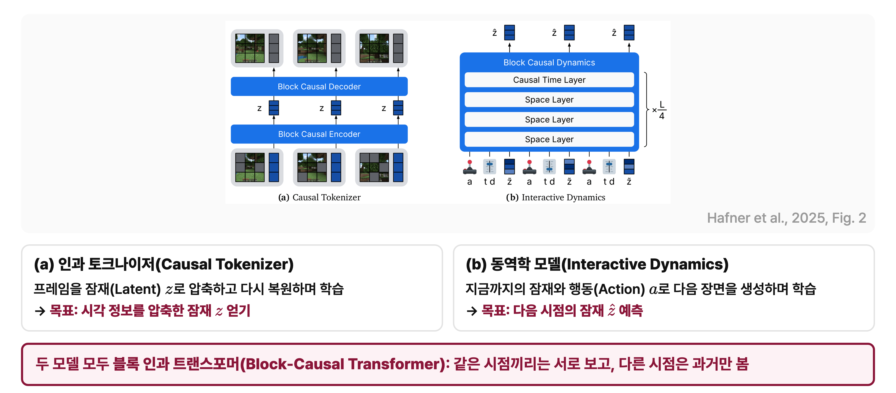

원문 Figure 2의 (a) 인과 토크나이저는 일부 패치가 가려진 프레임을 Block Causal Encoder로 잠재 $z$로 압축하고, Block Causal Decoder로 다시 복원하며 학습한다. 목표는 시각 정보를 압축한 잠재 $z$를 얻는 것이다. (b) 동역학 모델은 행동, 신호 수준과 스텝 크기, 오염된 잠재를 시점마다 받아 다음 시점의 잠재를 예측한다. 시간 층 1개와 공간 층 3개를 한 묶음으로 $L/4$번 반복하며, $L$은 트랜스포머의 전체 층 수다.

블록 인과 트랜스포머는 같은 시점 안의 토큰끼리는 서로 자유롭게 보고, 다른 시점은 과거만 볼 수 있다. 덕분에 한 프레임씩 순서대로 만들어 낼 수 있다.

**토크나이저는 잠재 $z$를 만드는 역할이고, 디코더는 그 $z$를 학습시키는 데 필요하다.** 디코더가 $z$에서 원래 프레임을 복원해야 하므로, $z$에 장면 정보가 제대로 담긴다. 추론할 때 에이전트는 디코더 없이 $z$만 본다. 상상 훈련도, 실제 게임에서 정책을 돌릴 때도 $z$ 위에서 계산한다. 디코더는 학습할 때와, 사람이 월드 모델을 직접 조작하거나 생성 영상을 확인할 때처럼 화면을 보여 줘야 할 때만 쓴다.

---

## 4. 인과 토크나이저: 프레임을 한 장씩 풀 수 있는 압축기

### 4-1. 목적과 구성

**인과 토크나이저는 원본 영상을 연속 표현으로 압축하고 다시 복원하는 모델이며, 인코더와 디코더 모두 시간 방향으로 인과적이다.** 시간 $t$의 표현을 만들 때 현재와 과거만 쓰고 미래 프레임은 보지 않는다.

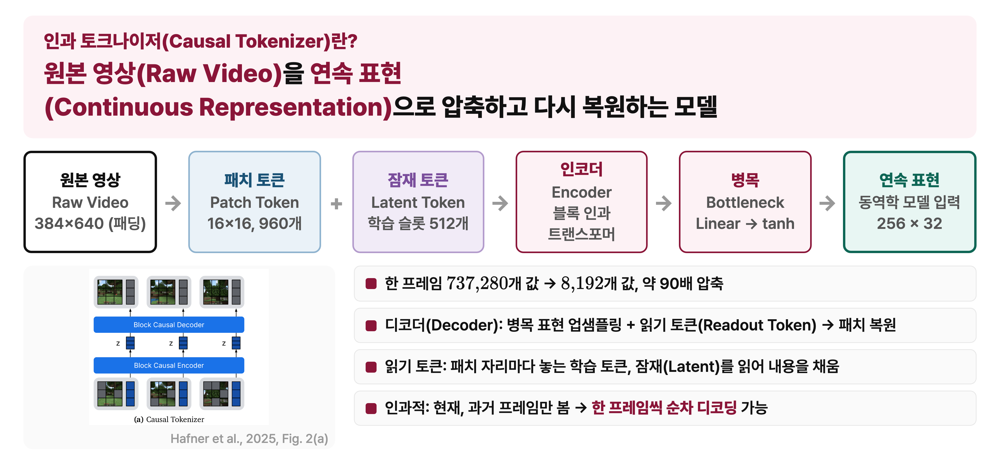

패치 토큰 960개에 학습되는 잠재 토큰 512개를 더해 인코더에 넣는다. 인코더 출력 중 잠재 토큰 자리를 읽어 선형 사영으로 채널을 줄이고 tanh를 씌우면 512×16 크기의 병목 표현이 된다. 이것을 256×32로 재배열한 것이 동역학 모델의 입력이다. 패딩한 프레임 하나의 값 737,280개가 8,192개로 줄어들어 약 90배 압축된다.

디코더는 병목 표현을 다시 모델 차원으로 올리고, 읽기 토큰과 이어 붙여 패치를 복원한다. 읽기 토큰은 패치 자리마다 하나씩 놓는 학습 가능한 토큰으로, 잠재를 읽어 와서 그 자리의 패치 내용을 채운다. 인과적으로 만든 덕분에 이전 프레임의 정보를 활용해 압축이 잘 되고, 동시에 한 프레임씩 순서대로 디코딩할 수 있다. 키를 누를 때마다 다음 화면 한 장을 바로 보여 줘야 하는 인터랙티브 추론에 맞는 구조다.

### 4-2. 두 종류의 입력 토큰과 어텐션

**각 시간 스텝의 입력은 이미지에서 온 패치 토큰과, 모델 파라미터인 잠재 토큰 두 종류다.**

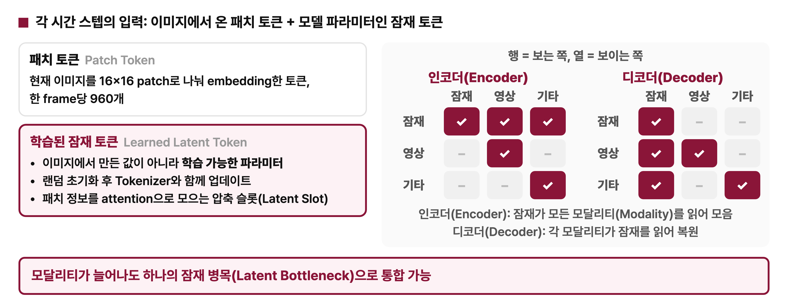

패치 토큰은 현재 이미지를 16×16 패치로 나눠 임베딩한 토큰이다. 잠재 토큰은 이미지에서 계산한 값이 아니라 학습 가능한 파라미터로, 랜덤하게 초기화된 뒤 토크나이저와 함께 업데이트된다. 역할은 패치 정보를 어텐션으로 끌어모으는 압축 슬롯이다. 빈 슬롯 512개를 준비해 두고, 각 슬롯이 패치들 중 필요한 정보를 골라 담는다고 생각하면 된다.

오른쪽 행렬은 누가 누구를 볼 수 있는지를 나타낸다. 인코더에서는 잠재 토큰이 모든 모달리티를 보고, 각 모달리티는 자기 자신만 본다. 디코더에서는 반대로 각 모달리티가 자기 자신과 잠재를 보고, 잠재는 잠재끼리만 본다. **인코더에서 모달리티끼리 서로 보지 못하니 모든 정보는 잠재 토큰을 거쳐야만 모이고, 디코더는 잠재만 보고 복원해야 하니 $z$ 하나에 모든 입력의 정보가 담긴다.** 그래서 새 모달리티가 생겨도 잠재가 읽어 가게만 하면 되고, $z$의 모양은 그대로라 동역학 모델을 바꿀 필요가 없다.

### 4-3. Masked Autoencoding

**토크나이저는 일부 패치를 일부러 가린 채 원본 프레임을 복원하도록 학습한다.**

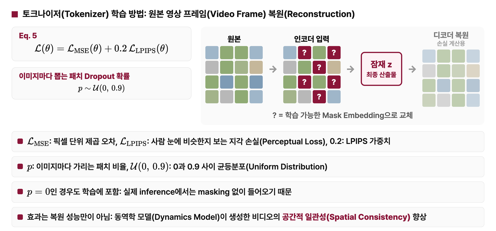

손실은 픽셀 단위 오차인 MSE에 사람 눈에 비슷한지를 보는 지각 손실 LPIPS를 0.2배 더한 것이다. MSE만 쓰면 흐릿한 평균 이미지가 나오기 쉬워서 LPIPS로 보완한다.

$$
\mathcal{L}(\theta) = \mathcal{L}_{\rm MSE}(\theta) + 0.2\,\mathcal{L}_{\rm LPIPS}(\theta), \qquad p \sim \mathcal{U}(0, 0.9)
$$

가리는 비율 $p$는 이미지마다 0에서 0.9 사이에서 무작위로 뽑고, 가린 패치는 학습 가능한 마스크 임베딩으로 바꾼다. 실제 추론에서는 가리지 않은 프레임이 들어오므로 $p = 0$인 경우도 학습에 포함한다. 저자들은 이 마스킹 학습이 복원 성능만이 아니라 동역학 모델이 생성한 영상의 공간적 일관성을 높였다고 보고한다.

!!! example "비유: 군데군데 찢긴 사진 복원"
    멀쩡한 사진만 베끼는 학생은 픽셀을 옮겨 적기만 하면 된다. 사진이 찢겨 있으면 "벽돌 무늬는 이렇게 이어진다", "하늘은 위에 있다" 같은 장면의 규칙을 알아야 빈칸을 채울 수 있다. 이런 규칙을 담은 잠재일수록 동역학 모델이 다음 장면을 이어 그리기 쉬워진다.

---

## 5. 동역학 모델과 Shortcut forcing

### 5-1. 동역학 모델의 역할

**동역학 모델은 고정된 토크나이저의 잠재와 행동을 시간 순서대로 받아 다음 잠재 상태를 생성하는 트랜스포머다.** 화면을 직접 그리지 않고 잠재를 먼저 만들며, 화면이 필요할 때만 토크나이저 디코더로 복원한다.

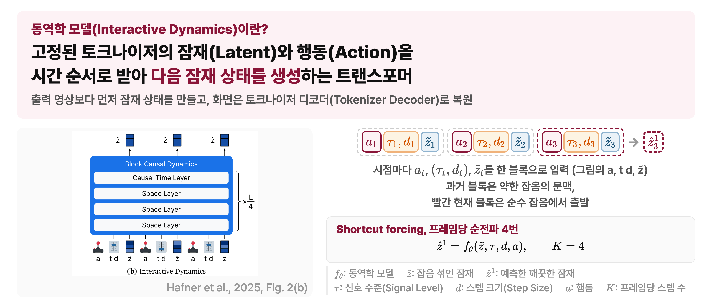

시점마다 행동 $a_t$, 신호 수준과 스텝 크기 $(\tau_t, d_t)$, 오염된 잠재 $\tilde z_t$가 한 블록이 되고, 블록들이 시간 순서대로 이어진다. 원문 Figure 2(b)처럼 한 블록 안에서는 행동이 잠재 앞에 놓인다. 과거 블록의 잠재는 약한 잡음만 섞인 문맥이고, 현재 블록은 순수 잡음에서 출발한다. 동역학 모델은 지금까지의 블록과 이번 행동을 보고 현재 블록의 깨끗한 잠재를 채운다. Shortcut forcing 덕분에 한 프레임을 만들 때 모델을 $K = 4$번만 통과한다.

$$
\hat z^1 = f_\theta(\tilde z, \tau, d, a), \qquad K = 4
$$

### 5-2. 시점별 입력 블록

**한 시점의 입력 블록은 행동, Shortcut 조건, 오염된 관측 잠재, 레지스터 토큰으로 이루어진다.**

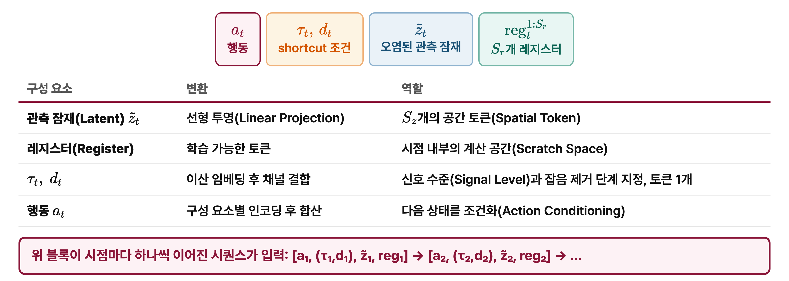

관측 잠재는 선형 사영으로 $S_z$개의 공간 토큰이 된다. $\tau$와 $d$는 이산값이라 각각 임베딩한 뒤 채널 방향으로 이어 붙여 토큰 하나로 만들며, 이 토큰이 "지금 얼마나 깨끗한 입력이고 이번에 얼마나 큰 스텝을 갈지"를 알려 준다.

레지스터는 토크나이저에서 나온 $z$와 다른 토큰이다. $z$는 화면을 압축한 값이지만, 레지스터는 화면과 상관없는 학습 가능한 파라미터로 시점마다 $S_r$개를 끼워 넣는다. 어텐션 계산 중에 프레임 전체에 걸친 정보를 잠시 적어 두는 메모장 역할을 하고, 예측 대상이 아니라서 출력은 버린다.

행동은 구성 요소별로 인코딩한 뒤 합산한다. Minecraft의 행동은 키보드와 마우스로 이루어지는데, 키보드는 23개 키를 눌렀는지 여부이고 마우스는 좌표마다 11칸씩 나눈 121개 범주 중 하나라서 값의 형태가 다르다. 그래서 각자 맞는 방식으로 $S_a$개의 토큰으로 바꾼 뒤 같은 자리끼리 더해 하나의 행동 토큰 묶음으로 만든다.

### 5-3. Shortcut forcing의 입력과 출력

**Dreamer 4는 시점마다 신호 수준과 스텝 크기를 따로 주고, 속도 대신 깨끗한 잠재를 직접 예측한다.**

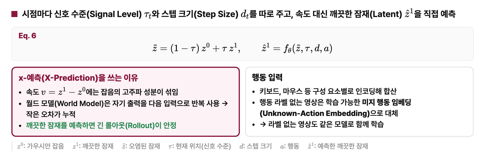

$$
\tilde z = (1-\tau)\,z^0 + \tau\,z^1, \qquad \hat z^1 = f_\theta(\tilde z, \tau, d, a)
$$

Flow matching의 $x$ 자리에 토크나이저 잠재 $z$가 들어간 형태다. 기존 Shortcut model과 달리 Dreamer 4는 **x-예측**을 쓴다. v-예측은 잡음에서 데이터로 가는 속도 $v = z^1 - z^0$을 출력하고, x-예측은 깨끗한 데이터, 여기서는 깨끗한 잠재 $z^1$ 자체를 출력한다. 둘 중 하나를 알면 다른 하나를 계산할 수 있어서 담는 정보는 같지만, 신경망이 맞혀야 하는 대상의 성격이 다르다.

저자들은 v-예측이 고주파 출력을 만들도록 학습되고, 프레임을 하나씩 이어서 긴 영상을 만들 때 작은 오차가 쌓인다고 설명한다. 월드 모델은 자기가 만든 출력을 다음 입력으로 계속 다시 쓰기 때문이다. 반면 깨끗한 잠재를 직접 예측하면 임의 길이의 롤아웃을 안정적으로 만들 수 있었다고 보고한다.

!!! example "비유: 릴레이 그림 그리기"
    사람들이 한 줄로 서서 앞사람 그림을 보고 다음 그림을 그린다고 하자. "앞 그림에서 이만큼 고쳐라"라는 수정 지시, 즉 속도를 넘기면 지시에 섞인 작은 떨림이 사람을 거칠 때마다 쌓인다. "완성본은 이렇게 생겼다", 즉 깨끗한 잠재를 넘기면 각자 매번 그럴듯한 완성본을 그리려 하므로 떨림이 덜 넘어간다.

!!! note "x-예측만으로 좋아진 것은 아니다"
    원문 Table 2를 보면 x-예측만 추가했을 때는 FVD가 329에서 326으로 거의 그대로이고, 손실까지 x 공간에서 계산했을 때 151로 크게 좋아진다. 출력 형태와 함께 손실을 재는 공간, 즉 신호 수준별 가중치가 바뀐 것이 큰 몫을 했다.

행동 라벨이 없는 영상에는 학습 가능한 미지 행동 임베딩을 대신 넣는다. 그래서 라벨 있는 영상과 없는 영상을 같은 모델로 함께 학습할 수 있다. 미지 행동 임베딩은 아무 키도 누르지 않은 무동작이 아니라 행동을 모른다는 뜻이다.

### 5-4. Shortcut forcing의 손실과 추론

**신경망은 항상 깨끗한 잠재를 출력하고, 부트스트랩 정답을 만들 때만 그 출력을 잠시 속도로 바꿔 계산한다.**

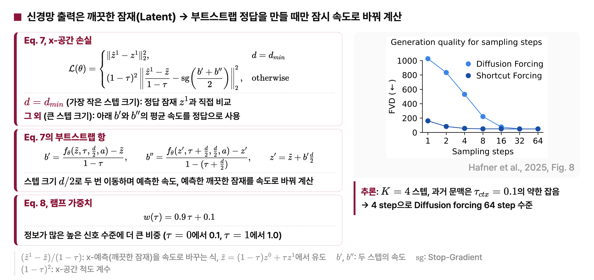

$$
\mathcal{L}(\theta) = \begin{cases} \|\hat z^1 - z^1\|_2^2, & d = d_{\min} \\[4pt] (1-\tau)^2 \left\| \dfrac{\hat z^1 - \tilde z}{1-\tau} - \mathrm{sg}\!\left(\dfrac{b' + b''}{2}\right) \right\|_2^2, & \text{otherwise} \end{cases}
$$

가장 작은 스텝 크기에서는 예측한 깨끗한 잠재와 정답 잠재를 직접 비교한다. 그 외의 큰 스텝 크기에서는 2-2절의 부트스트랩과 같다. 스텝 크기 $d/2$로 두 번 이동한 속도 $b'$, $b''$의 평균을 정답으로 쓰고, 신경망 출력을 속도로 바꾼 값을 여기에 맞춘다.

**깨끗한 잠재를 속도로 바꾸는 식은 "남은 거리 ÷ 남은 구간"이다.** 경로가 $\tilde z = (1-\tau)z^0 + \tau z^1$이므로 $z^1 - \tilde z = (1-\tau)(z^1 - z^0)$이고, 양변을 $1-\tau$로 나누면 속도가 나온다. 신경망은 잡음 $z^0$을 모르고 지금 위치 $\tilde z$와 예측한 끝점 $\hat z^1$만 알기 때문에 이 식으로 속도를 구한다. 예를 들어 잡음이 −2, 데이터가 6인 1차원 경로에서 $\tau = 0.25$인 위치는 0이다. 끝점을 6으로 예측하면 속도는 $(6 - 0) / 0.75 = 8$로, 실제 속도 $6 - (-2) = 8$과 같다. $b'$과 $b''$도 같은 변환으로 계산하며, 두 번째 스텝은 신호 수준 $\tau + d/2$에서 출발하므로 분모가 $1 - (\tau + d/2)$가 된다. 앞에 곱한 $(1-\tau)^2$는 속도 공간에서 잰 오차를 x 공간 척도로 맞추는 계수다. 자세한 유도는 부록에 있다.

$$
w(\tau) = 0.9\,\tau + 0.1
$$

램프 가중치 $w(\tau)$는 $\tau = 0$에서 0.1, $\tau = 1$에서 1.0이다. $\tau$가 0에 가까우면 입력이 거의 순수 잡음이라 데이터 평균 같은 답밖에 낼 수 없어 배울 것이 적다. $\tau$가 1에 가까우면 정확히 맞혀야 할 세부가 많다. 그래서 정보가 많은 높은 신호 수준에 더 큰 비중을 준다.

원문 Figure 8에서 Diffusion forcing은 스텝을 줄이면 FVD가 1000 가까이 치솟지만, Shortcut forcing은 적은 스텝에서도 낮게 유지된다. 추론할 때는 새 프레임을 순수 잡음에서 $K = 4$스텝으로 만들고, 과거 문맥에는 $\tau_{ctx} = 0.1$의 약한 잡음을 섞는다. 모델이 직접 만든 과거 프레임에는 작은 흠집이 있기 마련인데, 살짝 흐린 문맥에 익숙하게 해 두면 그 흠집에 덜 흔들린다.

---

## 6. 에이전트 미세조정과 상상 훈련

### 6-1. 에이전트 미세조정: 정책과 보상 헤드

**2단계에서 에이전트는 녹화된 사람의 행동을 따라 하는 행동 복제 능력을 얻는다.** 별도의 정책 네트워크를 만드는 대신, 과제 임베딩을 받는 에이전트 토큰을 동역학 트랜스포머 안에 하나 더 끼워 넣는다.

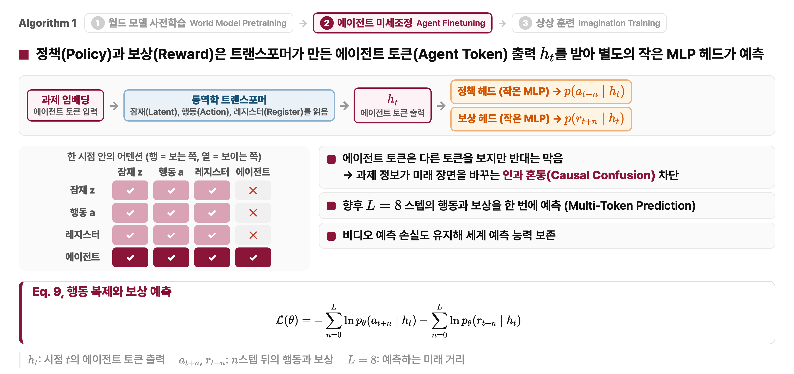

에이전트 토큰은 트랜스포머 안에서 잠재, 행동, 레지스터를 읽고, 그 출력 $h_t$를 별도의 작은 MLP인 정책 헤드와 보상 헤드가 받아 행동과 보상을 예측한다. 트랜스포머는 공유하고 마지막 출력부만 따로 붙인 구조다. 트랜스포머는 입력 토큰마다 출력을 하나씩 내므로, 같은 계산에서 잠재 자리의 출력은 다음 장면 $\hat z$가 되고 에이전트 자리의 출력은 $h_t$가 된다.

**어텐션은 한쪽으로만 열려 있다.** 에이전트 토큰은 다른 토큰을 모두 보지만, 다른 토큰은 에이전트 토큰을 볼 수 없다. 과제 정보가 미래 장면을 직접 바꾸는 인과 혼동(Causal Confusion)을 막기 위해서다. 잠재 토큰이 에이전트 토큰을 볼 수 있다면, 과제가 "다이아몬드 캐기"라는 이유만으로 월드 모델이 화면에 다이아몬드를 그려 버릴 수 있다. 미래는 과제 설명이 아니라 에이전트가 고른 행동을 통해서만 바뀌어야 한다.

$$
\mathcal{L}(\theta) = -\sum_{n=0}^{L} \ln p_\theta(a_{t+n} \mid h_t) - \sum_{n=0}^{L} \ln p_\theta(r_{t+n} \mid h_t), \qquad L = 8
$$

$h_t$ 하나로 앞으로 8스텝의 행동과 보상을 한 번에 예측하며, 이것을 Multi-Token Prediction이라고 부른다. 여기서 $L$은 예측하는 미래 거리로, 트랜스포머 층 수 $L$과는 다른 기호다. 이 단계에서도 비디오 예측 손실을 유지해, 정책과 보상을 새로 배우다가 사전학습한 세계 예측 능력을 잊지 않게 한다.

### 6-2. 상상 훈련: 롤아웃과 가치 학습

**3단계에서는 트랜스포머와 보상 헤드를 고정하고, 작은 MLP인 정책 헤드와 가치 헤드만 상상 롤아웃 위에서 학습한다.**

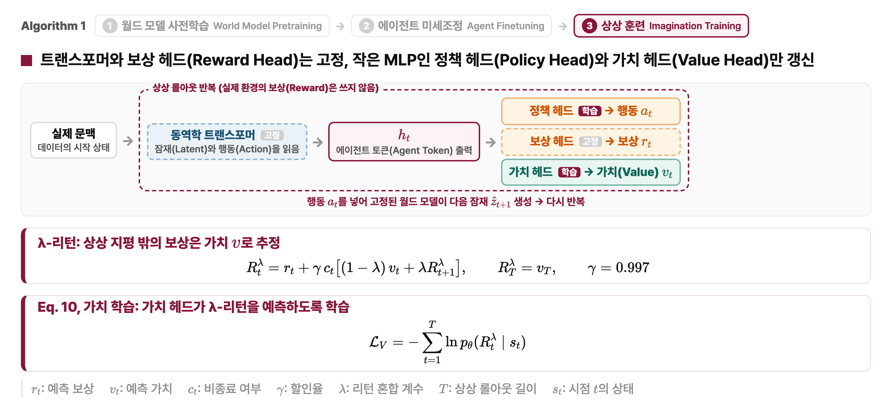

롤아웃(Rollout)은 모델을 한 스텝씩 연달아 실행해 미래의 궤적을 펼쳐 보는 것이다. 상상 롤아웃은 이것을 실제 게임이 아니라 월드 모델 안에서 한다. 출발점은 실제 문맥, 즉 녹화 데이터 속 실제 영상 구간이다. 그다음부터는 고정된 동역학 트랜스포머가 $h_t$를 만들고, 정책 헤드가 행동 $a_t$를, 고정된 보상 헤드가 보상 $r_t$를, 가치 헤드가 가치 $v_t$를 낸다. 정책이 고른 행동을 넣으면 월드 모델이 다음 잠재를 만들고, 이 과정을 반복한다. 이 과정에서 실제 환경의 보상은 하나도 쓰지 않는다.

!!! example "비유: 바둑에서 몇 수 앞까지 읽어 보기"
    "내가 여기 두면 상대가 저기 두고, 그다음엔…" 하고 몇 수 앞까지 머릿속으로 이어서 두어 보는 것이 롤아웃이다. 에이전트는 이렇게 만든 상상 궤적을 실제 경험 대신 써서 학습한다.

**가치는 "이 상태에서 출발하면 앞으로 보상을 모두 합쳐 얼마나 받을 것 같은가"에 대한 예측이다.** Minecraft의 보상은 드물게 오고, 상상 롤아웃은 유한한 $T$스텝까지만 만든다. 그래서 롤아웃이 끝난 뒤 받을 보상을 대신 추정해 줄 가치 헤드가 필요하다.

$$
R_t^\lambda = r_t + \gamma\,c_t\big[(1-\lambda)\,v_t + \lambda R_{t+1}^\lambda\big], \qquad R_T^\lambda = v_T, \qquad \gamma = 0.997
$$

$R_t^\lambda$는 롤아웃의 $t$번째 스텝에서 계산한 λ-리턴으로, 지금 받은 예측 보상에 미래 몫을 할인해 더한 값이다. 미래 몫은 가치 예측 $v_t$와 다음 스텝의 λ-리턴을 $\lambda$ 비율로 섞는다. 롤아웃 끝까지 예측 보상을 모두 더하는 방법과 지금 보상만 보고 나머지를 가치로 채우는 방법의 중간이다. 식에 다음 스텝 값이 들어 있으므로 뒤에서부터 계산하며, 마지막 스텝은 $R_T^\lambda = v_T$로 시작한다. $\gamma = 0.997$이면 대략 333스텝, 20 FPS 기준 약 17초 앞까지를 주로 본다. $c_t$는 에피소드가 끝나지 않았으면 1, 끝났으면 0이다.

$$
\mathcal{L}_V = -\sum_{t=1}^{T} \ln p_\theta(R_t^\lambda \mid s_t)
$$

가치 헤드는 이 λ-리턴을 맞히도록 학습한다. 가치 헤드가 숫자 하나가 아니라 값의 분포를 출력하기 때문에 음의 로그 우도 형태의 손실이 된다. λ-리턴 계산에 가치 예측이 쓰이고 가치는 다시 λ-리턴으로 배우는 구조는 2-2절의 부트스트랩과 같은 원리다. λ-리턴에는 롤아웃 안에서 예측된 보상이 섞여 있어 가치 예측 하나보다 조금 더 나은 목표가 되고, 그 목표를 따라가며 가치 헤드가 점점 정확해진다.

### 6-3. PMPO 목적함수와 행동 사전

**정책 헤드는 어드밴티지의 크기 대신 부호만 쓰는 PMPO로 학습하고, 행동 사전과의 KL로 데이터에서 크게 벗어나지 않게 붙잡는다.**

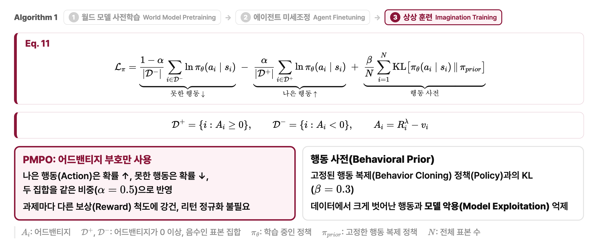

$$
\mathcal{L}_\pi = \frac{1-\alpha}{|\mathcal{D}^-|} \sum_{i \in \mathcal{D}^-} \ln \pi_\theta(a_i \mid s_i) - \frac{\alpha}{|\mathcal{D}^+|} \sum_{i \in \mathcal{D}^+} \ln \pi_\theta(a_i \mid s_i) + \frac{\beta}{N} \sum_{i=1}^{N} \mathrm{KL}\big[\pi_\theta(a_i \mid s_i)\,\|\,\pi_{\rm prior}\big]
$$

어드밴티지 $A_i = R_i^\lambda - v_i$는 실제로 해 본 행동이 평소 기대보다 얼마나 나았는지를 나타낸다. 어드밴티지가 0 이상인 표본은 $\mathcal{D}^+$, 음수인 표본은 $\mathcal{D}^-$에 넣는다. 첫 항은 기대보다 못한 행동의 확률을 내리고, 둘째 항은 기대보다 나은 행동의 확률을 올린다. 두 항이 각 집합의 크기로 나눈 평균이고 $\alpha = 0.5$로 같은 비중을 주므로, 좋은 사례가 적어도 나쁜 사례에 묻히지 않는다.

부호만 쓰는 이유는 20개 과제를 한 정책으로 함께 학습하기 때문이다. 과제마다 보상 크기가 달라서 크기를 그대로 쓰면 보상이 큰 과제가 학습을 독차지한다. 부호만 쓰면 보상 척도에 흔들리지 않고, 리턴 정규화 같은 추가 장치도 필요 없다.

!!! example "비유: O/X만 매기는 코치"
    점수를 매기는 코치 밑에서는 점수 단위가 큰 종목만 열심히 연습하게 된다. PMPO 코치는 "평소보다 나았다 O, 못했다 X"만 말하고, O 묶음과 X 묶음을 따로 복습시킨다. 행동 사전은 "기본 자세에서 너무 벗어나지는 마라"는 고삐다.

셋째 항의 행동 사전 $\pi_{\rm prior}$는 2단계에서 배운 행동 복제 정책을 고정한 복사본이고, KL 가중치는 $\beta = 0.3$이다. 이 고삐가 없으면 정책이 데이터에 없던 이상한 행동을 하거나, 월드 모델의 허점을 파고들어 상상 속에서만 점수를 올리는 모델 악용이 생길 수 있다.

!!! note "이전 Dreamer와 무엇이 같고 무엇이 다른가"
    월드 모델 안의 상상 롤아웃에서 actor와 critic을 학습하는 틀, λ-리턴으로 가치를 배우는 방식은 이전 Dreamer와 같다. 보상 헤드와 가치 헤드의 출력 방식은 원문이 밝히듯 Dreamer 3를 따른다. 원문이 "이전 세대 Dreamer와 달리"라고 밝힌 부분은 정책 학습이다. Dreamer 3는 리턴 정규화와 엔트로피 정규화를 썼고, Dreamer 4는 PMPO와 행동 사전 KL을 쓴다. 이전 Dreamer는 실제 환경과 계속 상호작용하며 모델의 허점이 교정됐지만, 오프라인인 Dreamer 4는 그런 교정이 없어서 행동 사전으로 붙잡는다. 또 문맥 하나당 롤아웃을 하나만 만들어 시작 상태의 다양성을 높이고 메모리를 아낀다.

---

## 7. 효율적 트랜스포머와 실시간 생성

**공간 어텐션과 시간 어텐션을 나누고 시간 어텐션을 4층마다 한 번만 넣어, 2B 모델을 H100 한 장에서 초당 21프레임으로 돌린다.**

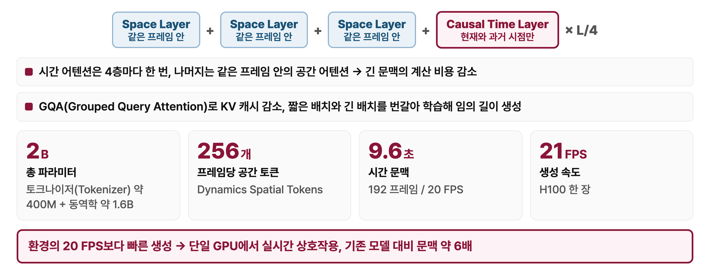

같은 프레임 안만 보는 공간 층 3개와 현재와 과거 시점을 보는 시간 층 1개를 한 묶음으로 $L/4$번 반복한다. 긴 문맥을 읽는 층이 전체의 4분의 1로 줄어 계산 비용이 줄어든다.

GQA(Grouped Query Attention)는 KV 캐시를 줄이는 방법이다. 한 프레임씩 생성할 때 과거 프레임 토큰의 키와 값은 바뀌지 않으므로 저장해 두는데, 이것이 KV 캐시다. 문맥이 192프레임이라 이 저장량과 매 스텝 읽어 오는 양이 속도를 좌우한다. 일반 멀티헤드 어텐션은 쿼리 헤드마다 키와 값 헤드를 따로 두지만, GQA는 쿼리 헤드 몇 개를 한 그룹으로 묶어 그룹마다 키와 값 헤드를 하나만 둔다. 원문 Table 2에서 GQA를 추가하면 FVD는 70에서 71로 거의 그대로이고 생성 속도는 18.9에서 23.2 FPS로 빨라진다. 학습할 때는 짧은 배치와 긴 배치를 번갈아 써서 학습을 빠르게 하고, 임의 지점에서 시작하는 긴 생성에도 일반화되게 했다.

!!! example "비유: 지난 컷을 가끔만 훑는 웹툰 작가"
    새 컷을 그릴 때마다 지난 200컷을 전부 펼쳐 보면 너무 느리다. 대부분의 시간은 지금 컷 안의 구도와 인물을 다듬고, 가끔씩만 지난 컷들을 훑어 연속성을 확인한다. 지난 컷의 메모는 요점만 압축해 둔다. 지금 컷 다듬기가 공간 층, 가끔 훑기가 4층마다 한 번 있는 시간 층, 요점 메모가 GQA로 줄인 KV 캐시다.

최종 모델은 토크나이저 약 400M과 동역학 모델 약 1.6B를 합친 2B 파라미터이고, 프레임당 공간 토큰 256개, 시간 문맥 192프레임(20 FPS 기준 9.6초)을 쓴다. 게임은 초당 20프레임으로 돌아가는데 모델은 21프레임을 생성하므로 GPU 한 장으로 사람이 실시간으로 조작할 수 있고, 문맥은 기존 Minecraft 월드 모델보다 약 6배 길다.

---

## 8. 실험

### 8-1. 오프라인 다이아몬드 챌린지

**실제 Minecraft에서 빈 인벤토리로 시작해 다이아몬드까지 가는 과제이고, 학습에는 녹화 데이터 2,541시간만 쓴다.**

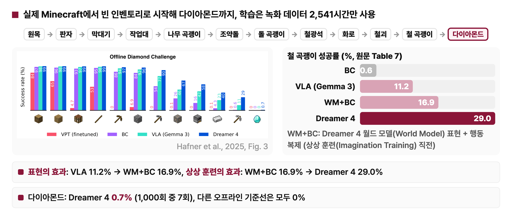

숙련된 사람도 평균 약 20분, 키보드와 마우스 행동으로 약 24,000번이 필요한 긴 과제다. 원목, 판자, 작업대, 나무 곡괭이, 조약돌, 돌 곡괭이, 철광석, 화로, 철괴, 철 곡괭이를 거쳐야 다이아몬드를 캘 수 있어 장기 계획이 필요하다. 무작위 월드, 60분 제한으로 1,000개 에피소드를 돌려 각 아이템을 얻은 비율을 잰다.

비교 대상은 모두 같은 오프라인 데이터만 쓴다. VPT finetuned는 VPT 연구에서 계약자 데이터로 웹 영상에 행동 라벨을 추정해 붙여 학습한 정책이고, BC는 계약자 데이터로 처음부터 학습한 행동 복제, VLA는 사전학습된 비전 언어 모델 Gemma 3를 행동 복제로 미세조정한 기준선이다. WM+BC는 Dreamer 4의 월드 모델 표현에 행동 복제만 한, 상상 훈련 직전 상태다.

**결과는 두 효과로 나눠 읽을 수 있다.** 같은 행동 복제인데 철 곡괭이 성공률이 VLA 11.2%에서 WM+BC 16.9%로 오른 것은 표현의 효과로, 영상 예측을 배우며 얻은 표현이 행동 결정에 더 유용했다는 뜻이다. 같은 월드 모델에서 WM+BC 16.9%가 Dreamer 4 29.0%로 오른 것은 상상 훈련의 효과다. 다이아몬드는 Dreamer 4만 0.7%를 기록했고 다른 오프라인 기준선은 모두 0%다. 다만 0.7%는 1,000번 중 7번이라, 처음 도달했다는 의미는 크지만 안정적으로 해결했다고 보기는 어렵다.

### 8-2. 사람의 직접 조작으로 본 월드 모델 정확도

**같은 시작 장면에서 사람이 월드 모델 안을 직접 조작해 16개 과제를 수행했고, Dreamer 4는 14개를 성공했다.**

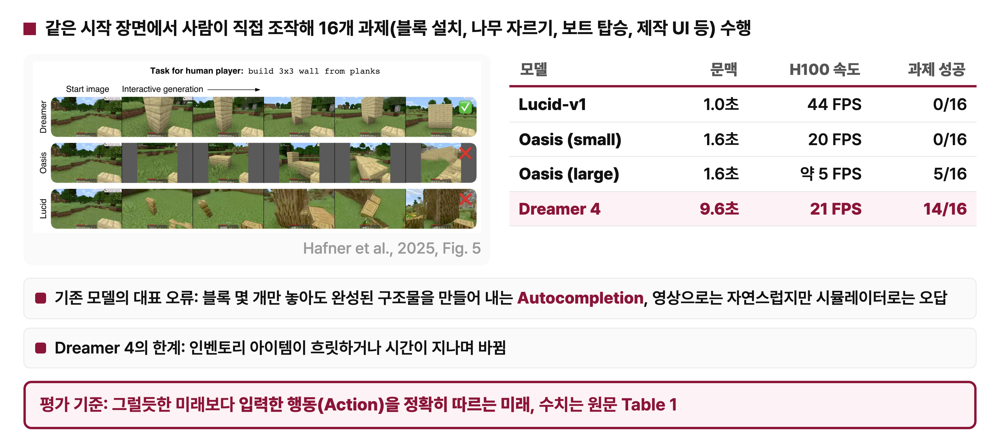

원문 Figure 5의 "판자로 3×3 벽 쌓기" 과제에서 Dreamer 4는 블록을 놓는 대로 벽이 쌓였다. Oasis는 블록을 몇 개 놓았을 뿐인데 플레이어가 짓지 않은 큰 구조물을 지어 냈고, Lucid는 장면이 무너지고 손에 든 아이템이 바뀌었다. 원문 Table 1에서 Lucid-v1은 44 FPS로 가장 빠르지만 문맥이 1초이고 과제를 하나도 성공하지 못했다. Oasis large는 약 5 FPS에 5/16, Dreamer 4는 문맥 9.6초, 21 FPS에 14/16이다.

기존 모델의 대표 오류인 Autocompletion은 영상 생성 관점에서는 자연스럽지만, 플레이어가 하지 않은 행동의 결과가 화면에 나타났으니 시뮬레이터로서는 오답이다. **월드 모델을 평가할 때 중요한 것은 그럴듯한 미래가 아니라 입력한 행동을 정확히 따르는 미래다.** Dreamer 4에도 인벤토리 아이템이 흐릿하게 그려지거나 시간이 지나며 바뀌는 한계가 있다.

### 8-3. 적은 행동 라벨로 배우는 행동 조건화

**영상 2,541시간 중 행동 라벨 100시간만 줘도 전체 라벨 모델 대비 PSNR 85%, SSIM 100%를 얻었다.**

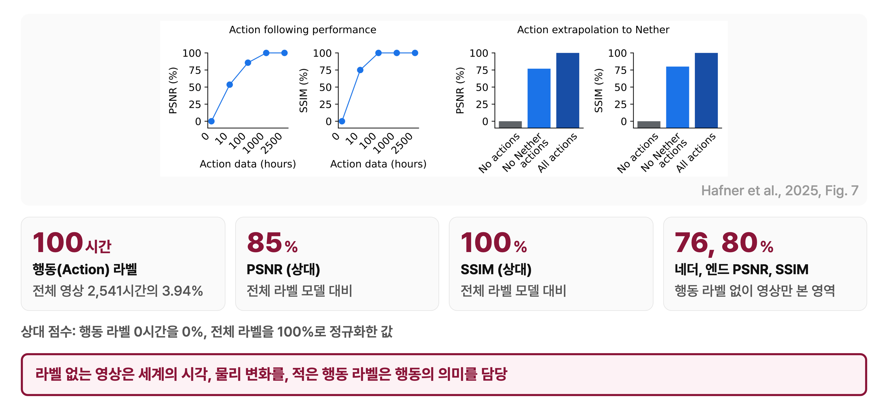

영상은 모두 학습에 쓰고 행동 라벨을 보여 주는 시간만 바꿨다. 행동 라벨이 0시간에서 10시간, 100시간으로 늘 때 행동을 따르는 정도가 빠르게 올라가고, 그 뒤로는 거의 평평하다. 퍼센트는 행동 라벨 0시간을 0%, 전체 라벨을 100%로 놓고 정규화한 상대 점수다.

더 까다로운 실험도 있다. Minecraft의 네더와 엔드는 오버월드와 질감, 블록, 지형이 전혀 다른 영역이다. 영상은 두 영역 모두 학습하지만 행동 라벨은 오버월드에만 줬는데도, 네더와 엔드에서 행동 조건부 예측이 PSNR 76%, SSIM 80%였다. 세상이 어떻게 보이고 변하는지는 라벨 없는 영상에서 배우고, 키를 눌렀을 때 무슨 일이 일어나는지는 적은 행동 라벨로 연결할 수 있다는 결과다.

!!! example "비유: 한 게임에서만 조이스틱 설명서를 읽은 사람"
    게임 영상을 수천 시간 본 사람이 그중 한 게임에서만 "이 버튼을 누르면 캐릭터가 이렇게 움직인다"를 배웠다고 하자. 버튼과 움직임의 관계는 배경이 달라도 같기 때문에, 처음 보는 맵에서도 버튼을 누르면 무슨 일이 생길지 대부분 맞힐 수 있다.

### 8-4. Ablation: 생성 품질과 속도의 기여

**단순한 Diffusion forcing 트랜스포머에서 출발해 개선을 하나씩 누적한 결과, 속도는 0.8에서 21.4 FPS로, FVD는 306에서 57로 함께 좋아졌다.**

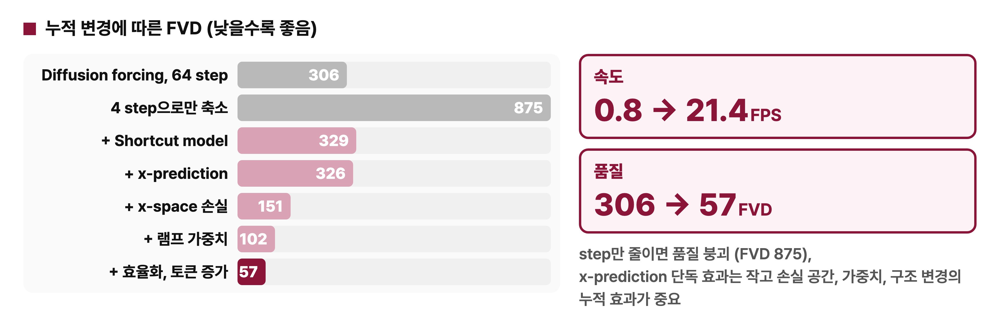

64스텝 Diffusion forcing의 FVD는 306이다. 속도를 위해 스텝만 4로 줄이면 875로 품질이 무너진다. Shortcut model을 더하면 329로 회복되고, x-예측은 326으로 효과가 작지만, x 공간 손실을 더하면 151, 램프 가중치를 더하면 102가 된다. 마지막으로 효율화와 공간 토큰 증가까지 마치면 57이다. 손실 공간, 가중치, 구조 변경이 함께 쌓였을 때 효과가 나며, 효율화로 남긴 속도 여유를 공간 토큰을 늘리는 데 다시 쓴 것이 최종 품질을 만들었다.

---

## 9. 결론과 한계

**Dreamer 4는 오프라인 월드 모델 안에서 정책을 개선해 실제 게임에서 다이아몬드를 얻었지만, 절대 성공률은 0.7%에 머문다.**

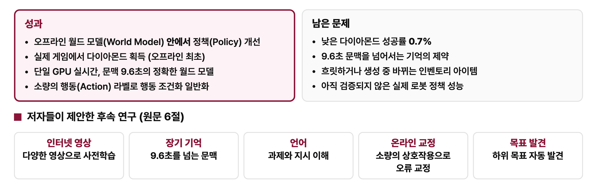

남은 문제는 분명하다. 다이아몬드 성공률이 낮고, 문맥이 9.6초라서 그보다 오래된 일은 기억하지 못한다. 인벤토리 아이템이 흐릿하거나 생성 중에 바뀌기도 하고, 로봇 데이터로 월드 모델을 학습해 보였지만 실제 로봇 정책의 성능은 아직 검증되지 않았다.

저자들이 6절에서 제안한 후속 방향은 다섯 가지다. 더 다양한 인터넷 영상으로 사전학습하기, 9.6초를 넘는 장기 기억, 과제와 지시를 이해하는 언어 능력, 소량의 온라인 상호작용으로 오류 교정하기, 긴 과제를 하위 목표로 쪼개는 목표 자동 발견이다.

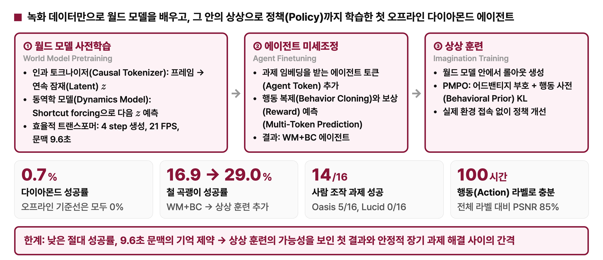

**Dreamer 4는 큰 월드 모델 안의 상상 훈련이 가능하다는 첫 결과를 보여 줬다.** 다만 상상 훈련의 가능성을 보인 첫 결과와 안정적인 장기 과제 해결 사이에는 아직 간격이 있다.

---

## 부록: 수식 전개

??? note "x-예측을 속도로 바꾸는 식의 유도"
    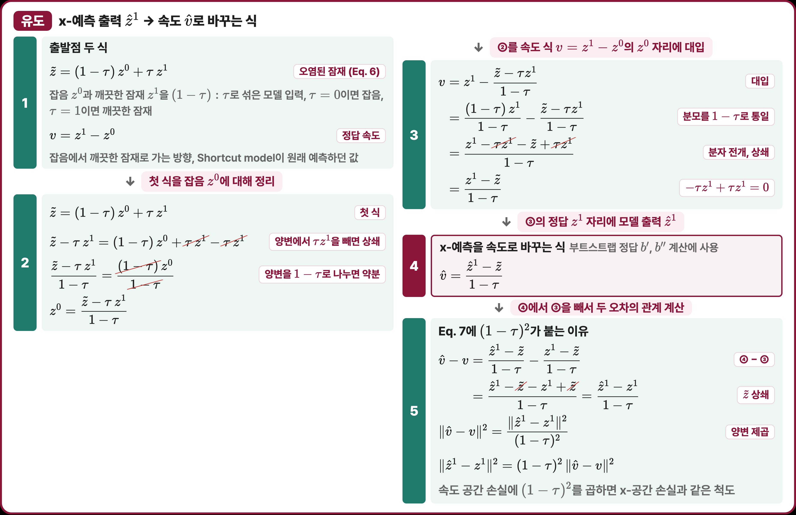

    출발점은 오염된 잠재 $\tilde z = (1-\tau)z^0 + \tau z^1$과 정답 속도 $v = z^1 - z^0$이다. 속도 식에는 모델이 모르는 잡음 $z^0$이 들어 있으므로, 첫 식을 $z^0$에 대해 정리하면 $z^0 = (\tilde z - \tau z^1)/(1-\tau)$다. 이것을 속도 식에 대입해 정리하면 $\tau z^1$ 항이 상쇄되어 다음 식이 남는다.

    $$
    v = \frac{z^1 - \tilde z}{1 - \tau}
    $$

    정답 $z^1$ 자리에 모델 출력 $\hat z^1$을 넣으면 예측 속도 $\hat v = (\hat z^1 - \tilde z)/(1-\tau)$가 된다. 두 식을 빼면 $\tilde z$가 상쇄되어 $\hat v - v = (\hat z^1 - z^1)/(1-\tau)$이고, 제곱하면 다음 관계가 나온다.

    $$
    \|\hat z^1 - z^1\|^2 = (1-\tau)^2\,\|\hat v - v\|^2
    $$

    즉 속도 공간 손실에 $(1-\tau)^2$를 곱해야 x 공간 손실과 같은 척도가 된다. Eq. 7의 큰 스텝 크기 항에 $(1-\tau)^2$가 붙는 이유다.

??? note "Shortcut model 부트스트랩에서 Eq. 7로"
    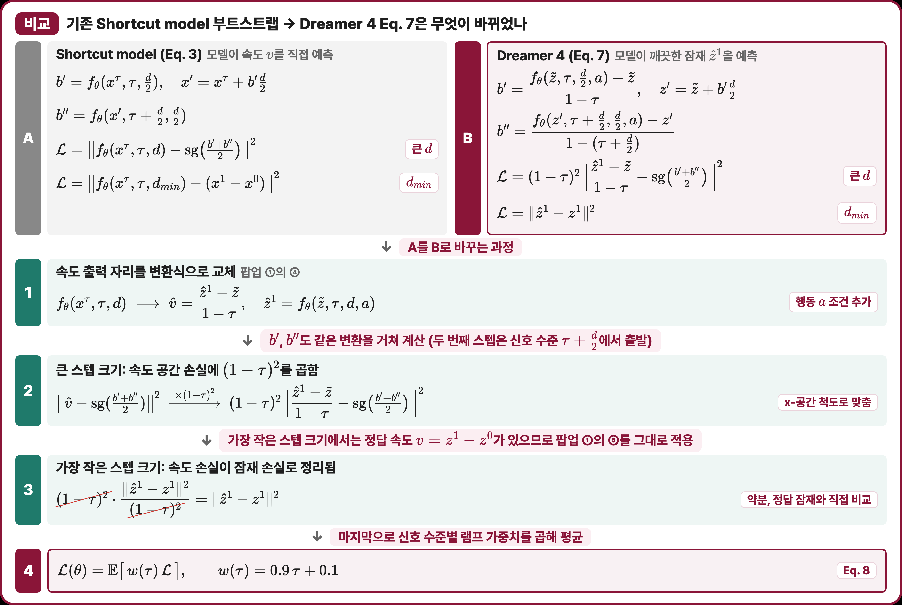

    기존 Shortcut model(Eq. 3)은 모델이 속도를 직접 예측하므로 $b'$, $b''$이 모델 출력 그대로다. Dreamer 4(Eq. 7)는 모델이 깨끗한 잠재를 예측하므로 다음 과정을 거친다.

    1. 속도를 출력하던 자리를 앞의 변환식 $\hat v = (\hat z^1 - \tilde z)/(1-\tau)$로 교체하고, 행동 $a$를 조건으로 추가한다. $b'$, $b''$도 같은 변환을 거치며, 두 번째 스텝은 신호 수준 $\tau + d/2$에서 출발한다.
    2. 큰 스텝 크기에서는 속도 공간 손실에 $(1-\tau)^2$를 곱해 x 공간 척도로 맞춘다.
    3. 가장 작은 스텝 크기에서는 정답 속도가 있으므로, $(1-\tau)^2$가 약분되어 손실이 $\|\hat z^1 - z^1\|^2$로 정리된다.
    4. 마지막으로 신호 수준별 램프 가중치 $w(\tau) = 0.9\tau + 0.1$을 곱해 평균한다.
