<!-- 청중도 각자 이 페이지를 열어 두고 따라온다. 절 순서 = 발표 순서 = 스크립트 순서, 발표 약 50분 + 토론.
     각 절 머리의 "발표:" 주석은 리허설용 큐이며 사이트에는 보이지 않는다. 시간은 스크립트를 분당 약 320음절로 읽는 기준이다.
     "대표 모델" 상자 12개는 모두 발표에서 설명하므로 기본으로 펼쳐 둔다. ①에서 상자를 읽는 순서를 한 번 소개하고, 이후에는 구조·학습·추론 그림으로 넘어갈 때만 그림을 짚는다.
     위치는 새 절이나 새 그림으로 넘어갈 때만 말하고, 그 안에서는 앞 내용의 한계가 다음 내용으로 이어지는 흐름으로 말한다.
     그림은 해당 설명 바로 옆에 둔다(Figure 3(a)~(c)는 3-1~3-3, 4(a)·(b)는 3-4·3-5, 5(a)·(b)는 4-1·4-2). -->

# World Model for Robot Learning: A Comprehensive Survey

!!! info "Information"
    - **Title:** World Model for Robot Learning: A Comprehensive Survey
    - **Authors:** Bohan Hou, Gen Li, Jindou Jia, Tuo An, Xinying Guo, … Yilun Du, Jianfei Yang (NTU MARS Lab, UC Berkeley, Stanford, Oxford, ETH, Harvard 등 18명)
    - **Venue:** arXiv 2026 (2605.00080, 2026-04-30)
    - **Paper:** [arXiv](https://arxiv.org/abs/2605.00080)
    - **Project:** [Project Page](https://ntumars.github.io/wm-robot-survey/)
    - **Code:** [Awesome-World-Model-for-Robotics-Policy](https://github.com/NTUMARS/Awesome-World-Model-for-Robotics-Policy)
    - **Presenter:** [송용휘](https://github.com/thddydgnl)
    - **Last updated:** 2026-10-28

<!-- 발표: 0:00 시작, 2분. 굵은 첫 문장, 다루는 것, 세 관점, 페이지 흐름 순서로 짧게 말한다. -->

## 0. Summary

**이 서베이는 로봇이 움직이기 전에 그 결과를 미리 내다보게 하는 모델, 즉 월드 모델을 로봇 학습에 어떻게 쓰는지 정리한다.** NTU MARS Lab이 UC Berkeley, Stanford, Harvard 등과 함께 2023년부터 2026년 3월까지 나온 로봇 월드 모델 연구 100여 편을 모았다.

**무엇을 다루나**

지금의 로봇 정책은 카메라 영상과 지시를 보고 바로 다음 행동을 낸다. "컵을 이렇게 밀면 테이블 끝에서 떨어질까"처럼 행동의 결과를 먼저 떠올려 보는 과정이 없다. 월드 모델은 지금 장면과 앞으로 할 행동을 받아, 그 행동을 했을 때 장면이 어떻게 바뀔지 예측하는 모델이다. 이 서베이는 월드 모델이 로봇 정책을 만들고, 학습시키고, 평가하는 과정에 어떻게 들어가는지를 다룬다.

**왜 이런 정리가 필요한가**

최근 3년 사이 비디오 생성 모델이 크게 발전하면서 로봇 월드 모델 연구가 빠르게 늘었다. 그런데 같은 "월드 모델"이라는 이름 아래 서로 다른 쓰임이 섞여 있다. 어떤 연구는 월드 모델을 정책 안에 넣고, 어떤 연구는 정책을 연습시키는 가상 환경으로 쓰고, 어떤 연구는 로봇 영상을 더 잘 만드는 데 집중한다. 서베이는 이 연구들을 같은 기준으로 비교할 수 있도록 세 가지 관점으로 나누어 정리한다.

**무엇을 비교하고 분석하나**

- **정책 안에서 쓰는 경우 (3절):** 미래를 예측하는 부분과 행동을 만드는 부분을 얼마나 하나로 묶었는지에 따라 다섯 갈래로 나눈다. 미래 영상을 끝까지 그린 뒤 행동을 읽는 방식부터, 영상을 전혀 그리지 않고 잠재 표현만 예측하는 방식까지 이어진다.
- **정책 바깥에서 쓰는 경우 (4절):** 월드 모델을 정책이 시행착오를 겪는 가상 환경으로 쓰는지, 정책의 행동을 미리 채점하는 평가기로 쓰는지로 나눈다.
- **비디오 월드 모델 자체 (5절):** 그럴듯한 영상을 만드는 단계에서 출발해, 명령한 행동을 정확히 따르는 영상, 접촉과 기하 구조를 지키는 영상, 여러 용도에 재사용하는 기반 모델로 어떻게 발전했는지 본다.

**이 페이지의 흐름**

1. **1절 배경:** 로봇 정책이 어떻게 행동을 내는지, 거기에 무엇이 빠져 있는지, 월드 모델이 무엇인지 정리한다.
2. **2절 지도:** 서베이 전체를 한 장의 지도로 보고, 뒤에서 반복해서 나올 개념을 미리 익힌다.
3. **3~5절 세 관점:** 갈래마다 원리를 먼저 설명하고, **대표 모델** 12개를 상자 하나씩에서 아키텍처, 학습, 추론 그림으로 살펴본다.
4. **6절 정리:** 세 관점을 표 한 장으로 묶고, 세 관점에 공통인 조건과 아직 열린 질문을 정리한다.

**읽고 나면 알 수 있는 것**

- 월드 모델이 로봇 정책을 돕는 세 가지 방식과, 각 방식이 무엇을 얻고 무엇을 치르는지
- 대표 모델 12개가 월드 모델을 어디에 두고, 어떻게 학습하고, 추론 때 어떻게 쓰는지
- 그럴듯한 영상을 만드는 모델과 로봇에게 쓸모 있는 월드 모델의 차이

---

<!-- 발표: 2:00 시작, 4분. 화면: VLA 그림(1-1, 1-2), 수식 3개(1-3). 처음 나오는 말: 행동 청크, 모방 학습, 디퓨전, VLM, backbone, flow matching, embodiment, credit assignment, 모델 예측 제어, 강화학습. -->

## 1. 배경: 로봇 정책과 월드 모델

### 1-1. 로봇 정책 두 갈래: visuomotor 정책과 VLA

**로봇 정책은 관측과 지시에서 행동 청크를 예측하는 모델이고, 과제 특화의 visuomotor 정책과 범용 VLA 모델로 갈라진다.** 월드 모델이 끼어드는 자리를 알려면 먼저 이 두 정책이 어떻게 작동하는지 알아야 한다.

#### Visuomotor 정책: 카메라 관측에서 행동으로 바로 간다

- **작동 원리:** 카메라 이미지(와 관절 상태)를 인코더로 읽고 곧바로 행동을 낸다. 과제마다 수십에서 수백 개의 사람 시연으로 모방 학습한다.
- **행동 출력의 발전:** 처음에는 행동을 회귀로 직접 예측했다. 그런데 같은 상황에서 사람은 여러 방식으로 움직이므로(다봉 분포) 평균 행동이 어색해진다. Diffusion Policy처럼 행동을 생성 모델(diffusion, flow matching)로 샘플링하면 다봉 분포를 그대로 담을 수 있어 요즘은 생성형이 주류다.
- **장단점:** 가볍고 정밀하며 지연이 짧다. 대신 본 적 없는 물체, 지시, 환경으로의 일반화가 좁다.

#### VLA(Vision-Language-Action): 웹 지식을 물려받은 범용 정책

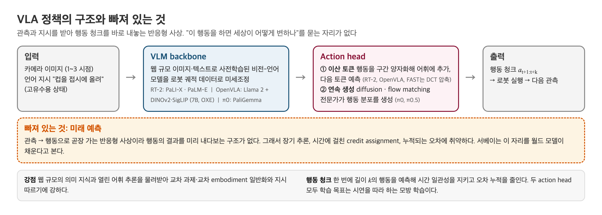{ width="820" }

- **작동 원리:** 웹 규모 이미지·텍스트로 사전학습된 비전-언어 모델(VLM)에 action head를 붙이고, Open X-Embodiment 같은 대규모 로봇 궤적 데이터로 함께 미세조정한다. 웹에서 배운 의미 지식과 열린 어휘 추론을 그대로 물려받는 것이 핵심이다.
- **행동 출력 두 방식:**
    - *이산 action 토큰:* 연속 행동을 구간 양자화해 언어 모델의 어휘에 추가하고 다음 토큰 예측으로 행동을 뽑는다. RT-2와 OpenVLA가 이 방식이며, 구간 양자화가 고주파 제어에 약한 문제를 FAST는 DCT(신호를 주파수 성분으로 바꾸는 변환)로 행동 청크를 압축한 토큰으로 푼다.
    - *연속 생성:* action head를 diffusion이나 flow matching 생성기로 두어 양자화 오차 없이 다봉 분포를 담는다. π 계열이 대표다.
- **행동 청크:** 어느 방식이든 한 번에 길이 $k$의 행동 청크를 예측한다. 시간 일관성을 지키고 오차 누적을 줄이는 지배적 전략이다. 학습 목표는 시연을 따라 하는 모방 학습이다.
- **대표 모델:** RT-2(2023)는 VLM을 웹 데이터와 로봇 데이터로 함께 미세조정하고 행동을 텍스트 토큰처럼 출력해 웹 지식이 제어로 전이됨을 보였다. OpenVLA(2024)는 7B 오픈소스 VLA로 이후 연구의 베이스라인이 되었다. π0(2024)는 flow matching action expert로 연속 행동을 고주파로 생성하고, π0.5로 열린 세계 일반화를 넓혔다.
- **Visuomotor 정책과의 차이:** VLA는 의미 지식 덕분에 교차 과제·교차 embodiment(로봇 몸체의 종류) 일반화에 강하지만 모델이 크고 느리다. Visuomotor 정책은 반대다.

### 1-2. VLA에 빠져 있는 것

**VLA는 관측에서 행동으로 곧장 가는 반응형 사상이라, 행동의 결과를 미리 내다보는 구조가 없다.**

- "이 행동을 하면 세상이 어떻게 변하나"를 묻는 자리가 구조 안에 없다.
- 그래서 규모를 키워도 복잡한 물리 환경에서 장기 추론, 시간에 걸친 credit assignment(나중의 성공이나 실패가 앞의 어떤 행동 때문이었는지 가려내는 문제), 누적되는 오차에 취약하다.
- 서베이의 진단은 분명하다. 이 한계는 행동 예측 용량의 부족만이 아니라 **에이전트의 행동 아래에서 세상이 어떻게 변할지 내다보는 명시적 예측 구조의 부재**에서 온다. 행동하기 전에 미래 상태를 추론하게 해 주는 예측 표현, 즉 월드 모델이 다시 주목받는 이유다.

### 1-3. 월드 모델의 계보와 정의

**월드 모델이라는 말은 1943년 Craik까지 올라가고, 현대적 부활은 model-based RL과 대규모 비디오 생성이라는 두 동력이 만들었다.** 핵심 뜻은 "시스템이나 환경이 지금 상태에서 어떤 개입이나 행동 아래 어떻게 변하는가"이며, 가장 표준적인 형태는 현재 상태와 행동으로 다음 상태를 예측하는 상태 전이 모델이다.

#### 오래된 생각: 분야마다 같은 아이디어가 있었다

- **인지과학 (Craik 1943, Miller et al. 1960):** 머릿속 시뮬레이션과 계획을 위한 내부 모델.
- **제어 이론 (Conant & Ashby 1970, Richalet et al. 1978):** "좋은 조절기는 그 시스템의 모델이어야 한다"는 명제와 모델 예측 제어.
- **고전 로봇 계획 (Lozano-Perez 1983):** 실행 전에 기하, 제약, 행동 결과를 따지는 내부 모델.

#### 현대적 부활: 두 갈래가 합쳐졌다

- **Model-based 강화학습:** 학습한 동역학으로 계획하고 정책을 개선한다. 서베이가 현대적 출발점으로 인용하는 [World Models](world-models.md)(Ha & Schmidhuber, 2018)가 여기에 속하고, PlaNet과 Dreamer 계열이 이 줄기를 잇는다.
- **대규모 생성 모델, 특히 비디오 생성:** 대규모 시각·상호작용 데이터에서 풍부한 시공간 규칙을 배운다. Cosmos, Wan, CogVideoX 같은 비디오 backbone이 이 줄기다.
- **합류점:** 두 흐름이 만나면서 픽셀에서 바로 예측 표현을 배워 로봇의 결정에 다시 쓰는 일이 현실적인 선택지가 되었다.

#### 서베이의 정의: 월드 모델, 비디오 생성 모델, 로봇 정책

$$
\text{World model:}\quad p(x_{t+1:t+H} \mid x_t,\, a_{t:t+H-1},\, l)
$$

$$
\text{Video generation model:}\quad p(v_{t+1:t+H} \mid o_t,\, a_{t:t+H-1},\, l)
$$

$$
\text{Robot policy:}\quad p(a_{t+1:t+k} \mid o_t,\, l)
$$

- **월드 모델:** 상태 $x_t$는 시각 관측, 잠재 상태, 구조화된 물리 상태, 술어 같은 심볼 무엇이든 될 수 있다. 조건은 분명하다. 그럴듯한 미래 영상을 만든다고 월드 모델이 아니라, 로봇과 관련된 행동 아래에서 미래가 어떻게 달라지는지를 결정에 쓸 수 있는 형태로 담아야 한다. 그래서 가장 중요한 하위 부류는 **action-conditioned 월드 모델**이다.
- **비디오 생성 모델:** 같은 정의를 이미지·비디오 공간에 구현한 것이다. 미래가 눈에 보이는 증거로 남아 공간·시간·상호작용의 세부가 풍부하지만, 지각적 사실성에 더해 시간 일관성, 행동 일관성, 물리적 타당성, 장기 안정성을 함께 지켜야 한다. 서베이가 비디오 기반 월드 모델에 집중하는 이유는 픽셀 예측이 최적이어서가 아니라 최근 문헌에서 비중이 가장 크기 때문이라고 스스로 밝힌다.
- **로봇 정책:** 관측 $o_t$와 선택적인 지시 $l$에서 길이 $k$의 행동 청크를 예측한다. 1-1절의 두 갈래가 여기에 해당한다.

#### 실행 가능한 월드 모델의 세 능력

- **Foresight:** 실행 전에 미래 상태나 행동의 결과를 내다본다.
- **Imagination-driven planning:** 상상한 롤아웃으로 후보 행동을 비교해 고른다.
- **Data amplification:** 시연이나 상호작용 궤적을 합성해 학습 데이터를 늘린다.
- **행동의 넓은 의미:** 저수준 모터 명령은 에이전트가 어떻게 움직일지를, 언어 지시는 어떤 미래가 실현되어야 하는지를 정한다. 서베이는 둘 다 행동으로 다룬다.

---

<!-- 발표: 6:00 시작, 3분. 화면: Figure 2(2-1), Figure 1과 세 축 표(2-2), 개념 목록(2-3). 밀리면 2-3은 토큰과 디퓨전 두 개념만 말한다. -->

## 2. 세 축으로 읽기: 3~5절에 들어가기 전에

### 2-1. 두 가지 흐름

**지난 3년의 문헌은 예측과 행동 생성을 더 단단히 묶는 흐름과, 월드 모델을 시뮬레이터로 더 넓게 쓰는 흐름으로 갈라진다.**

<figure markdown="span">
  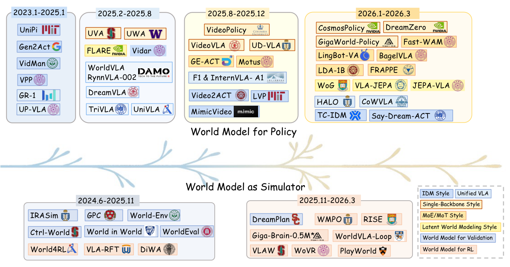{ width="820" }
  <figcaption>Figure 2. 2023.1~2026.3 타임라인. 위는 world model for policy, 아래는 world model as simulator (source: 원문 Figure 2)</figcaption>
</figure>

- **위쪽 가지, 정책:** 2023년의 UniPi처럼 비디오를 생성한 뒤 따로 행동을 복원하던 분리형 파이프라인에서 출발해, 단일 backbone, MoE/MoT, 통합 VLA, 잠재 공간 월드 모델링으로 예측과 행동 생성의 결합이 점점 깊어진다. 3절이 이 가지를 다룬다.
- **아래쪽 가지, 시뮬레이터:** 상상한 미래로 후보 행동을 검증하고 순위를 매기던 쓰임에서, 강화학습과 post-training(사전학습을 마친 정책을 목표 과제에 맞게 더 학습하는 단계)의 학습 환경이 되고, 나아가 정책과 함께 진화하는 쪽으로 넓어진다. 4절이 이 가지를 다룬다.
- **단서:** 서베이는 이것이 서로를 대체하는 단계가 아니라 지배적인 방향이라고 못 박는다. 두 흐름을 합치면 월드 모델이 더 이상 보조 예측기가 아니라 로봇 학습과 결정 루프의 중심으로 들어오고 있다는 뜻이다.

### 2-2. 세 축이 묻는 질문

**서베이는 같은 문헌을 구조, 응용, 능력이라는 세 기준으로 세 번 자른다. 한 논문이 여러 절에 동시에 나올 수 있다.**

<figure markdown="span">
  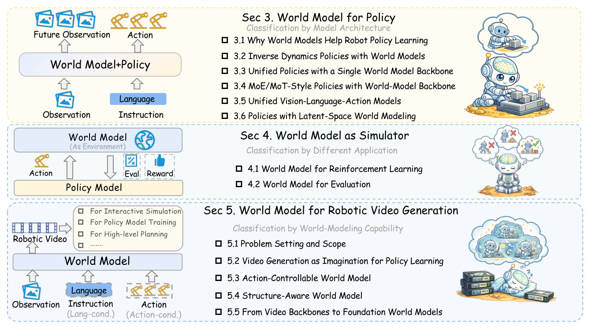{ width="700" }
  <figcaption>Figure 1. 서베이의 구성. 위에서부터 3절은 구조, 4절은 응용, 5절은 능력으로 분류한다. 그림 속 소절 번호는 원문 기준이다 (source: 원문 Figure 1)</figcaption>
</figure>

그림 속 소절 번호는 원문 번호다. 이 페이지는 원문 3.1을 3절의 '들어가며'로 줄였기 때문에 원문 3.2~3.6이 이 페이지의 3-1~3-5가 되고, 같은 이유로 원문 5.2~5.5가 5-1~5-4가 된다. 아래 표는 세 축을 한 줄씩 정리한 것이다.

| 절 | 분류 기준 | 묻는 질문 | 대표 |
| :-- | :-- | :-- | :-- |
| 3절 World Model for Policy | **구조:** 미래 예측과 행동 생성이 얼마나 단단히 묶였나 | 예측을 정책의 어디에 넣고, 추론 때 미래를 얼마나 그리나 | UniPi, Cosmos Policy, VLA-JEPA |
| 4절 World Model as Simulator | **응용:** 월드 모델을 무엇으로 쓰나 | 정책을 학습시키는 환경인가, 정책을 판단하는 평가기인가 | WMPO, WoVR, WorldEval |
| 5절 Robotic Video World Model | **능력:** 비디오 월드 모델이 무엇까지 하나 | 미래를 그리는 데서 출발해 행동 제어, 구조 보존, 기반 모델까지 | DreamGen, IRASim, DreamDojo |

### 2-3. 미리 알아 둘 개념 여섯 개

- **토큰과 backbone:** 모델은 이미지, 글, 행동을 작은 조각으로 잘라 벡터로 바꾼 토큰으로 다룬다. 이 토큰을 받아 처리하는 본체 신경망이 backbone이고, 그 위에서 행동이나 영상 같은 특정 출력을 만드는 작은 모듈이 head다. attention은 토큰들이 서로의 정보를 참조하게 하는 연산이다. 3절의 다섯 갈래는 미래 예측과 행동 생성이 backbone을 얼마나 함께 쓰는지로 나뉜다.
- **디퓨전과 디노이징:** 디퓨전 모델은 순수한 노이즈에서 시작해 노이즈를 조금씩 걷어 내며(디노이징) 영상이나 행동을 만든다. flow matching은 노이즈에서 정답으로 가는 경로를 직접 배워 더 적은 단계로 같은 일을 한다. 이 페이지의 비디오 월드 모델과 행동 생성기는 대부분 이 방식으로 출력을 만든다.
- **행동 조건부 예측 (action-conditioned):** 같은 장면이라도 행동이 다르면 다른 미래가 나와야 한다. 행동을 무시하고 "세상이 어떻게 흘러갈까"만 답하는 보통의 비디오 생성과의 차이이며, 3절의 결합, 4-2절의 평가기, 5-2절의 제어 가능성에서 반복해서 나온다.
- **역동역학 모델 (inverse dynamics model, IDM):** 두 장면 사이에 어떤 행동이 있었는지를 복원하는 모델이다. 영상에서 행동으로 가는 다리 역할을 하며, 3-1절의 분리형 정책과 5-1절의 합성 데이터 생성에 쓰인다.
- **롤아웃과 상상 속 강화학습:** 월드 모델을 한 스텝씩 연달아 돌려 미래 궤적을 펼치는 것이 롤아웃이고, 실제 환경 대신 그 롤아웃 위에서 정책을 학습하는 것이 상상 속 강화학습이다. 스터디에서 본 [Dreamer](dreamer.md) 계열의 핵심이고 4절에서 VLA로 확장된다.
- **잠재 공간 예측:** 픽셀 대신 표현 공간에서 미래를 예측한다. 그리지 않아도 되는 세부는 버리고 제어에 관련된 변화만 담을 수 있다. [V-JEPA](v-jepa.md) 계열의 생각이며 3-5절과 4-2절에 등장한다.

---

<!-- 발표: 9:00 시작, 19분 30초. 대표 모델 ①~⑦. 화면: 다섯 갈래 표, Figure 3(a)~(c)와 4(a)·(b)는 각 소절 첫머리, 3-6 노트. 밀리면 다섯 갈래 표는 보여 주기만 한다. ①에서 상자를 읽는 순서와 그림 색 범례를 한 번 설명한다. -->

## 3. World Model for Policy: 예측과 행동 생성의 결합 강도로 나눈 다섯 갈래

**들어가며.** 정책에 예측 구조를 넣는 가장 단순한 방법은 월드 모델이 미래를 먼저 그리고 역동역학 모델이 그 미래에서 행동을 읽는 것이다. 여기서 출발해 미래 예측과 행동 생성이 점점 하나로 묶인다. **결합 강도**는 미래를 예측하는 부분과 행동을 만드는 부분이 얼마나 한 모델, 한 학습 과정 안에 들어와 있는지를 뜻한다. 3-1은 두 모델을 따로 학습하고, 3-2는 한 생성기가 둘을 함께 만들고, 3-3은 전문가 네트워크는 나누되 attention을 공유하며, 3-4는 정책 backbone 하나가 행동과 미래를 함께 예측하고, 3-5는 미래를 픽셀 없이 잠재 공간에서만 예측한다. 두 질문을 기억해 두면 읽기 쉽다. 예측이 정책 안에 얼마나 내재화되었는가, 그리고 추론할 때 미래를 얼마나 그리는가.

서베이는 이 순서가 비디오 사전학습 backbone이 VLM이나 잠재·심볼릭 대안보다 본질적으로 낫다는 뜻은 아니라고 미리 선을 긋는다. 어떤 예측 기반이 제어에 가장 효과적인지는 아직 열린 경험적 질문이다.

| 패러다임 | 대표 | 추론 시 미래 생성 | Backbone | 결합 방식 |
| :-- | :-- | :-- | :--: | :-- |
| IDM-style | UniPi, VPP, MimicVideo | 명시적 비디오 롤아웃 → 점차 압축된 예측 표현 | VGM | 분리(decoupled) |
| Single-backbone | UVA, Cosmos Policy, DreamZero | 비디오와 행동을 한 생성 과정에서 함께 (일부는 시각 분기 생략 가능) | VGM | 공유 backbone |
| MoE / MoT | Motus, LingBot-VA, Fast-WAM | 비디오 전문가의 은닉 상태가 행동 전문가를 안내 | VGM | expert / MoT fusion |
| Unified VLA | GR-1, WorldVLA, DreamVLA | 미래 이미지·잠재 foresight (주로 학습 신호) | UMM | joint co-training |
| Latent-space WM | FLARE, VLA-JEPA, JEPA-VLA | 잠재 목표만 예측, 픽셀 생성 없음 | MLLM | latent internalization |

원문 Table 1을 줄인 표다. VGM은 video generation model, UMM은 unified multimodal model, MLLM은 multimodal LLM이다. 전체 목록은 부록에 있다.

### 3-1. IDM-style: 먼저 예측하고, 그다음 행동한다

**월드 모델이 미래를 만들고 별도의 역동역학 정책이 그 미래에서 행동을 읽어 내는 분리형 파이프라인이다.** 월드 모델 $W$가 지시 조건부로 미래 관측 $\hat o_{t+1:t+H} = W(o_t, l)$이나 그 잠재 표현을 먼저 만들고, 정책은 현재 관측과 생성된 미래를 함께 받아 행동 청크를 낸다. 월드 모델은 "다음에 무엇이 일어나야 하는가"라는 가설을 주고, 정책은 그 가설을 저수준 행동으로 번역한다.

<figure markdown="span">
  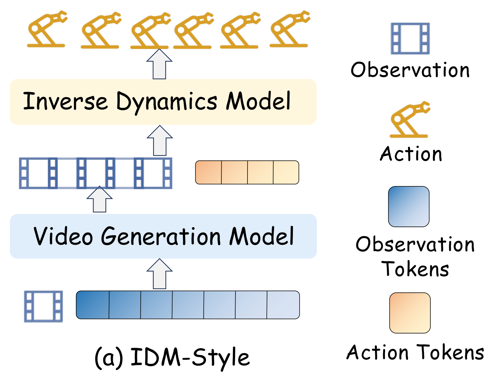{ width="580" }
  <figcaption>Figure 3(a). IDM-style. 아래의 비디오 생성 모델이 미래 영상을 만들고, 그 위의 역동역학 모델이 영상에서 행동을 읽는다 (source: 원문 Figure 3)</figcaption>
</figure>

#### 발전 방향: 정책에 전달하는 미래 표현

서베이는 이 갈래의 발전을 "정책에게 미래를 어떤 형태로 넘기느냐"의 변화로 정리한다.

- **명시적 픽셀 롤아웃 (Explicit Pixel Rollout):** 과제 조건부로 미래 영상을 만들고, 별도의 역동역학 모델이 인접 프레임을 비교해 행동을 복원한다. 이 두 단계를 지키면서 역동역학 모델에 masked inverse dynamics(이미지에서 행동과 무관한 부분을 가려, 팔과 물체처럼 행동과 관련된 영역의 시각 정보에 집중하게 하는 방식)를 넣거나, 로봇 대신 사람이 과제를 하는 영상을 생성해 실행의 조건으로 쓰는 변형이 나왔다. 예: UniPi(대표 모델 ①), VidMan, Vidar, Gen2Act.
- **잠재 예측 표현 (Latent Predictive Features):** 프레임을 끝까지 그리지 않고, 사전학습 비디오 디퓨전 모델의 잠재에서 제어에 필요한 특징만 꺼내 별도 행동 헤드에 준다. 접점이 픽셀에서 특징으로 바뀌어 더 작고 안정적이다. 예: VPP(대표 모델 ②), Video2Act.
- **실행 지향 중간 표현 (Execution-oriented Intermediates):** 부분적으로만 디노이징한 잠재 시각 계획, 도구 중심 궤적, 3D 대응점, 물체 flow처럼 행동 복원이 더 직접적인 형태로 미래를 넘기거나, 생성 영상을 정책의 in-context 프롬프트로 쓴다. 예: MimicVideo, TC-IDM, LVP, AVDC, VidBot, NovaFlow, Say-Dream-ACT.

#### 장점과 한계

- 분리의 이점은 모듈성, 비디오 prior의 재사용, 눈으로 확인할 수 있는 미래 예측이다.
- 대가는 성능이 생성된 미래의 충실도와 제어 가능성에 묶인다는 것이다. 시각적으로 그럴듯하지만 행동과 맞지 않는 예측이 오차를 쌓는다. 그래서 3-2부터의 갈래는 미래 예측과 행동 생성을 한 모델 안에서 함께 학습해, 예측한 미래와 실제로 낼 행동이 서로 맞춰지게 한다.

???+ note "대표 모델 ① UniPi (Du et al., 2023): 비디오를 계획으로, 역동역학으로 행동으로"
    **1. 문제와 핵심 아이디어**

    - **문제:** 언어 지시를 바로 행동으로 바꾸는 정책은 "언어 → 행동" 데이터가 적어 일반화가 좁다. 반면 "언어 → 영상" 데이터는 인터넷에 많다.
    - **핵심 아이디어:** 의사결정을 영상 생성 문제로 바꾼다. 먼저 과제를 수행하는 미래 영상을 생성하고, 그 영상에서 행동을 읽어 낸다. 월드 모델(비디오 디퓨전)과 정책(역동역학 모델)이 완전히 분리된 IDM-style의 원형이다.

    **2. 전체 아키텍처**

    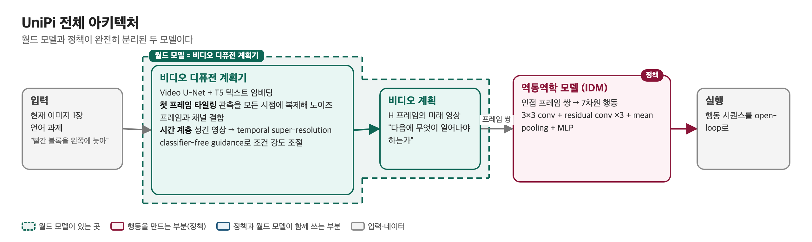{ width="820" }

    - **비디오 디퓨전 계획기:** Video U-Net에 T5 텍스트 임베딩을 조건으로 넣는다. 관측 이미지를 모든 시점에 복제해 노이즈 프레임과 채널 방향으로 결합하는 첫 프레임 타일링으로 조건화한다. 샘플링 때만 첫 프레임을 고정하는 방식은 잘 되지 않아 학습 때부터 명시적으로 조건화했다.
    - **시간 계층:** 성긴 비디오를 먼저 만들고 temporal super-resolution으로 사이를 보간한다. classifier-free guidance로 텍스트와 첫 프레임의 조건 강도를 조절한다.
    - **역동역학 모델(IDM):** 인접 프레임 쌍을 받아 7차원 행동을 예측하는 작은 CNN이다. 3×3 conv 한 층, residual 3×3 conv 세 층, mean pooling, MLP 출력으로 이루어진다.

    **3. 학습 과정**

    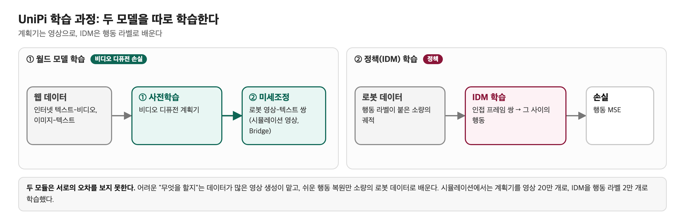{ width="820" }

    - 두 모듈을 따로 학습한다. 계획기는 비디오 디퓨전 손실로, IDM은 행동 MSE로 배우며 서로의 오차를 보지 못한다.
    - 시뮬레이션 과제는 스크립트 에이전트가 만든 영상으로 학습한다. 조합 과제에서는 비디오 20만 개로 계획기를, 행동 라벨이 붙은 2만 개로 IDM을 학습했다.
    - 실제 세계는 인터넷 규모의 텍스트-비디오·이미지-텍스트 데이터로 계획기를 사전학습한 뒤 Bridge 로봇 데이터(비디오-텍스트 쌍 7.2k)로 미세조정한다.

    **4. 추론 과정**

    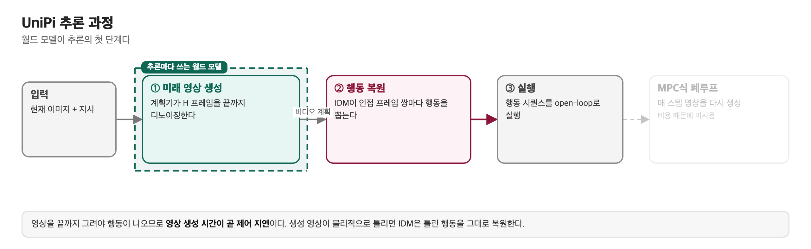{ width="820" }

    - 현재 이미지와 지시로 계획기가 H 프레임의 미래 영상을 끝까지 생성한다.
    - IDM이 인접 프레임 쌍마다 행동을 복원하고, 행동 시퀀스를 open-loop로 실행한다.
    - MPC식 폐루프(매 스텝 영상을 다시 생성)도 가능하지만 영상 생성 비용 때문에 쓰지 않았다.

    **5. 월드 모델의 역할**

    | 위치 | 예측 대상 | 학습에서 하는 일 | 추론에서 하는 일 |
    | :-- | :-- | :-- | :-- |
    | 정책 앞단의 별도 모듈 (비디오 디퓨전 계획기) | 과제를 수행하는 미래 영상, 즉 시각적 계획 | 인터넷 영상으로 사전학습하고 로봇 영상으로 미세조정한다. IDM과는 따로 학습한다 | 매 과제마다 영상을 끝까지 생성한다. 이 영상이 곧 계획이고, IDM은 그것을 행동으로 번역만 한다 |

    - 월드 모델이 의사결정의 대부분을 맡는다. 정책(IDM)은 "두 장면 사이에 어떤 행동이 있었나"만 푸는 쉬운 문제로 줄어든다.

    **6. 핵심 기술과 독창성**

    - **의사결정의 영상 생성화:** 언어를 "실현해야 할 미래 영상"으로 번역해 계획으로 쓴다. → 본 적 없는 언어 조합과 held-out 과제에서 언어를 행동에 직접 사상하는 베이스라인들을 크게 앞섰다. 서베이는 5절에서 이를 상상 엔진의 시초로도 다시 인용한다.
    - **첫 프레임 타일링과 시간 계층:** 학습 때부터 관측을 모든 시점에 깔아 장면이 바뀌지 않게 하고, 성긴 영상을 보간해 긴 영상을 만든다. → IDM이 읽을 수 있는 일관된 계획이 나온다.
    - **인터넷 영상 사전학습:** 로봇 밖의 영상으로 계획기를 미리 학습한다. → 생성 품질과 과제 성공률이 함께 올라, 로봇 밖의 데이터가 로봇 정책에 도움이 된다는 초기 증거가 되었다.
    - **한계:** 영상을 다 그려야 행동이 나오므로 폐루프 제어가 어렵고, 생성 영상이 물리적으로 틀리면 IDM이 틀린 행동을 그대로 복원한다. 다음 대표 모델인 VPP는 영상을 끝까지 그리지 않고 비디오 모델의 내부 특징만 정책에 넘겨 이 생성 비용을 없앤다.

???+ note "대표 모델 ② VPP (Hu et al., 2025): 비디오 디퓨전 모델의 중간 특징이 곧 정책의 눈이다"
    **1. 문제와 핵심 아이디어**

    - **문제:** 비디오 월드 모델의 미래 예측을 정책에 쓰고 싶지만, UniPi처럼 영상을 끝까지 생성하면 느리고 제어에 필요 없는 세부 화질까지 맞춰야 한다.
    - **핵심 아이디어:** 디노이징을 한 번만 돌리고, 그때 비디오 모델 안에 생기는 중간 특징을 "예측 시각 표현"으로 꺼내 행동 헤드에 준다. 분리형 구조는 유지하면서 예측과 제어의 접점을 픽셀에서 특징으로 바꿨다.

    **2. 전체 아키텍처**

    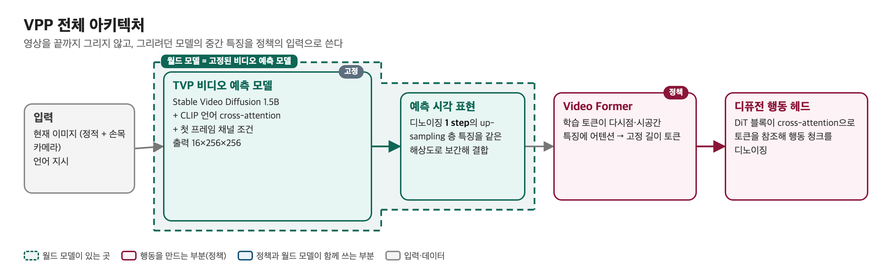{ width="820" }

    - **TVP(텍스트 조건 비디오 예측 모델):** Stable Video Diffusion 1.5B에 CLIP 언어 특징을 cross-attention으로 추가하고, 첫 프레임을 채널 조건으로 두며, 출력을 16×256×256으로 맞춘다. 미세조정한 뒤 고정한다.
    - **예측 시각 표현:** 현재 이미지와 노이즈 잠재를 넣어 TVP를 한 번만 앞으로 통과시키고, up-sampling 층들의 특징을 같은 해상도로 보간해 채널 방향으로 결합한다. 멀티스텝 디노이저가 아니라 인코더로 쓰는 셈이다.
    - **Video Former:** 학습 가능한 토큰이 정적·손목 카메라의 특징에 시공간 어텐션을 걸어 고정 길이 토큰으로 압축한다.
    - **디퓨전 행동 헤드:** diffusion transformer 블록이 Video Former 토큰에 cross-attention하면서 행동 청크를 디노이징한다.

    **3. 학습 과정**

    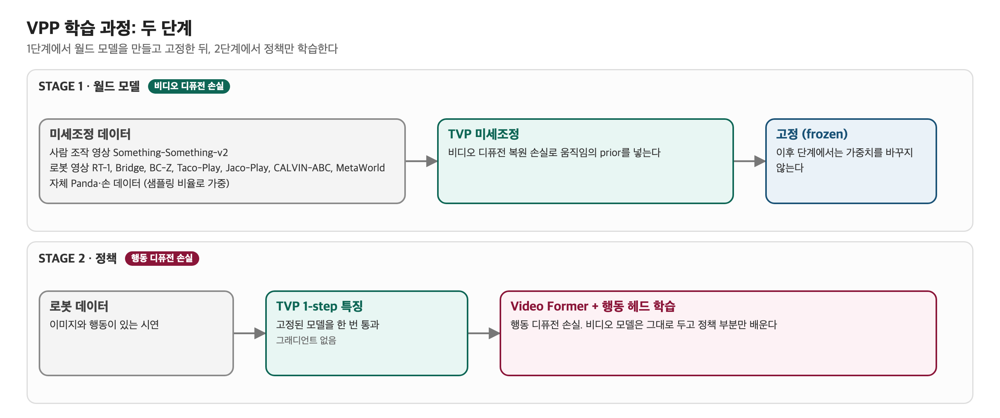{ width="820" }

    - **1단계, 월드 모델:** TVP를 사람 조작 영상(Something-Something-v2), 인터넷 로봇 데이터(RT-1, Bridge, BC-Z, Taco-Play, Jaco-Play, CALVIN-ABC, MetaWorld), 자체 Panda·손 데이터를 샘플링 비율로 가중해 비디오 디퓨전 복원 손실로 미세조정한다. 그다음 고정한다.
    - **2단계, 정책:** TVP는 고정한 채 Video Former와 행동 헤드만 로봇 데이터의 행동 디퓨전 손실로 학습한다.

    **4. 추론 과정**

    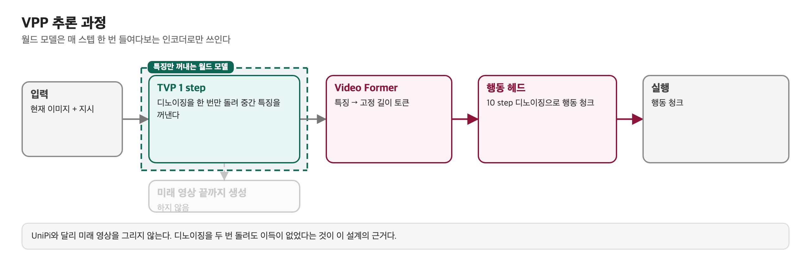{ width="820" }

    - 매 스텝 TVP를 한 번 통과시켜 특징을 얻고, Video Former와 행동 헤드가 10 step 디노이징으로 행동 청크를 낸다.
    - 미래 영상은 끝까지 생성하지 않는다. 디노이징을 두 번 돌려도 이득이 없었다는 것이 이 설계의 근거다.

    **5. 월드 모델의 역할**

    | 위치 | 예측 대상 | 학습에서 하는 일 | 추론에서 하는 일 |
    | :-- | :-- | :-- | :-- |
    | 정책 앞단의 고정된 비디오 예측 모델 (TVP) | 미래 영상. 단 픽셀이 아니라 그것을 그리려던 내부 특징으로 | 1단계에서 사람·로봇 영상으로 움직임의 prior를 익힌 뒤 고정된다 | 매 스텝 한 번 통과해 예측 특징만 넘긴다. 영상은 그리지 않는다 |

    - 월드 모델이 정책의 "눈" 역할을 한다. 정책은 현재 이미지 자체가 아니라 "앞으로 어떻게 움직일지"가 담긴 특징을 보고 행동한다.

    **6. 핵심 기술과 독창성**

    - **1-step 예측 표현:** 디노이징 한 번의 중간 특징을 정책 입력으로 쓴다. → 영상 생성 비용이 사라져 소비자용 GPU에서 실시간에 가까운 제어가 됐다.
    - **사람·로봇 영상으로 다진 예측기:** 비디오 모델을 미세조정한 뒤 고정해, 행동 학습이 영상 prior를 망가뜨리지 않게 한다. → 긴 과제를 연속으로 수행하는 CALVIN과 다과제 MetaWorld에서 기존 정책들을 앞섰고, 실제 손 조작에서 배운 적 없는 과제도 일부 수행했다.
    - **관점의 전환:** "비디오 모델의 가치는 렌더링된 프레임이 아니라 내부의 예측 표현에 있다"는 관점을 열었다. 3-3절의 Fast-WAM은 같은 질문을 더 밀어붙여, 이득의 대부분이 학습 때의 비디오 co-training에서 오고 추론 때의 명시적 상상에서 오는 것은 아닐 수 있다고 결론 낸다.
    - **한계:** 명시적 미래 영상이 없어 계획이나 검증에는 쓸 수 없고, 예측기가 고정되어 있어 로봇 데이터로 예측 표현을 더 다듬지 못한다.

### 3-2. Single-backbone: 한 생성기가 미래와 행동을 함께 만든다

**관측 토큰과 행동 토큰을 하나의 공유 backbone이 같은 디노이징 과정에서 처리한다.** 미래 시각 표현과 행동 표현을 이어 붙인 $x = [z_v; z_a]$를 잡음으로 오염시킨 뒤, 하나의 네트워크 $f_\theta$가 현재 관측과 지시를 조건으로 복원한다. "먼저 예측하고 그다음 행동한다"는 두 단계 분해를 하나의 멀티모달 생성 목적으로 바꾼 셈이다.

<figure markdown="span">
  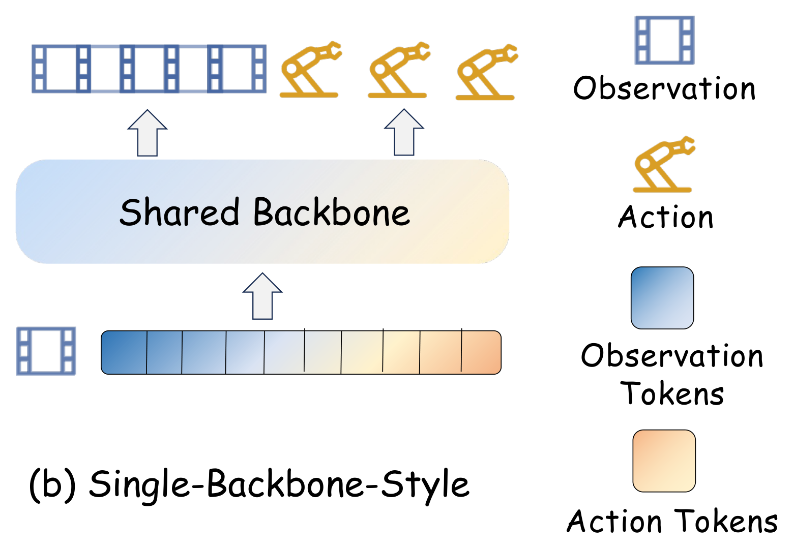{ width="580" }
  <figcaption>Figure 3(b). Single-backbone-style. 관측 토큰과 행동 토큰을 하나의 공유 backbone이 함께 처리해 미래 영상과 행동을 같이 낸다 (source: 원문 Figure 3)</figcaption>
</figure>

#### 왜 VLM 대신 비디오 backbone인가

- **VLM backbone이 잘하는 것과 못하는 것:** π0나 OpenVLA의 VLM backbone은 이미지-텍스트 정렬로 사전학습되어 "장면에 무엇이 있고 지시가 무엇을 가리키는가"(의미 대응)에 강하다. 하지만 정지 이미지와 문장의 대응만 배웠으므로, 물체가 어떻게 움직이고 부딪히는지 같은 시간에 따른 변화는 사전학습에서 직접 배우지 않는다.
- **비디오 backbone이 주는 것:** 비디오 생성 모델은 시간 순서가 있는 프레임을 예측하도록 학습되어, 움직임의 연속성, 시간 인과, 대략적인 물리 동역학에 대한 prior를 담고 있을 수 있다.
- **같은 생성 과정에 행동을 넣는 이유:** 행동 생성을 미래 영상을 만드는 디노이징 과정 안에 넣으면, 정책이 이미 시간 축으로 제약을 전파하도록 길들여진 backbone의 덕을 본다는 것이 이 갈래의 가설이다.
- **단서:** 서베이는 비디오 사전학습 backbone이 같은 규모의 VLM backbone보다 로봇 제어에서 일관되게 낫다는 증거는 아직 없으며, 현재 결과는 유망한 귀납 편향의 시사적 증거로 봐야 한다고 말한다. 실제로 부록의 LIBERO 결과에서도 VLM 기반 갈래(3-4, 3-5)가 비슷한 성능을 낸다.

#### 주요 설계 방향

- **분리 디코딩과 시각 분기 주변화 (Decoupled Decoding & Marginalization):** 영상과 행동을 같은 잠재에서 배우되 출력 헤드를 나누거나, 모달리티마다 다른 노이즈 단계(timestep)를 줘서 영상 쪽을 순수 노이즈로 둔 채 행동만 뽑는다. 학습 때는 영상 예측의 이득을 얻고 추론 때는 영상 생성 비용을 치르지 않는다. 예: UVA(대표 모델 ③), UWA.
- **비디오 생성기의 정책 전환 (Video-to-Policy Adaptation):** 사전학습 비디오 생성기의 구조를 거의 유지한 채, 미래와 행동을 함께 예측하는 출력이나 행동용 잠재 프레임을 덧붙인다. 비디오 prior를 가장 적게 건드린다. 예: VideoVLA, VideoPolicy, Cosmos Policy(대표 모델 ④).
- **청크 단위 공동 디노이징과 인과 설계 (Chunk-wise Joint Denoising & Causal Design):** 영상과 행동을 청크 단위로 함께 디노이징해 자유 롤아웃의 오차 누적을 막거나, 인과 구조로 설계해 추론 때 시각 분기를 필요할 때만 쓴다. 예: DreamZero, UD-VLA, GigaWorld-Policy.

#### 핵심 쟁점

- 쟁점은 전부 미래 비디오를 온라인으로 렌더링하느냐가 아니라, 제어하는 동안 **시각 분기를 얼마나 남기느냐**다. 어떤 방법은 일관성이나 계획을 위해 명시적 미래 예측을 유지하고, 어떤 방법은 공동 학습의 이득만 챙기고 추론 때는 시각 분기를 주변화하거나 잘라낸다.
- 비디오와 행동은 시간 주파수, 표현 스케일, 최적화 요구가 달라 완전한 파라미터 공유가 항상 최적은 아니다. 그래서 3-3의 MoE / MoT 갈래는 영상과 행동에 각자의 전문가 네트워크를 두고, attention 층만 공유해 정보를 주고받게 한다.

???+ note "대표 모델 ③ UVA (Li et al., 2025): 한 backbone으로 행동도 내고 미래도 예측한다"
    **1. 문제와 핵심 아이디어**

    - **문제:** 영상 예측을 함께 배우면 정책이 장면의 동역학을 더 잘 익히지만, 행동을 낼 때마다 영상을 생성하면 느려서 로봇 제어에 쓰기 어렵다.
    - **핵심 아이디어:** 영상과 행동을 한 Transformer의 공동 잠재에서 함께 배우되, 출력 헤드를 영상용과 행동용으로 나눈다. 학습은 함께 하고, 로봇을 움직일 때는 행동 헤드만 돌린다.

    **2. 전체 아키텍처**

    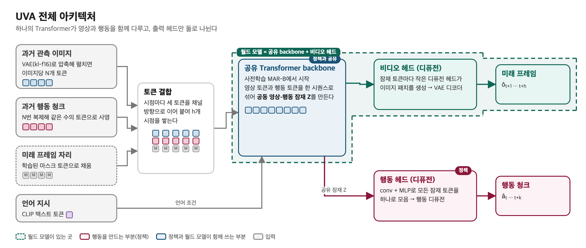{ width="820" }

    - **입력 토큰:** 과거 이미지를 사전학습 VAE(이미지를 작은 잠재 표현으로 압축했다가 되돌리는 인코더-디코더, kl-f16)로 압축하고 펼쳐 이미지당 N개 토큰을 만든다. 각 이미지와 짝을 이루는 행동 청크는 N번 복제해 같은 수의 토큰으로 사영한다. 예측할 미래 프레임 자리는 학습된 마스크 토큰으로 채운다. 시점마다 이 세 토큰을 채널 방향으로 이어 붙이고, 언어 지시는 CLIP 텍스트 토큰으로 더한다.
    - **공유 Transformer backbone:** 사전학습 MAR-B에서 시작한 Transformer가 영상 토큰과 행동 토큰을 한 시퀀스로 섞어 공동 영상-행동 잠재 $Z$를 만든다.
    - **비디오 헤드:** 잠재 토큰마다 작은 디퓨전 헤드가 이미지 패치를 생성하고, VAE 디코더가 패치를 프레임으로 되돌린다.
    - **행동 헤드:** conv와 MLP가 모든 잠재 토큰을 하나로 모은 뒤, 그것을 조건으로 행동 디퓨전이 행동 청크를 만든다.

    **3. 학습 과정**

    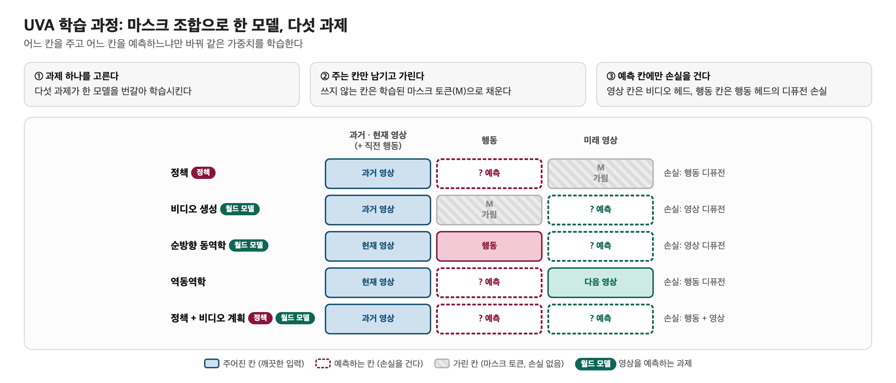{ width="820" }

    - 한 모델을 다섯 과제로 함께 학습한다. 과제마다 주는 칸과 예측하는 칸이 다르고, 쓰지 않는 칸은 학습된 마스크 토큰으로 가린다.
    - 손실은 예측하는 칸에만 건다. 영상 칸은 비디오 헤드의 디퓨전 손실, 행동 칸은 행동 헤드의 디퓨전 손실이며, 둘을 더해 한 모델을 학습한다.
    - 다섯 과제는 정책(과거 → 행동), 비디오 생성(과거 → 미래 영상), 순방향 동역학(현재 영상 + 행동 → 다음 영상), 역동역학(현재 영상 + 다음 영상 → 그 사이 행동), 정책 + 비디오 계획(과거 → 행동과 미래 영상)이다.

    **4. 추론 과정**

    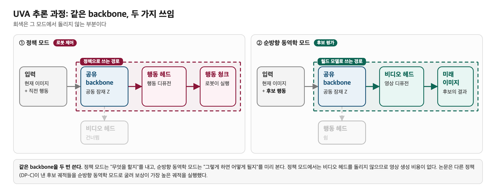{ width="820" }

    - **정책 모드:** 현재 이미지와 직전 행동 → 공유 backbone → 행동 헤드 → 행동 청크. 비디오 헤드는 돌리지 않으므로 영상 생성 비용이 없다.
    - **순방향 동역학 모드:** 현재 이미지 + 후보 행동 → 공유 backbone → 비디오 헤드 → 미래 이미지. 이때는 행동 헤드가 쉰다.
    - **같은 backbone을 두 번 활용한다.** 정책 모드로 "무엇을 할지"를 내고, 순방향 동역학 모드로 "그렇게 하면 어떻게 될지"를 미리 본다. 논문은 다른 정책(DP-C)이 낸 후보 궤적들을 순방향 동역학 모드로 굴려, 보상이 가장 높은 궤적을 실행했다.

    **5. 월드 모델의 역할**

    | 위치 | 예측 대상 | 학습에서 하는 일 | 추론에서 하는 일 |
    | :-- | :-- | :-- | :-- |
    | 정책 안. 공유 backbone + 비디오 헤드 | 행동이 주어졌을 때의 다음 프레임, 또는 과거에서 이어질 미래 프레임 | 영상 예측 손실로 backbone에 장면의 동역학을 가르친다 | 정책 모드에서는 꺼지고, 순방향 동역학 모드에서 후보 행동의 결과를 예측한다 |

    - 행동 헤드는 영상을 직접 보지 않고 공유 잠재만 읽는다. 그 잠재가 영상 예측과 함께 학습되었기 때문에, 영상을 생성하지 않아도 "장면이 어떻게 변할지"에 대한 정보가 행동 생성에 들어간다.

    **6. 핵심 기술과 독창성**

    - **공동 잠재 + 분리 디코더:** backbone을 공유해 영상 예측이 행동 학습을 돕게 하고, 디코더를 나눠 추론 때 영상 생성을 건너뛴다. → 영상을 그리는 정책보다 추론이 훨씬 가볍고, 다과제 시뮬레이션과 실제 다과제, 특히 분포 밖 물체에서 같은 데이터로 배운 디퓨전 정책과 π0를 앞섰다. 이후 Single-backbone 방법들이 추론 때 시각 분기를 끄거나 줄이는 설계가 여기서 출발한다.
    - **마스크 학습으로 한 모델, 다섯 과제:** 주는 칸과 예측하는 칸만 바꿔 정책, 비디오 생성, 순방향·역동역학을 한 가중치로 학습한다. → 과제마다 모델을 따로 만들 필요가 없고, 순방향 동역학 모드가 4-2절의 평가기처럼 다른 정책의 후보 궤적을 걸러 그 정책의 성공률을 끌어올렸다.
    - **한계:** 단일 과제에서는 전용 디퓨전 정책에 뒤져, 공동 학습의 이득은 주로 다과제와 분포 밖 설정에서 나온다.

???+ note "대표 모델 ④ Cosmos Policy (Kim et al., 2026): 비디오 모델의 빈칸 채우기로 정책·월드 모델·가치 함수를 한 번에"
    **1. 문제와 핵심 아이디어**

    - **문제:** 대규모 영상으로 사전학습한 비디오 모델은 장면이 시간에 따라 어떻게 변하는지 잘 알지만, 행동을 받거나 내는 자리가 없다. 행동 헤드를 붙이거나 구조를 바꾸면 사전학습이 만든 표현부터 다시 맞춰야 한다.
    - **핵심 아이디어:** 구조는 그대로 두고 입력만 바꾼다. 비디오 모델이 받는 프레임 시퀀스 안에 로봇의 상태, 행동, 가치를 프레임처럼 끼워 넣고, 비디오 모델이 원래 잘하는 "빈 프레임 채우기(디노이징)"로 행동과 미래와 가치를 만든다. [Cosmos](cosmos.md) 리뷰에서 본 기반 모델이 정책이 된 사례다.

    **2. 전체 아키텍처**

    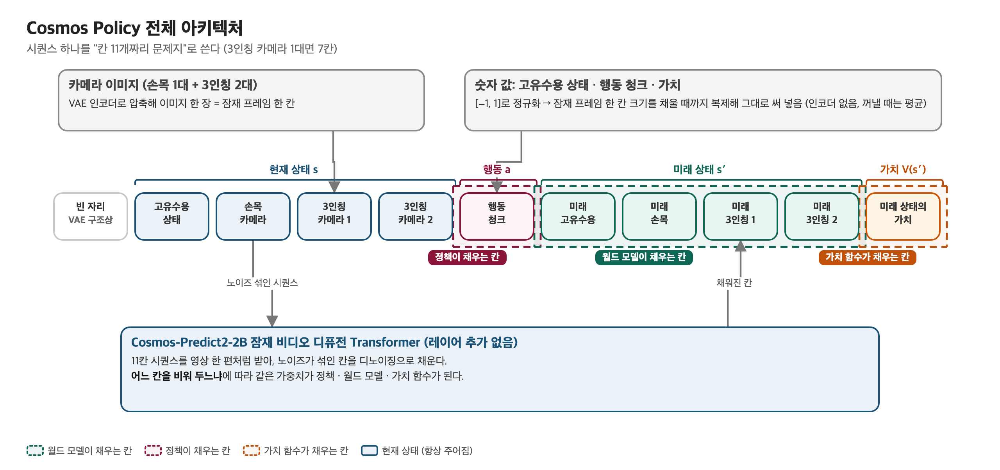{ width="820" }

    - **기반 모델:** NVIDIA Cosmos-Predict2-2B-Video2World 잠재 비디오 디퓨전 Transformer. 레이어를 하나도 추가하지 않는다.
    - **시퀀스 = 칸 11개짜리 문제지:** 앞에서부터 빈 자리 1칸, 현재 상태 $s$ 4칸(고유수용 상태, 손목 카메라, 3인칭 카메라 2대), 행동 청크 $a$ 1칸, 미래 상태 $s'$ 4칸(같은 구성), 미래 상태의 가치 $V(s')$ 1칸이다. 맨 앞 빈 자리는 VAE가 첫 프레임을 따로 압축하는 구조 때문에 둔다. 3인칭 카메라 1대만 쓰면 7칸이 된다.
    - **고유수용 상태(proprioception):** 관절 각도나 엔드이펙터 위치처럼, 로봇이 카메라 없이 자기 몸에 대해 센서로 아는 상태다. ALOHA에서는 관절 각도 14개다.
    - **숫자를 칸에 넣는 법:** 이미지는 VAE 인코더로 잠재 프레임이 된다. 숫자 벡터(고유수용 상태, 행동 청크, 가치)는 [−1, 1]로 정규화하고 잠재 프레임 한 칸의 크기를 채울 때까지 복제해 그 칸에 그대로 써 넣는다. 꺼낼 때는 복제본을 평균한다. 숫자용 인코더가 따로 없다.

    **3. 학습 과정**

    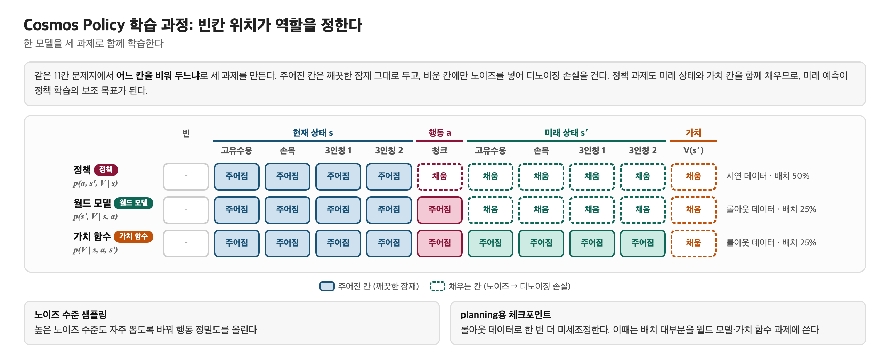{ width="820" }

    - 같은 문제지에서 어느 칸을 비워 두느냐로 세 과제를 만든다. 주어진 칸은 깨끗한 잠재 그대로 두고, 비운 칸에만 노이즈를 넣어 디노이징 손실을 건다.
        - **정책** $p(a, s', V(s') \mid s)$: 현재 상태만 주고 행동, 미래 상태, 가치 칸을 채운다. 사람 시연 데이터로 배운다.
        - **월드 모델** $p(s', V(s') \mid s, a)$: 현재 상태와 행동을 주고 미래 상태와 가치 칸을 채운다. 정책을 실제로 돌려 모은 롤아웃 데이터로 배운다.
        - **가치 함수** $p(V(s') \mid s, a, s')$: 가치 칸만 비우고 채운다. 롤아웃 데이터로 배운다.
    - 배치의 절반은 시연(정책), 나머지 절반은 롤아웃(월드 모델과 가치 함수에 반씩)이다. 정책 과제도 미래 상태와 가치 칸을 함께 채우므로, 미래 예측이 정책 학습의 보조 목표가 된다.
    - 노이즈 수준을 높은 쪽에서도 자주 뽑도록 샘플링을 바꿔 행동 정밀도를 올린다.
    - planning에 쓸 체크포인트는 롤아웃 데이터로 한 번 더 미세조정한다. 이때는 배치 대부분을 월드 모델과 가치 함수 과제에 쓴다.

    **4. 추론 과정**

    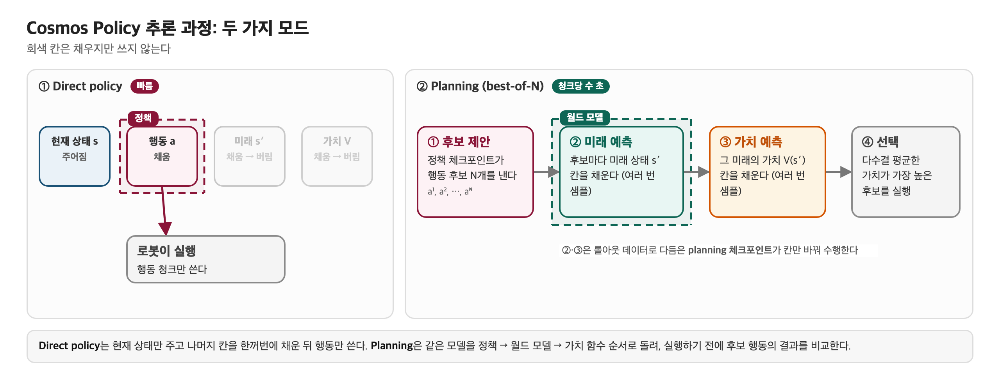{ width="820" }

    - **Direct policy:** 현재 상태만 주고 행동, 미래 상태, 가치 칸을 한꺼번에 채운 뒤 행동만 실행한다. 나머지 칸은 버린다. 디노이징 몇 step으로 끝나 빠르다.
    - **Planning (best-of-N):** ① 정책 체크포인트가 행동 후보 N개를 낸다. ② planning 체크포인트가 월드 모델로서 후보마다 미래 상태 칸을 채운다. ③ 같은 체크포인트가 가치 함수로서 그 미래의 가치 칸을 채운다. ④ 가치가 가장 높은 후보를 실행한다. 미래와 가치는 후보마다 여러 번 샘플해 다수결 평균으로 모으고, 청크당 수 초가 걸린다.

    **5. 월드 모델의 역할**

    | 위치 | 예측 대상 | 학습에서 하는 일 | 추론에서 하는 일 |
    | :-- | :-- | :-- | :-- |
    | 정책과 같은 모델. 미래 상태 칸을 채울 때가 월드 모델 | 행동 뒤의 고유수용 상태와 카메라 영상, 그리고 그 가치 | 정책 과제의 보조 목표이자, 롤아웃 데이터로 따로 배우는 과제 | Direct policy에서는 출력을 버리고, planning에서 후보 행동의 결과를 예측한다 |

    - 정책, 월드 모델, 가치 함수가 별도 모듈이 아니라 "어느 칸을 비우느냐"의 차이일 뿐이다. 그래서 정책이 내놓는 행동과 월드 모델이 예측하는 미래가 같은 표현 위에 있다.

    **6. 핵심 기술과 독창성**

    - **구조 변경 없는 post-training:** 행동·상태·가치를 잠재 프레임으로 써 넣어 비디오 모델을 그대로 정책으로 바꿨다. → 시뮬레이션(LIBERO, RoboCasa)과 실제 ALOHA에서 비교한 VLA·디퓨전 정책들을 앞섰다. 비디오 prior가 구조 수정 없이 제어로 옮겨진다는 증거다.
    - **빈칸 위치로 역할 전환:** 같은 가중치가 정책, 월드 모델, 가치 함수가 된다. → 세 모델을 따로 만들 필요가 없고, 정책이 미래 예측을 보조 목표로 함께 배운다.
    - **노이즈 샘플링 조정:** 높은 노이즈 수준을 더 자주 학습해 행동 정밀도를 올렸다.
    - **Planning:** Direct policy가 자주 실패하던 가장 어려운 과제의 실패를 줄였다. 대신 청크당 수 초의 지연이 생겨 실시간성을 내준다.
    - **한계:** planning에는 롤아웃 데이터와 별도 체크포인트가 필요하다. 서베이는 비디오 사전학습 backbone이 같은 규모의 VLM backbone보다 일관되게 낫다는 증거는 아직 없다고 단서를 단다.

### 3-3. MoE / MoT: 전문가는 따로, 어텐션으로 묶는다

**비디오 전문가와 행동 전문가를 따로 두고 joint attention으로 층마다 상호작용시킨다.** MoE(Mixture-of-Experts)와 MoT(Mixture-of-Transformers)는 입력 종류마다 따로 학습되는 전문가 네트워크를 두는 구조를 말한다. 모든 모달리티를 하나의 디퓨전 backbone에 몰아넣는 대신 비디오 예측, 행동 생성, 때로는 언어·장면 이해용 전문가 스트림을 유지하고, 공유 어텐션이나 cross-attention, 인터리브된 autoregressive 시퀀스로 서로 묶는다. 비디오 분기는 시간 예측 잠재 흐름이 되고 정책은 이 foresight를 행동 분기에 반복해서 주입받는다. VLM backbone 옆에 행동 전문가를 붙이는 π0·π0.5와 구조는 같지만, 그 backbone이 정지 이미지의 의미를 읽는 VLM이 아니라 미래를 예측하는 비디오 생성 모델이라는 점이 다르다.

<figure markdown="span">
  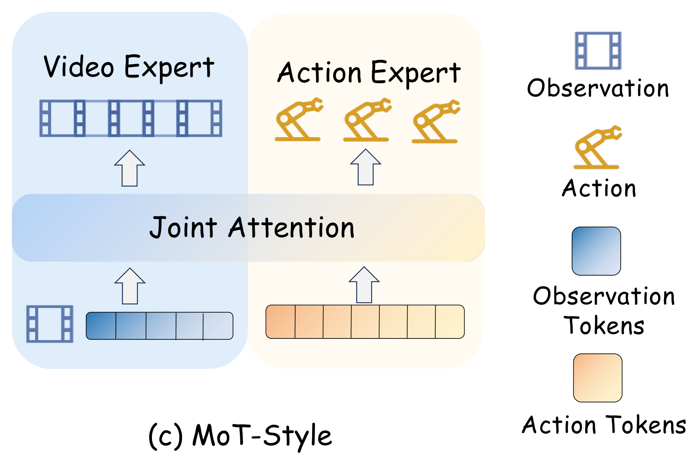{ width="580" }
  <figcaption>Figure 3(c). MoT-style. 비디오 전문가와 행동 전문가가 각자의 토큰을 처리하면서 가운데 joint attention을 공유한다 (source: 원문 Figure 3)</figcaption>
</figure>

#### 주요 설계 방향

- **병렬 전문가 결합 (Parallel Expert Coupling):** 사전학습 비디오 디퓨전 모델 옆에 행동 경로를 병렬로 두고, 행동 쪽이 cross-attention으로 비디오 잠재 특징을 읽는다. 비디오 모델을 거의 그대로 둔 채, 온라인 영상 렌더링 없이 예측 정보를 제어로 옮긴다. 이미지 편집 모델로 하위 목표 장면을 그리고 목표 조건부 정책이 따라가게 한 초기 방식이 전신이다. 예: GE-Act, SuSIE, GHIL-GLUE.
- **MoT 깊은 상호작용 (Mixture-of-Transformers Deep Interaction):** 이해·비디오·행동 전문가를 끝까지 따로 유지하면서 층마다 공유 attention으로 섞는다. 행동 정보도 비디오 쪽으로 흘러 두 전문가가 함께 맞춰진다. 비디오 분기를 끝까지 디노이징하지 않고 한두 step의 중간 특징만 쓰는 변형이 있고, 이득의 대부분이 학습 때의 비디오 co-training에서 오며 추론 때의 상상은 생략해도 된다는 결과도 나왔다. 예: Motus(대표 모델 ⑤), LingBot-VA, BagelVLA, DiT4DiT, Fast-WAM.
- **잠재 공간 전문가화 (Latent-space Expertization):** 전문가 구조는 유지하되, 비디오 전문가가 픽셀 대신 사전학습 시각 인코더(DINO 등)의 특징 공간에서 미래를 예측하게 한다. 그리지 않아도 되는 세부를 버리고 제어에 관련된 변화만 담는다. 예: LDA-1B, FRAPPE.

#### 이 갈래의 기여

- 비디오 분기는 끝까지 렌더링할 출력이 아니라, 은닉 상태로 행동 전문가를 안내하는 중간 과정이 되었다.
- 다음 두 갈래는 비디오 전문가를 아예 없앤다. 3-4 Unified VLA는 정책 backbone 하나가 행동과 함께 미래 이미지를 예측하고, 3-5 Latent-space WM은 미래 이미지 대신 미래의 잠재 표현만 예측한다. 둘 다 비디오 생성 모델을 정책 옆에 따로 두지 않는다.

???+ note "대표 모델 ⑤ Motus (Bi et al., 2025): 이해·비디오·행동 전문가를 joint attention으로 묶는다"
    **1. 문제와 핵심 아이디어**

    - **문제:** 사전학습된 VLM은 장면과 지시를 이해하고, 사전학습된 비디오 생성 모델은 장면이 어떻게 변할지를 안다. 둘의 장점을 함께 살리면서 행동까지 내려면 어떻게 묶어야 할까. 영상과 행동은 시간 주파수와 규모가 달라 한 backbone을 통째로 공유하면 손해를 본다.
    - **핵심 아이디어:** 이해, 영상, 행동 전문가를 각자의 Transformer로 두고 self-attention 층만 하나로 합친다. 가중치는 분리하고 정보만 공유한다. 영상과 행동에 노이즈 단계(timestep)를 따로 주어, 그 조합만 바꿔 한 모델을 정책, 월드 모델, 역동역학 등 다섯 모드로 쓴다.

    **2. 전체 아키텍처**

    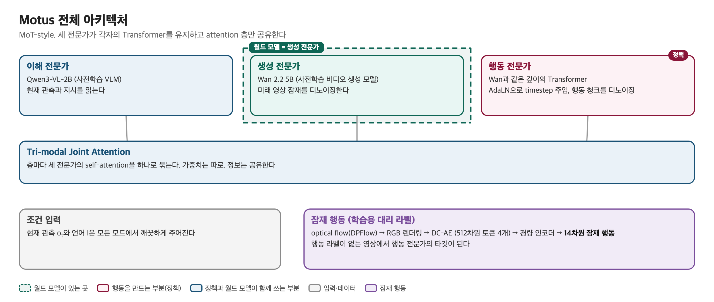{ width="820" }

    - **세 전문가:** 이해 전문가는 Qwen3-VL-2B, 생성 전문가는 Wan 2.2 5B 비디오 생성 모델, 행동 전문가는 Wan과 같은 깊이의 Transformer이며 AdaLN으로 timestep을 주입한다.
    - **Tri-modal Joint Attention:** 층마다 세 전문가의 multi-head self-attention을 하나로 묶어 서로의 토큰을 본다. 영상 전문가가 내다본 미래가 행동 전문가에 바로 흘러든다.
    - **잠재 행동:** 프레임 간 optical flow(DPFlow)를 RGB 이미지로 렌더링하고 DC-AE로 인코딩해 512차원 토큰 4개를 만든 뒤, 경량 인코더가 로봇 행동 공간 크기의 14차원 잠재 행동으로 사영한다. 행동 라벨이 없는 영상에서 행동 전문가의 학습 타깃으로 쓰인다.

    **3. 학습 과정**

    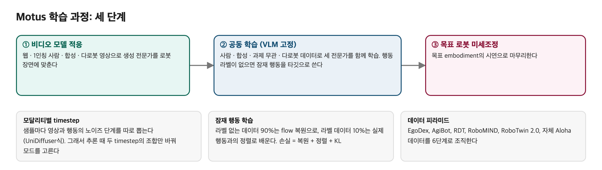{ width="820" }

    - **3단계 학습:** ① 웹·1인칭 사람·합성·다로봇 데이터로 생성 전문가를 적응시킨다. ② VLM을 고정한 채 잠재 행동과 함께 전체 모델을 학습한다. ③ 목표 로봇 데이터로 미세조정한다.
    - **잠재 행동 학습:** 라벨 없는 데이터 90%는 flow 복원으로, 라벨 데이터 10%(과제 무관·로봇 시연)는 실제 행동과의 정렬로 학습한다. 손실은 복원 + 정렬 + KL 정규화다.
    - **모달리티별 timestep:** 학습 샘플마다 영상과 행동의 노이즈 단계를 따로 뽑는다(UniDiffuser식 스케줄러). 이 덕분에 추론 때 두 timestep의 조합으로 모드를 고를 수 있다.
    - **데이터:** EgoDex, AgiBot, RDT, RoboMIND, RoboTwin 2.0, 자체 Aloha 데이터를 6단계 피라미드로 조직한다.

    **4. 추론 과정**

    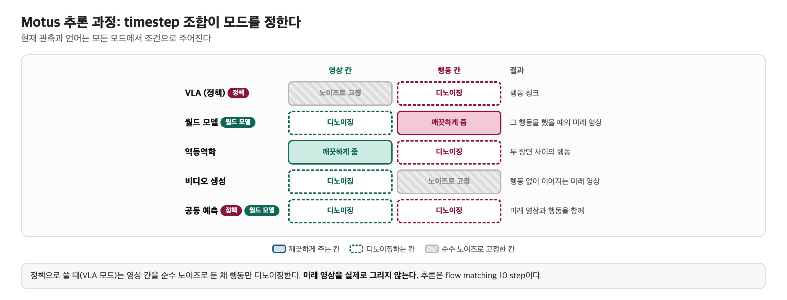{ width="820" }

    - 현재 관측과 언어는 모든 모드에서 깨끗한 조건으로 주어진다. 영상 칸과 행동 칸의 timestep 조합이 모드를 정한다.
        - **VLA(정책):** 영상은 순수 노이즈로 고정하고 행동만 디노이징한다. 미래 영상을 실제로 그리지 않는다.
        - **월드 모델:** 행동을 깨끗하게 주고 영상을 디노이징한다. 그 행동을 했을 때의 미래 영상이 나온다.
        - **역동역학:** 미래 영상을 깨끗하게 주고 행동을 디노이징한다. 두 장면 사이의 행동이 나온다.
        - **비디오 생성:** 행동은 순수 노이즈로 고정하고 영상만 디노이징한다.
        - **공동 예측:** 영상과 행동을 함께 디노이징한다.
    - 추론은 flow matching 10 step이다.

    **5. 월드 모델의 역할**

    | 위치 | 예측 대상 | 학습에서 하는 일 | 추론에서 하는 일 |
    | :-- | :-- | :-- | :-- |
    | 정책 안의 생성 전문가 (Wan 2.2 5B). 행동 전문가와 attention으로 연결된다 | 미래 영상의 잠재 | 사람·합성 영상으로 동역학을 익히고, 공동 학습에서 joint attention으로 행동 전문가에 예측 정보를 준다 | VLA 모드에서는 영상 칸이 노이즈로 고정된 채 attention으로만 참여하고, 월드 모델 모드에서는 행동이 주어진 미래 영상을 생성한다 |

    - 같은 가중치가 timestep 조합만 바꿔 정책이 되기도 하고 월드 모델이 되기도 한다. 정책으로 쓸 때 영상을 그리지 않으므로, 이득은 주로 학습 때의 공동 학습에서 온다.

    **6. 핵심 기술과 독창성**

    - **전문가 분리 + 공유 attention:** 가중치를 나눠 각 전문가가 자기 사전학습을 그대로 가져오고, attention만 섞는다. → 무작위화가 심한 RoboTwin 2.0 과제와 실제 두 로봇에서 VLA 기반 정책들을 크게 앞섰고, 긴 과제(LIBERO-Long)에서는 최고 수준과 동률이었다.
    - **잠재 행동:** 프레임 사이의 움직임을 행동 공간 크기로 압축해 대리 라벨로 쓴다. → 사람·합성 영상까지 행동 조건부 학습에 들어가, 행동 데이터의 범위가 로봇 시연 밖으로 넓어졌다.
    - **모달리티별 timestep:** 노이즈 단계의 조합으로 모드를 바꾼다. → 정책, 월드 모델, 역동역학, 비디오 생성을 한 가중치로 쓴다.
    - **한계:** 전문가 셋을 동시에 돌려 모델이 크고 학습이 세 단계로 길다. 같은 MoT 구조를 쓴 Fast-WAM은 이득의 대부분이 학습 때의 비디오 co-training에서 온다고 보고해, 추론 때 상상이 꼭 필요한지는 열린 문제로 남는다.

### 3-4. Unified VLA: 월드 모델을 정책 backbone 안에 내재화한다

**별도의 비디오 모델 없이, 하나의 멀티모달 정책 backbone이 행동과 함께 미래 지향 출력을 학습한다.** 앞의 비디오 backbone 갈래와 다른 점은 미래 모델링이 별도 예측 모듈로 들어오는 것이 아니라 통합 VLA 구조 안에 내재화된다는 것이다.

<figure markdown="span">
  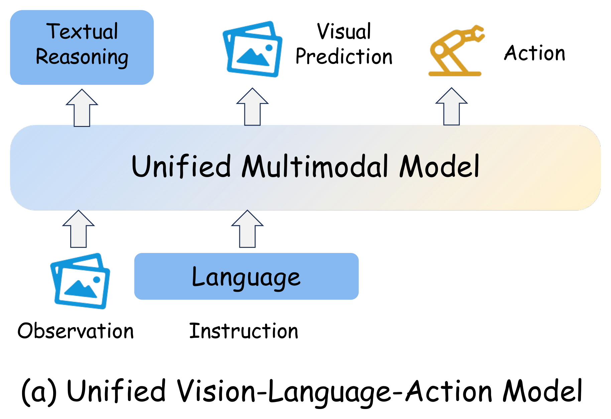{ width="580" }
  <figcaption>Figure 4(a). Unified VLA. 하나의 통합 멀티모달 모델이 관측과 지시를 받아 텍스트 추론, 시각 예측, 행동을 함께 낸다 (source: 원문 Figure 4)</figcaption>
</figure>

#### 하위 유형

- **명시적 미래 이미지 예측 (Explicit Future Image Prediction):** 정책 backbone 하나가 행동과 함께 미래 이미지를 예측한다. 미래 이미지는 추론 때 꼭 내는 출력이라기보다 행동 학습을 돕는 공동 학습 신호다. 예: GR-1, UP-VLA, WorldVLA(대표 모델 ⑥).
- **암묵적·잠재 미래 모델링 (Implicit Latent Foresight):** 중복이 많은 미래 프레임 대신 동적·공간적·의미적 단서나 잠재 모션처럼 압축된 미래를 예측하거나, post-training 단계에서 월드 모델링 목적을 넣어 대규모 비디오의 인과 동역학을 흡수한다. 예: DreamVLA, UniVLA, CoWVLA.
- **기능 분화형 통합 모델 (Unified Multi-expert Systems):** 학습과 과제 수준에서는 하나의 VLA지만 구조 안에 이해, 예측, 행동 기능을 나눠 둔다. 예측 분기는 별도 월드 모델이 아니라 통합 VLA 안의 시각 foresight나 하위 목표 생성기로 쓰인다. 예: F1, InternVLA-A1, HALO, TriVLA.

#### 공통 원리

- 행동 생성이 현재 관측에서의 순수 반응형 사상이 아니라, 미래 상태의 변화나 그 압축된 대리 변수를 담는 내부 예측 목적과 함께 학습된다.
- 핵심 구분은 독립된 월드 모델이 있느냐가 아니라, 미래 지향 예측이 같은 정책 backbone 안에 내재화되었느냐다. 3-5는 여기서 더 나아가 미래를 이미지로 그리지 않고 잠재 표현으로만 예측한다.

???+ note "대표 모델 ⑥ WorldVLA (Cen et al., 2025): 이미지·텍스트·행동을 한 어휘로, 행동 모델과 월드 모델을 한 Transformer로"
    **1. 문제와 핵심 아이디어**

    - **문제:** 정책과 월드 모델을 따로 두면, 정책은 행동이 세상을 어떻게 바꾸는지 모르고 월드 모델은 어떤 행동이 좋은지 모른다.
    - **핵심 아이디어:** 이미지, 텍스트, 행동을 한 어휘의 토큰으로 바꾸고, 언어 모델처럼 다음 토큰을 예측하는 Transformer 하나로 행동 모델 과제와 월드 모델 과제를 함께 학습한다. [Trajectory Transformer](trajectory-transformer.md)가 궤적을 토큰 시퀀스로 본 관점을 멀티모달로 넓힌 것이다.

    **2. 전체 아키텍처**

    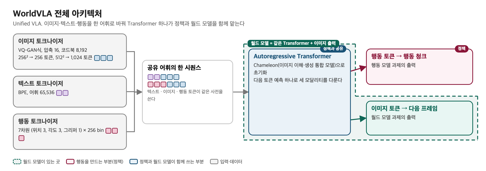{ width="820" }

    - **공유 어휘:** 이미지 이해와 생성을 통합한 Chameleon으로 초기화한다. 텍스트 BPE 어휘 65,536 안에 이미지 토큰 8,192와 행동 토큰 256이 함께 들어 있다.
    - **이미지 토크나이저:** VQ-GAN식, 압축 16, 코드북 8,192다. 256×256 이미지는 256 토큰, 512×512는 1,024 토큰이 된다.
    - **행동 토크나이저:** 7차원 행동(상대 위치 3, 상대 각도 3, 그리퍼 1)을 차원마다 256 bin으로 양자화한다.
    - **Autoregressive Transformer:** 세 모달리티를 하나의 다음 토큰 예측으로 다룬다. 같은 가중치가 행동 토큰도 내고 이미지 토큰도 낸다.

    **3. 학습 과정**

    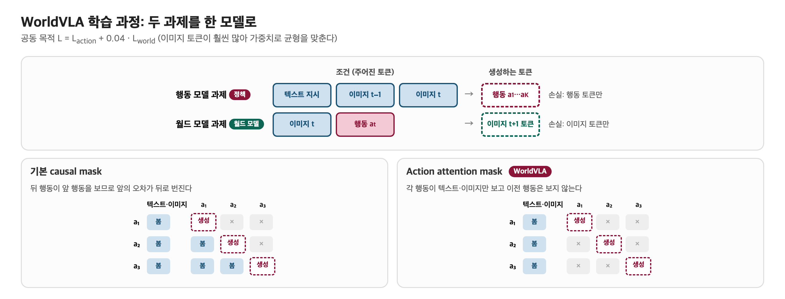{ width="820" }

    - **행동 모델 과제:** 텍스트 지시와 과거 이미지 2장에서 행동 K개(5~10)를 생성한다. 손실은 행동 토큰에만 건다.
    - **월드 모델 과제:** 현재 이미지와 행동에서 다음 프레임을 생성한다. 손실은 이미지 토큰에만 건다.
    - **공동 목적:** $L = L_{\text{action}} + 0.04\, L_{\text{world}}$. 이미지 토큰이 훨씬 많아 가중치로 균형을 맞춘다.
    - **Action attention mask:** 기본 causal mask에서는 청크 안의 앞 행동 오차가 뒤 행동으로 전파된다. 각 행동이 텍스트와 이미지만 보고 이전 행동은 보지 않도록 마스크를 바꾼다. 월드 모델 과제는 표준 causal mask를 유지한다.

    **4. 추론 과정**

    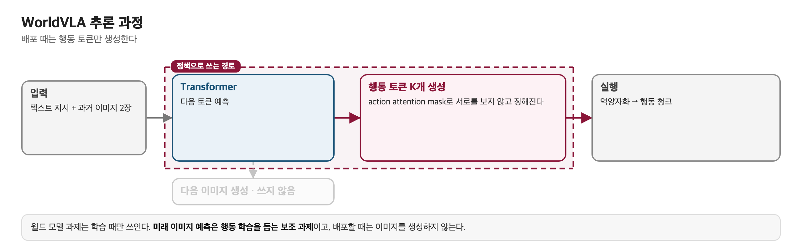{ width="820" }

    - 텍스트 지시와 과거 이미지를 넣고 행동 토큰 K개를 생성해 행동 청크로 되돌린다. 바뀐 마스크 덕분에 청크 안의 행동들은 서로를 보지 않고 정해진다.
    - 다음 이미지는 생성하지 않는다. 월드 모델 과제는 추론 때 쓰이지 않는다.

    **5. 월드 모델의 역할**

    | 위치 | 예측 대상 | 학습에서 하는 일 | 추론에서 하는 일 |
    | :-- | :-- | :-- | :-- |
    | 같은 Transformer가 푸는 두 번째 과제 | 현재 이미지와 행동이 주어졌을 때의 다음 프레임 토큰 | 행동 예측과 함께 학습되어, "행동이 세상을 어떻게 바꾸는지"를 backbone에 가르친다 | 쓰이지 않는다. 배포 때는 행동 토큰만 생성하므로 이미지 생성 비용이 없다 |

    - 월드 모델이 별도 모듈이 아니라 학습 신호로만 존재하는 설계다. 미래 이미지 예측은 행동 학습을 돕는 보조 과제이고, 배포할 때는 떼어 낸다.

    **6. 핵심 기술과 독창성**

    - **공유 어휘의 통합 autoregressive 학습:** 행동 모델과 월드 모델을 한 Transformer로 학습한다. → 행동 모델만 학습한 경우와 이산 토큰 VLA 베이스라인보다 LIBERO 성공률이 올랐다. 행동이 세상을 어떻게 바꾸는지 배운 것이 행동 예측을 돕는다는 직접 증거다.
    - **양방향 이득:** 행동 모델을 함께 학습하면 긴 영상(50프레임) 생성 품질도 좋아졌다. 짧은 영상에서는 소폭 나빠져, 이득은 긴 horizon에서 나온다.
    - **Action attention mask:** 이전 행동을 가려 청크 생성의 오차 누적을 없앴다. → 평균 성공률과 긴 과제 성공률이 크게 올랐다.
    - **한계:** 이산 토큰이라 행동 정밀도에 한계가 있고, 이미지 토큰이 많아 시퀀스가 길다. 서베이 Table 5의 Unified VLA 행에는 후속 버전인 RynnVLA-002가 올라 있다.

### 3-5. Latent-space WM: 픽셀 없이 표현 공간에서만 예측한다

**미래 이미지를 그리지 않고 잠재 목표·미래 인식 임베딩만 예측해 행동 생성에 쓴다.** 월드 모델링이 시각 복원이 아니라 "환경이 어떻게 변할지를 제어에 바로 쓸 수 있는 형태로 담은 표현 학습"으로 실현된다. 예측 구조를 넣는다는 이득은 지키면서 생성 디코딩의 비용과 중복은 피한다. 개념적으로 JEPA 계열과 닿아 있지만, 서베이의 관심은 이 원리를 정책 학습 장치로 바꾼 VLA 방법들이다.

<figure markdown="span">
  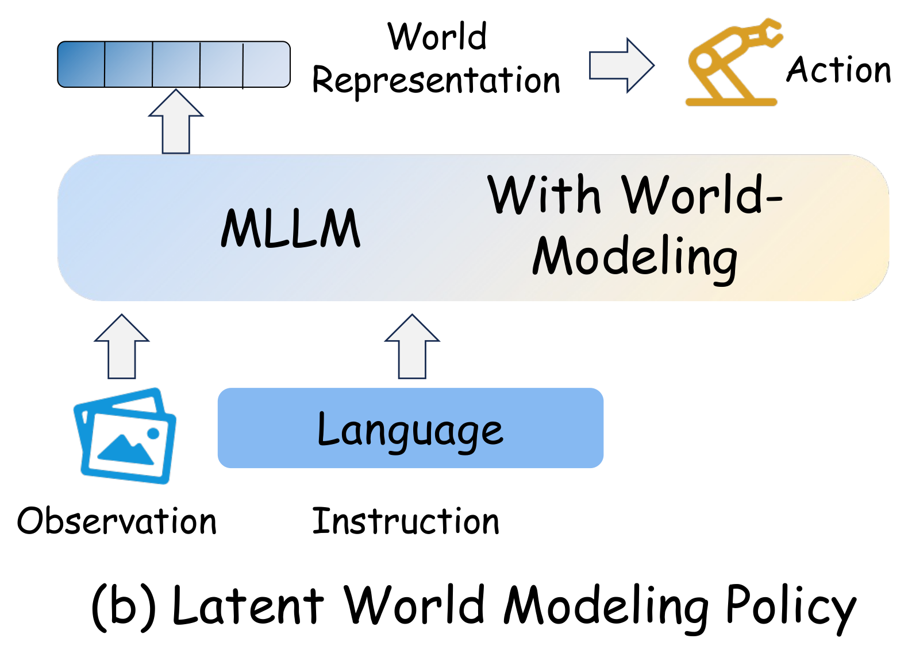{ width="580" }
  <figcaption>Figure 4(b). Latent world modeling policy. MLLM이 미래 이미지 대신 월드 표현을 예측하고, 그 표현으로 행동을 낸다 (source: 원문 Figure 4)</figcaption>
</figure>

#### 대표 접근

- **잠재 미래 정렬 (Latent Future Alignment):** 행동 디노이징 네트워크의 은닉 특징을 미래 관측의 잠재 임베딩에 정렬해, 미래를 생성하지 않고도 암묵적으로 예측하게 한다. 예: FLARE.
- **JEPA식 예측 목적과 표현 (JEPA-style Objectives & Representations):** JEPA식 사전학습 목적을 VLA에 더하고 미래 프레임은 잠재 타깃으로만 쓰거나, 예측 헤드를 더하는 대신 [V-JEPA 2](v-jepa-2.md)의 예측 임베딩을 정책 backbone으로 쓴다. 정적 시각 표현보다 예측 임베딩이 더 나은 정책 prior라는 주장이다. 예: VLA-JEPA(대표 모델 ⑦), JEPA-VLA.
- **조건 공간·병목으로서의 잠재 예측 (Latent Foresight as Condition or Bottleneck):** 월드 모델링을 행동 생성의 조건 공간으로 옮겨 정밀 제어에 필요한 미래 정보만 예측하거나, VLM 특징 공간의 잠재 foresight를 병목으로 두어 의도와 행동을 분리한다. 예: WoG, DIAL.
- **심볼릭 전이 모델 (Symbolic Transition Models):** 술어, 물체 관계, affordance 위의 추상 전이 모델을 배워 계획기가 질의한다. 픽셀 대신 심볼로 미래를 예측해도 계획에 쓸 수 있다는 점에서, 월드 모델이 꼭 픽셀을 예측할 필요는 없다는 이 갈래의 주장을 뒷받침한다. 예: VisualPredicator, ExoPredicator.

???+ note "대표 모델 ⑦ VLA-JEPA (Sun et al., 2026): 미래는 잠재 타깃으로만 쓰고, VLM은 미래를 보지 못한다"
    **1. 문제와 핵심 아이디어**

    - **문제:** 행동 라벨이 없는 사람 영상은 많지만, 보통의 VLA는 행동 라벨이 있어야 배운다. 미래를 픽셀로 예측하게 하면 라벨 없이도 배울 수 있지만, 비싸고 제어에 불필요한 세부까지 맞춰야 한다.
    - **핵심 아이디어:** 미래를 그리지 않고, [V-JEPA 2](v-jepa-2.md) 임베딩 공간에서 다음 세계 상태를 맞히는 잠재 월드 모델 목적을 VLA에 더한다. 미래 프레임은 정답(타깃)을 만드는 데만 쓰고 정책은 미래를 보지 못하게 한다.

    **2. 전체 아키텍처**

    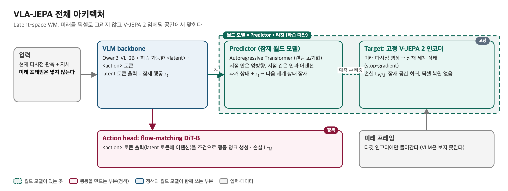{ width="820" }

    - **VLM backbone:** Qwen3-VL-2B에 학습 가능한 `<latent>` 토큰과 `<action>` 토큰을 추가한다. VLM은 초기 다시점 관측과 지시만 받고, latent 토큰 출력이 잠재 행동 표현 $z_t$가 된다.
    - **Predictor(잠재 월드 모델):** 랜덤 초기화한 autoregressive Transformer가 과거 세계 상태와 $z_t$로 다음 세계 상태 청크를 예측한다. 어텐션은 시점 안에서는 양방향, 시점 간에는 인과적이다.
    - **Target:** 고정한 V-JEPA 2 인코더가 미래 다시점 영상을 인코딩해 잠재 세계 상태 타깃을 만든다(stop-gradient). EMA 타깃 인코더는 쓰지 않는다.
    - **Action head:** `<action>` 토큰 출력(latent 토큰에 어텐션)을 조건으로 flow-matching DiT-B가 행동 청크를 낸다.

    **3. 학습 과정**

    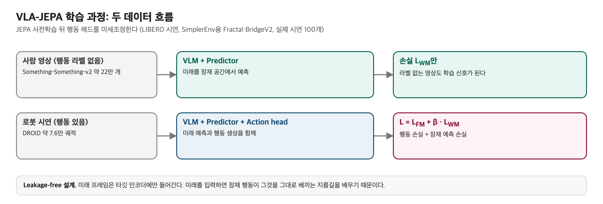{ width="820" }

    - **손실:** 잠재 예측 손실 $L_{\text{WM}}$은 예측 상태와 타깃 상태의 잠재 공간 회귀이며 픽셀 복원은 없다. 로봇 데이터에서는 $L = L_{\text{FM}} + \beta\, L_{\text{WM}}$로 행동 손실과 함께 학습한다.
    - **데이터:** 행동 라벨이 없는 사람 영상 Something-Something-v2 약 22만 개는 $L_{\text{WM}}$만, 행동이 있는 DROID 약 7.6만 궤적은 공동 목적으로 학습한다.
    - **2단계 레시피:** JEPA 사전학습 다음에 행동 헤드를 미세조정한다(LIBERO 시연, SimplerEnv용 Fractal과 BridgeV2, 실제 시연 100개).
    - **Leakage-free:** 미래 프레임은 타깃 인코더에만 들어간다. 미래를 입력하면 잠재 행동이 그것을 베끼는 지름길을 배우기 때문이다.

    **4. 추론 과정**

    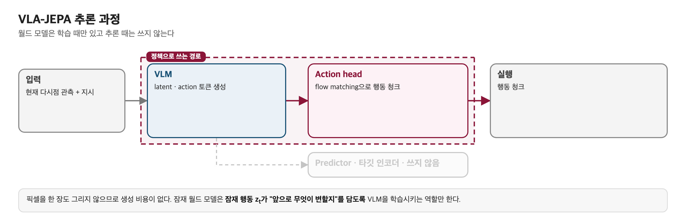{ width="820" }

    - VLM이 관측과 지시에서 latent·action 토큰을 만들고, flow-matching 헤드가 행동 청크를 낸다.
    - Predictor와 타깃 인코더는 추론 때 쓰지 않는다.

    **5. 월드 모델의 역할**

    | 위치 | 예측 대상 | 학습에서 하는 일 | 추론에서 하는 일 |
    | :-- | :-- | :-- | :-- |
    | 정책 옆의 학습 전용 모듈 (Predictor + 고정 V-JEPA 2 타깃) | 다음 세계 상태의 잠재 임베딩 | 잠재 행동 $z_t$가 "앞으로 무엇이 변할지"를 담도록 VLM을 학습시킨다. 라벨 없는 사람 영상도 이 경로로 학습에 들어간다 | 쓰이지 않는다 |

    - 월드 모델이 픽셀을 한 장도 그리지 않고 학습 신호로만 존재한다. WorldVLA와 같은 학습 전용 월드 모델이지만, 예측 대상이 이미지 토큰이 아니라 잠재 임베딩이다.

    **6. 핵심 기술과 독창성**

    - **잠재 월드 모델 목적:** 픽셀 복원 대신 V-JEPA 2 공간에서 미래를 맞힌다. → LIBERO와 SimplerEnv에서 같은 규모의 VLA들과 같거나 앞섰고, 실제 Franka에서는 물체 배치가 바뀐 분포 밖 과제에서 π0 계열을 앞섰다.
    - **라벨 없는 사람 영상 활용:** 행동 없이 $L_{\text{WM}}$만으로 사람 영상을 학습에 넣는다. → 사람 영상을 뺐을 때보다 성공률이 올랐다.
    - **Leakage-free 설계:** 미래는 타깃으로만 쓰여 정책이 베끼지 못한다.
    - **한계:** 잠재 타깃은 사람이 볼 수 없어 예측이 맞는지 검사하거나 계획에 쓰기 어렵고, 타깃 인코더가 담지 못하는 변화는 배울 수 없어 월드 모델의 상한이 V-JEPA 2에 묶인다.

### 3-6. 정리: 다섯 갈래를 관통하는 두 질문

!!! note "두 기준으로 본 다섯 갈래"
    첫째, 추론할 때 시각 분기를 얼마나 남기는가. IDM-style은 미래를 전부 그리고, Single-backbone과 MoT는 공동 학습의 이득을 챙기되 추론 때는 시각 분기를 줄이거나 끄며, Unified VLA는 미래 이미지를 주로 학습 신호로만 쓰고, Latent-space WM은 아예 그리지 않는다. 둘째, 미래 예측이 정책 안에 얼마나 내재화되었는가. 분리된 상류 모듈에서 공유 backbone과 전문가 결합을 거쳐, 같은 정책 backbone 안의 목적과 표현으로 들어간다. 3절이 "예측을 정책에 어떻게 넣나"였다면, 4절은 월드 모델을 정책 바깥에 두고 환경과 평가기로 쓰는 이야기다.

---

<!-- 발표: 28:30 시작, 9분. 순서: Figure 5(a)와 수식 → 1단계 → ⑧ WMPO → 2단계와 수식 → ⑨ WoVR → Figure 5(b) → 평가 방식 → ⑩ WorldEval → 인접 방향 → 노트. -->

## 4. World Model as Simulator: 환경으로, 평가기로

**들어가며.** 3절의 월드 모델은 정책의 일부였다. 4절의 월드 모델은 정책 바깥에서 환경 그 자체를 대신한다. 현재 관측, 과제 지시, 후보 행동이 주어지면 월드 모델이 미래 상태를 롤아웃하고 피드백 신호를 주어 상상 속 상호작용으로 결정을 돕는다. 실제 로봇의 강화학습은 느리고 비싸고 초기화가 어렵고 위험하며, 순수 모방 학습은 시연 품질에 묶이고 실패에서 배우기 어렵다. 그래서 월드 모델이 post-training용의 저비용 가상 환경이 되고, 같은 롤아웃 능력이 보상, 과제 완료, 롤아웃 일관성 같은 검증 가능한 신호를 노출하므로 평가, 순위, 결정 시점의 선택에도 쓰인다. 4-1절이 환경으로 쓰는 경우, 4-2절이 평가기로 쓰는 경우다.

### 4-1. 강화학습 환경으로서의 월드 모델

**실제 로봇 대신 학습된 시뮬레이터 안에서 VLA 정책을 롤아웃하고 보상을 받아 개선한다.** 월드 모델 $p_\phi$가 상상 전이와 선택적으로 보상·종료 신호를 주고, 정책은 상상 롤아웃의 기대 보상을 최대화하거나 실제로는 GRPO식 clipped 목적으로 개선된다. GRPO는 같은 시작점에서 여러 번 롤아웃한 결과끼리 비교해 평균보다 나은 행동의 확률을 높이는 강화학습 방법이고, clipped 목적은 확률비 $r_t$를 일정 범위로 잘라 정책이 한 번에 너무 크게 바뀌지 않게 한다.

<figure markdown="span">
  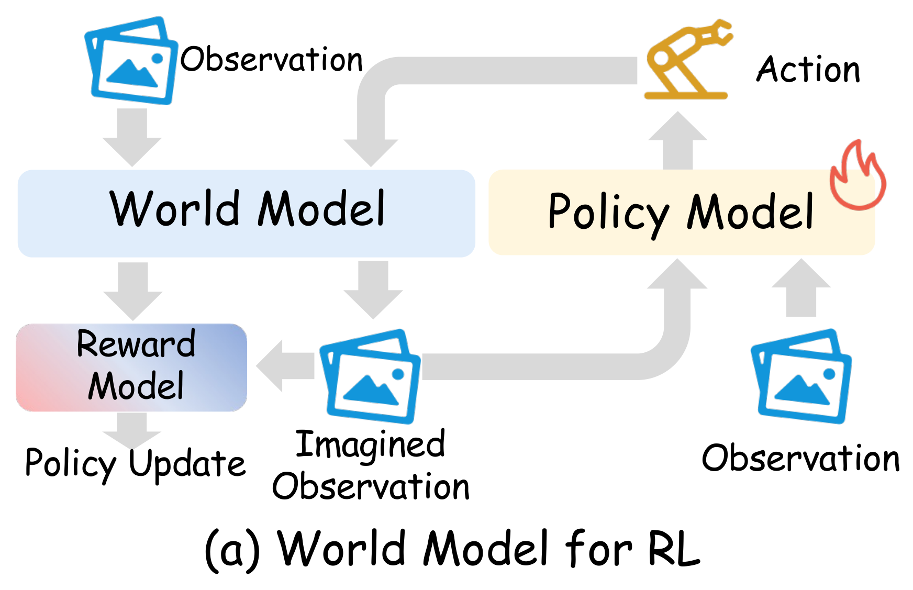{ width="580" }
  <figcaption>Figure 5(a). World model for RL. 정책(불꽃 표시, 학습 대상)이 낸 행동으로 월드 모델이 상상 관측을 만들고, 보상 모델의 점수로 정책을 갱신한다 (source: 원문 Figure 5)</figcaption>
</figure>

$$
(\hat o_{t+1}, \hat r_t, \hat d_t) \sim p_\phi(\cdot \mid o_{\le t}, a_{\le t}, l), \qquad
J(\theta) = \mathbb{E}_{\hat\tau \sim (\pi_\theta, p_\phi)}\Big[\sum_t \gamma^t \hat r_t\Big]
$$

$$
\mathcal{L}_{\mathrm{RL}}(\theta) = -\mathbb{E}_t\Big[\min\big(r_t(\theta)\hat A_t,\ \mathrm{clip}(r_t(\theta), 1-\epsilon, 1+\epsilon)\hat A_t\big)\Big], \qquad
r_t(\theta) = \frac{\pi_\theta(a_t \mid s_t)}{\pi_{\theta_{\mathrm{old}}}(a_t \mid s_t)}
$$

#### 1단계: 월드 모델 안에서의 RL (RL in World Models)

- **학습된 시뮬레이터와 보상 헤드 (Learned Simulator with Reward Heads):** 행동 조건부 세계 시뮬레이션에 보상 생성을 결합해 기본 틀을 세웠다. 시뮬레이터에 연속 보상 예측과 행동 종료 예측을 붙이거나, 상상 궤적에 대해 계산한 검증 보상으로 VLA를 미세조정한다. 예: UniSim, World-Env, VLA-RFT.
- **오프라인·자율 수집 데이터 적응 (Offline & Play-data Adaptation):** 대규모 play 데이터나 자율 play로 배운 월드 모델을 고정해 두고 그 안에서만 정책을 적응시켜도 실제 성능이 오른다. 예: DiWA, PlayWorld.
- **VLA 최적화와의 정합 (Optimizer Compatibility & Scale):** 상상 롤아웃 위의 최적화를 VLA의 행동 출력 방식과 규모에 맞춘다. 픽셀 공간 상상과 on-policy GRPO, flow 기반 action head용 GRPO 변형, 구성적 동역학과 진행도 가치 추정, 물리적으로 일관된 시뮬레이터의 보상·종료 피드백, 사전학습 VLA 적응으로의 확장이 여기에 속한다. 비디오 월드 모델 안의 RL이 지도 미세조정과 소프트웨어 시뮬레이터를 모두 이길 수 있다는 결과도 나왔다. 예: WMPO(대표 모델 ⑧), ProphRL, RISE, RehearseVLA, GigaBrain-0.5M\*, WorldGym.
- **공통점:** 차이는 보상 설계, 롤아웃 표현, 최적화 호환성에 있을 뿐, 모두 월드 모델을 정책 최적화가 일어나는 환경으로 다룬다. [Dreamer](dreamer.md)가 잠재 상태의 상상 롤아웃 위에서 actor-critic을 학습했듯, 이 방법들은 비디오 월드 모델의 상상 롤아웃 위에서 VLA를 강화학습한다. 다른 점은 상태가 잠재 벡터가 아니라 영상이고 정책이 VLA라는 것이다. [DreamerV4](dreamer-v4.md)의 오프라인 상상 훈련도 같은 구도다.

???+ note "대표 모델 ⑧ WMPO (Zhu et al., 2026): 비디오 월드 모델 안에서 on-policy GRPO"
    **1. 문제와 핵심 아이디어**

    - **문제:** VLA를 on-policy 강화학습으로 개선하려면 정책이 직접 환경과 상호작용해야 하는데, 실제 로봇에서는 느리고 위험하며 초기화가 어렵다.
    - **핵심 아이디어:** 비디오 월드 모델을 환경으로 삼아 상상 궤적에 GRPO를 건다. 월드 모델을 정책 자신의 롤아웃으로 미세조정해, 정책이 실제로 가는 상황을 덮게 한다.

    **2. 전체 아키텍처**

    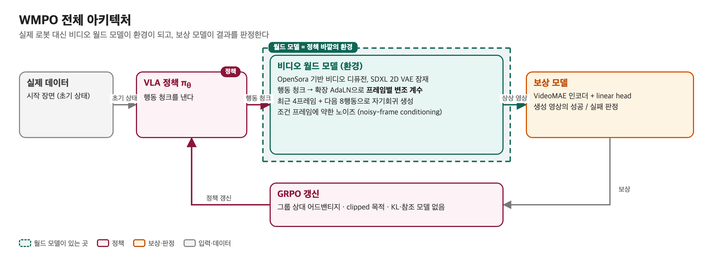{ width="820" }

    - **행동 조건부 비디오 월드 모델:** OpenSora에서 가져온 비디오 디퓨전 모델이다. 3D VAE 대신 SDXL의 2D VAE를 써서 디퓨전은 잠재에서 돌리고 프레임은 픽셀로 디코딩해 VLA에 준다. 행동 청크의 각 행동은 확장 AdaLN 블록을 거쳐 해당 프레임의 변조 계수가 된다. 최근 4프레임과 다음 8행동으로 자기회귀 생성한다.
    - **보상 모델:** VideoMAE 인코더에 linear head를 얹은 이진 성공 분류기다. 궤적 위로 윈도를 밀면서 한 클립이라도 임계값을 넘으면 성공으로 본다.
    - **정책:** 행동 청크를 내는 VLA다. 구조는 그대로 두고 파라미터만 갱신한다.

    **3. 학습 과정**

    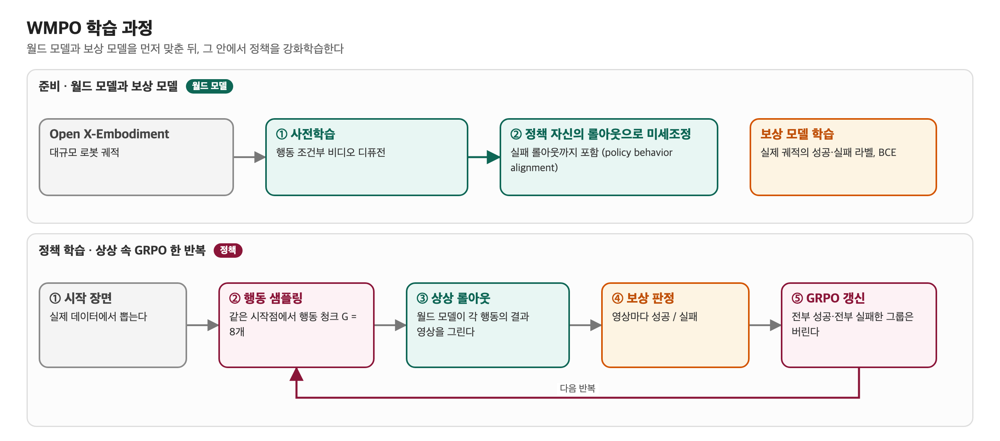{ width="820" }

    - **월드 모델과 보상 모델 준비:** 월드 모델은 Open X-Embodiment로 사전학습한 뒤 정책 자신의 롤아웃(실패 포함)으로 미세조정한다. 학습 때 조건 프레임에 약한 노이즈를 섞어 자기 생성 프레임에 대한 의존을 줄인다. 보상 모델은 실제 궤적의 성공·실패 라벨로 학습한다.
    - **정책 학습 한 반복:** ① 실제 데이터에서 시작 장면을 뽑는다. ② 현재 정책이 같은 시작점에서 행동 청크를 G = 8번 샘플링한다. ③ 월드 모델이 각 행동의 결과 영상을 그린다. ④ 보상 모델이 영상마다 성공·실패를 판정한다. ⑤ GRPO로 갱신한다.
    - **GRPO 세부:** 전부 성공하거나 전부 실패한 그룹은 버리고(dynamic sampling), 그룹 안에서 어드밴티지를 정규화하며, clipped 확률비 목적으로 몇 epoch 갱신한다. KL 페널티와 참조 모델은 없다.

    **4. 추론 과정**

    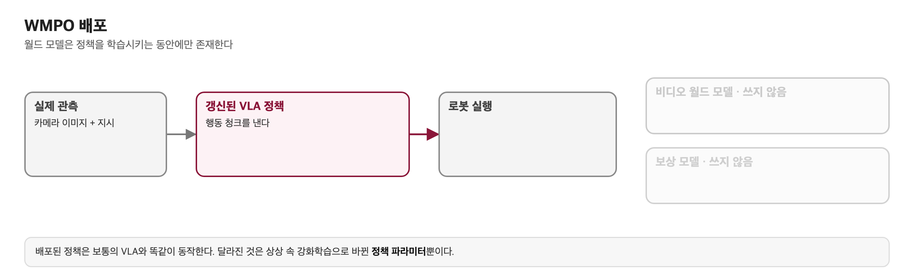{ width="820" }

    - 배포 때는 월드 모델과 보상 모델을 쓰지 않는다. 갱신된 VLA가 평소처럼 행동 청크를 낸다.

    **5. 월드 모델의 역할**

    | 위치 | 예측 대상 | 학습에서 하는 일 | 추론에서 하는 일 |
    | :-- | :-- | :-- | :-- |
    | 정책 바깥의 학습 환경 | 행동 청크를 실행한 뒤의 영상 | 실제 로봇 대신 상상 롤아웃을 만들고, 보상 모델이 그 영상을 판정한다 | 쓰이지 않는다. 정책을 학습시키는 동안에만 존재한다 |

    - 월드 모델이 정책의 일부가 아니라 "정책이 연습하는 세계"다. 그래서 정책이 실제로 가는 상황, 특히 실패 상황을 얼마나 충실히 재현하느냐가 학습 품질을 정한다.

    **6. 핵심 기술과 독창성**

    - **상상 속 on-policy GRPO:** 실제 롤아웃 대신 월드 모델 롤아웃에 GRPO를 건다. → 실제 로봇 상호작용 없이 탐색과 자기 교정의 이득을 얻어, 비교한 오프라인 DPO와 실제 환경 GRPO보다 성공률이 높았다.
    - **정책 자신의 롤아웃으로 월드 모델 미세조정:** 시뮬레이터가 정책의 실패 분포까지 덮게 한다. → 환각이 보상을 오염시키는 일이 줄었다.
    - **행동별 프레임 변조와 노이즈 증강:** 행동과 프레임의 정렬을 지키고 긴 롤아웃의 오차 누적을 줄였다.
    - **창발:** 끼우기에 실패해 충돌하면 들어 올려 재정렬한 뒤 다시 끼우는, 시연에 없던 교정 행동이 생겼다.
    - **한계:** 디퓨전 롤아웃 비용이 크고 보상 모델이 과제별 분류기다. 월드 모델을 RL 전에 맞춘 뒤 고정하므로 정책이 새로운 상황으로 가면 시뮬레이터가 따라가지 못한다. 바로 아래 2단계의 WoVR(대표 모델 ⑨)은 이 신뢰성 문제를 모델, 시작점, 갱신 루프 세 곳에서 푼다.

#### 2단계: 월드 모델과 함께하는 RL (RL with World Models)

시뮬레이터가 완벽하지 않다는 것을 인정하고, 정책과 월드 모델을 번갈아 개선한다.

$$
\phi_{k+1} \leftarrow \mathrm{UpdateWM}\big(\phi_k,\ \mathcal{D}_{\mathrm{real}} \cup \mathcal{D}_{\mathrm{policy}}(\pi_{\theta_k})\big), \qquad
\theta_{k+1} \leftarrow \mathrm{UpdatePolicy}\big(\theta_k,\ \hat{\mathcal{D}}(\phi_{k+1})\big)
$$

- **실패 롤아웃 기반 보정 (Failure-driven Correction):** 미래 관측과 보상을 함께 예측하면서, 정책이 실패한 롤아웃으로 시뮬레이터를 보정해 루프를 닫는다. 예: World-VLA-Loop.
- **교대 최적화 (Alternating Repair and Improvement):** 실제 데이터로 시뮬레이터를 수리하는 단계와 합성 데이터로 VLA를 개선하는 단계를 번갈아 돈다. 예: VLAW.
- **신뢰성 중심 공진화 (Reliability-aware Co-evolution):** 시뮬레이터의 신뢰성 자체를 병목으로 보고 모델, 롤아웃 시작점, 갱신 루프 세 곳을 손본다. 예: WoVR(대표 모델 ⑨).
- **초점의 이동:** "월드 모델 안에서의 강화학습"에서 "충실도와 행동 추종 정밀도를 계속 개선해야 하는 월드 모델과 함께하는 강화학습"으로 옮겨 간다.

???+ note "대표 모델 ⑨ WoVR (Jiang et al., 2026): 신뢰할 수 있는 시뮬레이터를 만드는 세 장치"
    **1. 문제와 핵심 아이디어**

    - **문제:** 월드 모델 안의 RL은 환각과 장기 오차가 보상 신호를 오염시키면 무너진다. 정책이 나아지면 가는 상황도 바뀌는데, 고정된 시뮬레이터는 그 변화를 따라가지 못한다.
    - **핵심 아이디어:** 시뮬레이터의 신뢰성을 병목으로 보고 세 곳을 손본다. 행동이 확실히 반영되는 월드 모델(①), 실패 직전 상태에서 시작하는 롤아웃(②), 정책과 함께 진화하는 갱신 루프(③)다.

    **2. 전체 아키텍처**

    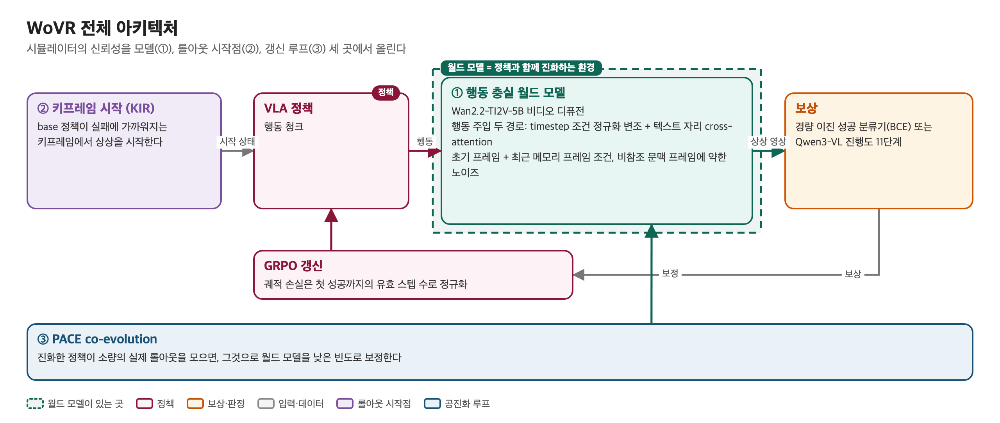{ width="820" }

    - **① 행동 충실 월드 모델:** Wan2.2-TI2V-5B 디퓨전 backbone이다. 행동은 두 경로로 들어간다. timestep 조건 정규화가 디노이징 특징을 변조하고, 행동 임베딩이 텍스트 자리의 cross-attention 임베딩을 대신한다. 자기회귀 단계마다 초기 프레임과 최근 메모리 프레임을 조건으로 쓴다.
    - **② Keyframe-Initialized Rollouts(KIR):** 상상 롤아웃을 항상 에피소드 첫 프레임에서 시작하지 않고, 일부는 과제 결정적 상태에 가까운 키프레임, 특히 현재 정책이 실패에 가까워지는 지점에서 시작한다. 과제마다 그 키프레임 인덱스를 고정한다.
    - **③ PACE co-evolution:** base 정책의 궤적으로 초기 월드 모델을 학습하고, 그 안에서 RL을 한 뒤, 진화한 정책이 제한된 추가 롤아웃을 수집해 낮은 빈도로 월드 모델을 보정한다.
    - **보상:** 경량 분류기가 BCE로 학습한 이진 성공 보상을 주거나, Qwen3-VL 기반 모델이 연속 4프레임과 과제 텍스트로 11단계 진행도를 예측해 [0, 1]로 정규화한다.

    **3. 학습 과정**

    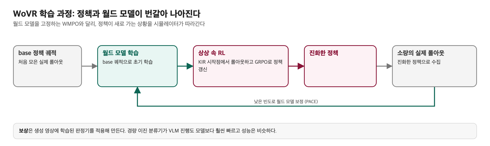{ width="820" }

    - **월드 모델 학습:** base 정책 궤적으로 학습하고, 학습 때 비참조 문맥 프레임에 약한 노이즈를 섞어 자기 생성 프레임에 대한 의존을 줄인다.
    - **정책 학습:** KIR로 정한 시작점에서 상상 롤아웃을 만들고 GRPO로 VLA를 갱신한다. 궤적 손실은 첫 성공까지의 유효 스텝 수로 정규화한다.
    - **공진화 루프:** RL 단계가 끝나면 진화한 정책의 실제 롤아웃을 소량 모아 월드 모델을 보정하고 다시 RL을 돈다.
    - 경량 분류기 보상이 VLM 진행도 보상보다 훨씬 빠르고 성능은 비슷하다.

    **4. 추론 과정**

    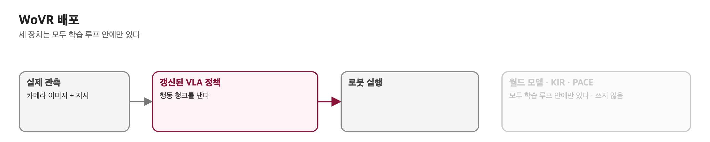{ width="820" }

    - 배포 때는 월드 모델 없이 갱신된 VLA만 돌린다. 세 장치는 모두 학습 루프 안에만 있다.

    **5. 월드 모델의 역할**

    | 위치 | 예측 대상 | 학습에서 하는 일 | 추론에서 하는 일 |
    | :-- | :-- | :-- | :-- |
    | 정책 바깥의 학습 환경. 정책과 번갈아 갱신된다 | 행동을 실행한 뒤의 영상 | 상상 롤아웃을 만들고, 진화한 정책의 롤아웃으로 주기적으로 보정된다 | 쓰이지 않는다 |

    - WMPO와 같은 "정책이 연습하는 세계"지만, 그 세계가 고정되지 않고 정책을 따라 함께 바뀐다. 서베이가 4-1절의 2단계, 즉 "월드 모델과 함께하는 RL"의 대표로 드는 이유다.

    **6. 핵심 기술과 독창성**

    - **두 경로 행동 주입과 문맥 노이즈:** → 명령과 어긋나거나 긴 롤아웃에서 무너지는 영상이 줄어, 보상이 실제 결과를 반영하게 됐다.
    - **KIR:** 실패 직전에서 롤아웃을 시작한다. → 결정적 구간의 학습 신호가 늘고 긴 예측의 오차 누적이 줄었다.
    - **PACE:** 정책과 함께 월드 모델을 낮은 빈도로 보정한다. → 월드 모델을 고정한 WMPO보다 시연이 적은 설정과 충분한 설정 모두에서 성공률이 높았고, 실제 두 로봇에서도 base 정책 대비 성공률이 크게 올랐다.
    - **한계:** 적지만 추가 실제 롤아웃이 필요하고, 보상 분류기가 과제별이며, 키프레임 위치를 과제마다 사람이 정한다.

### 4-2. 평가기로서의 월드 모델

**정책을 더 학습시키지 않고도, 월드 모델로 후보 행동·정책·체크포인트의 성공 가능성을 미리 판단한다.** 현재 관측과 지시, 하나 이상의 후보 행동을 받아 예측한 미래를 순위 매기기, 거부, 안전 필터링에 쓴다.

<figure markdown="span">
  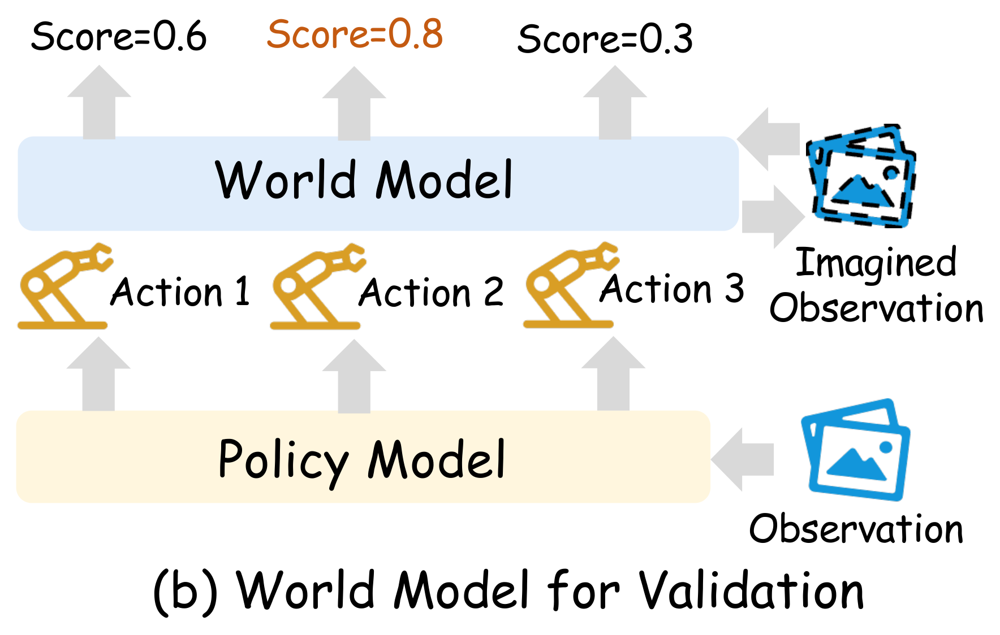{ width="580" }
  <figcaption>Figure 5(b). World model for validation. 정책이 낸 후보 행동마다 월드 모델이 미래를 상상해 점수를 매기고, 가장 높은 후보를 고른다 (source: 원문 Figure 5)</figcaption>
</figure>

#### 평가 방식

- **롤아웃 기반 후보 평가 (Rollout-based Candidate Evaluation):** 정책이 여러 행동 시퀀스를 제안하면 월드 모델이 각각의 미래를 예측하고 가장 좋은 결과를 고른다. 고정된 생성형 정책에 행동 조건부 월드 모델을 붙여 배포 시점에 순위를 매기거나, 상상 속에서 계획을 굴리고 고쳐 실행하는 폐루프 계획으로 넓히거나, 롤아웃으로 만든 선호쌍을 학습 신호로 쓴다. 예: GPC, IRASim(대표 모델 ⑫), World-in-World, DreamPlan.
- **MPC의 전이 동역학 (Transition Dynamics for MPC):** MPC(모델 예측 제어)는 모델로 몇 스텝 앞을 내다보며 행동 시퀀스를 최적화하고, 그중 첫 행동만 실행하기를 반복하는 제어 방식이다. 몇 개의 후보 중에서 고르는 데 그치지 않고, 월드 모델의 상상 궤적 안에서 행동 시퀀스를 직접 최적화한다. 잠재 공간에서 기울기 기반으로 계획하면 시연에 없던 전략을 찾을 수 있다. [MuZero](muzero.md)가 트리 탐색으로 하던 일의 연속 제어 버전이다. 예: TD-MPC2, LeWorldModel.
- **정책 평가기 (Policy Evaluator):** 서로 다른 정책과 같은 정책의 체크포인트들을 모두 상상 안에서 돌려 성공률로 순위를 매기고, 안전 감지에도 쓴다. 비디오 세계 시뮬레이터로 대규모 정책을 오프라인 평가하고 분포 밖 시험과 안전 점검을 하는 사례, 정책 평가를 핵심 용도로 정한 벤치마크도 같은 방식이다. 예: WorldEval(대표 모델 ⑩), Gemini Robotics 정책의 Veo 시뮬레이터 평가, WorldArena.
- **피드백 헤드 (Explicit Feedback Heads):** 시뮬레이터에 보상, 종료, 진행도 헤드를 붙여 상상 롤아웃을 평가 신호로 바꾼다. 예: World-Env, VLA-RFT, World-VLA-Loop, RISE.

???+ note "대표 모델 ⑩ WorldEval (Li et al., 2025): 정책을 벡터로 바꿔 월드 모델 안에서 평가한다"
    **1. 문제와 핵심 아이디어**

    - **문제:** 정책과 체크포인트가 많아지면 실제 로봇으로 모두 평가하기 어렵다. 월드 모델 안에서 평가하려면, 생성된 롤아웃이 그 정책의 실제 행동 스타일을 따라야 순위가 맞는다.
    - **핵심 아이디어:** 정책이 스스로 만든 내부 표현을 비디오 월드 모델의 조건으로 넣어 "그 정책이 수행하는 영상"을 만들고, VLM이 성공을 판정한다.

    **2. 전체 아키텍처**

    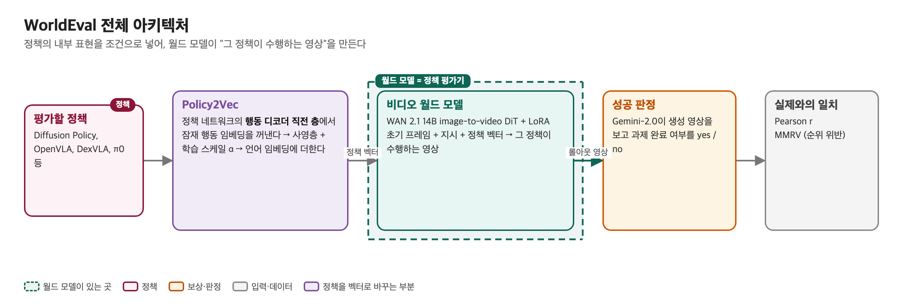{ width="820" }

    - **Policy2Vec:** 정책 네트워크에서 행동 디코더 직전의 잠재 행동 임베딩을 꺼내, 사영층으로 차원을 맞추고 학습 가능한 스케일 α를 곱해 언어 임베딩에 더한다.
    - **비디오 월드 모델:** WAN 2.1 14B image-to-video 디퓨전(DiT backbone)을 LoRA(원래 가중치는 두고 작은 추가 행렬만 학습하는 가벼운 미세조정)로 미세조정한다. 초기 프레임, 언어 지시, 정책 벡터를 받아 미래 로봇 영상을 만든다.
    - **판정:** Gemini-2.0이 생성 영상을 보고 과제 완료 여부를 yes/no로 답한다. 간단한 과제에는 생성 영상과 실제 영상의 FID를 싼 대리 지표로 쓴다.
    - **평가기 검증:** 실제 성공률과의 Pearson 상관과 순위 위반 정도(MMRV)로 평가기 자체를 검증한다.

    **3. 학습 과정**

    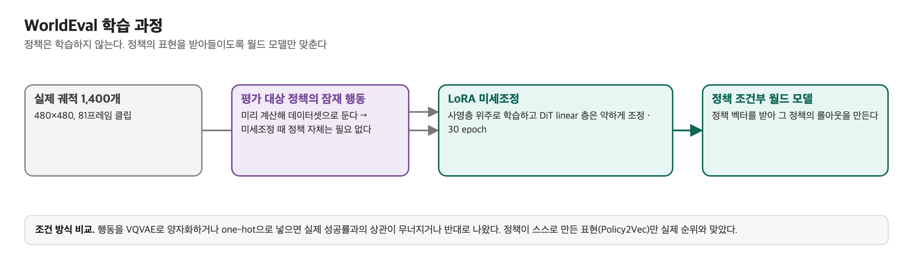{ width="820" }

    - 실제 궤적 1,400개로 LoRA를 학습한다. 주로 사영층을 학습하고 DiT linear 층은 약하게 조정하며, 480×480, 81프레임 클립으로 30 epoch 학습한다.
    - 평가 대상 정책들의 잠재 행동은 미리 계산해 데이터셋으로 둔다. 그래서 미세조정 때 정책 자체는 필요 없다.
    - 조건 방식으로 VQVAE 양자화, one-hot 인코딩과 비교해 Policy2Vec을 골랐다.

    **4. 추론 과정**

    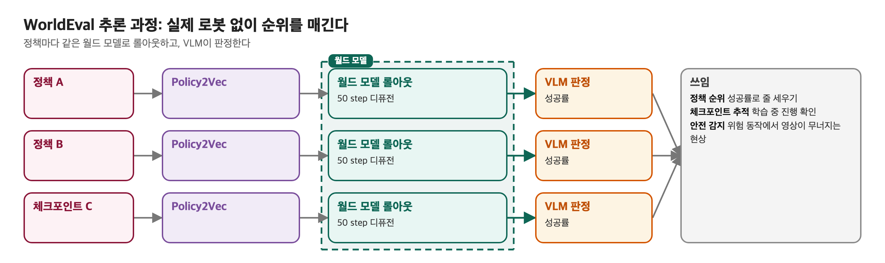{ width="820" }

    - 평가할 정책마다 Policy2Vec 벡터를 만들고, 50 step 디퓨전으로 롤아웃 영상을 생성한 뒤, VLM 판정으로 성공률을 낸다.
    - 정책들의 성공률로 순위를 매기고, 학습 체크포인트마다 반복해 학습 진행을 추적하며, 위험한 동작에서 영상이 무너지는 현상을 안전 신호로 쓴다.

    **5. 월드 모델의 역할**

    | 위치 | 예측 대상 | 학습에서 하는 일 | 추론에서 하는 일 |
    | :-- | :-- | :-- | :-- |
    | 정책 바깥의 평가기 | 특정 정책이 그 과제를 수행하는 영상 | 실제 궤적과 정책의 잠재 행동으로 LoRA 미세조정된다. 정책 학습에는 관여하지 않는다 | 정책과 체크포인트를 실제 로봇 대신 상상 속에서 돌려 순위를 매긴다 |

    - 월드 모델이 정책을 학습시키지 않고 판단만 한다. 4-2절이 말하는 정책 평가기의 대표다.

    **6. 핵심 기술과 독창성**

    - **Policy2Vec 조건화:** 정책의 내부 표현으로 행동 스타일을 전달한다. → 네 정책의 실제 성공률 순위를 거의 그대로 재현했고, 순위 위반이 real-to-sim 베이스라인보다 크게 줄었다. 행동을 양자화하거나 one-hot으로 넣으면 상관이 무너지거나 반대로 나왔다.
    - **체크포인트 추적:** 학습 중 체크포인트의 실제 성공률과 WorldEval 성공률이 함께 올라, 실제 로봇 없이 학습 진행을 볼 수 있다.
    - **안전 감지:** 위험한 동작에서 생성 영상이 무너진 사례를 들어 안전 신호로 쓸 가능성을 보였다. 단일 사례라는 점은 유의해야 한다.
    - **일반화:** 미학습 배경(사무실, 거실, 주방)에서도 실험실과 비슷한 상관을 유지했다.
    - **한계:** 판정이 VLM에 달려 있어 VLM이 못 보는 실패(접촉, 힘)는 놓칠 수 있고, 내부 표현을 꺼낼 수 없는 블랙박스 정책에는 쓸 수 없다.

#### 인접 방향: 잠재 계획과 타당성 검사 (Latent Planning & Plausibility Checking)

- 픽셀 미래를 그려 후보를 순위 매기는 대신 임베딩 공간에서 예측하고 계획한다. 잠재 행동 조건부 월드 모델이 이미지 목표만으로 zero-shot 로봇 계획을 하거나, 단순하고 빠른 end-to-end JEPA가 물리적으로 말이 안 되는 사건을 감지한다. 서베이는 이들을 위의 정책 평가기로 분류하지 않고, 잠재 공간에서 계획하고 물리적 타당성을 검사하는 도구로 따로 둔다. 예: [V-JEPA 2](v-jepa-2.md), V-JEPA 2.1, LeWorldModel.

!!! note "평가기가 쓸모 있으려면"
    평가기는 상상한 미래가 후보 행동의 인과적 결과를 보존할 때만 쓸모가 있다. Ctrl-World는 행동에 충실한 롤아웃이 상상 속 정책 평가를 뒷받침할 수 있음을 보여 이 연결을 명시했고, WoVR은 반대 방향의 경고를 준다. 환각과 장기 오차는 화질만 떨어뜨리는 것이 아니라 평가 신호 자체를 오염시킨다. 롤아웃이 실제 실행을 따라가는 순위·선택·거부를 뒷받침할 만큼 신뢰할 수 있느냐가 관건이다. 5-2절은 영상이 명령한 행동을 정확히 따르게 만드는 방법을 다룬다.

---

<!-- 발표: 37:30 시작, 6분. 대표 모델 ⑪ DreamGen, ⑫ IRASim. 밀리면 5-3은 첫 문장만 말한다.
     화면: Figure 6, 네 단계 표, 5-5 다섯 항목. 접힌 원문 6절(내비게이션·자율주행)은 생략한다. -->

## 5. Robotic Video World Model: 능력으로 나눈 네 단계

**들어가며.** 3절과 4절의 많은 방법이 비디오 생성 모델을 월드 모델로 썼다. 5절은 그 비디오 월드 모델 자체를 놓고, "얼마나 실행 가능한 미래를 만드는가"라는 능력 기준으로 네 단계를 나눈다. 로봇 비디오 생성은 일반 비디오 합성보다 훨씬 무거운 요구를 받는다. 예측한 미래는 시각적으로 그럴듯할 뿐 아니라 시간적으로 일관되고 행동과 맞고 물리적으로 믿을 만하며 결정에 쓸모 있어야 한다.

- 서베이는 로봇 비디오 생성을 지각 생성 문제가 아니라 정책 학습, 계획, 평가, 시뮬레이션, 데이터 생성을 떠받치는 **시각적으로 명시적인 월드 모델을 만드는 수단**으로 본다.
- CogVideoX 같은 대규모 비디오 backbone이 장기·고화질 시공간 생성을 규모 있게 배울 수 있음을 보인 것이 중요한 배경이다.
- 언어 조건도 고수준 행동으로 보므로, 저수준 행동 조건부 롤아웃만이 아니라 텍스트나 과제로 유도된 시각 예측도 로봇 비디오 생성에 포함된다.

<figure markdown="span">
  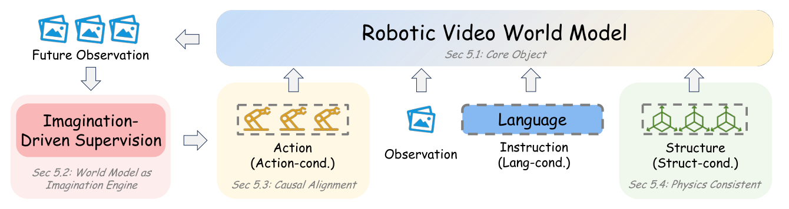{ width="760" }
  <figcaption>Figure 6. 핵심 객체 위에 상상, 행동 조건, 구조 조건이 쌓인다. 그림 속 Sec 번호는 원문 기준이며 이 페이지의 5-1(상상), 5-2(행동 제어), 5-3(구조 인식)에 해당한다 (source: 원문 Figure 6)</figcaption>
</figure>

| 단계 | 묻는 질문 | 대표 | 주 용도 |
| :-- | :-- | :-- | :--: |
| Imagination-based | 미래를 그려 감독 신호로 쓸 수 있나 | UniPi, Dreamitate, DreamGen | Plan. / Data |
| Action-controllable | 명령한 행동을 충실히 따르나 | IRASim, Ctrl-World, EVA | Eval. / Sim. |
| Structure-aware | 접촉·기하·다시점 구조를 보존하나 | Mask2IV, TesserAct, RoboVIP | Data / Sup. |
| Foundation video WM | 재사용 가능한 기반층인가 | Vid2World, DreamDojo, Cosmos Predict 2.5 | Sim. / Data |

원문 Table 2를 줄인 표다. 전체 목록과 각 방법이 과제·행동·구조 조건 중 무엇을 지원하는지는 부록에 있다.

### 5-1. 상상 엔진: 비디오로 감독 신호를 늘린다

**첫 단계는 강한 생성 prior로 미래의 과제 수행을 합성하고, 그 상상을 로봇 제어의 감독 신호로 바꾼다.** 비디오 모델의 가치는 인상적인 클립이 아니라 수집한 로봇 궤적의 좁은 범위 바깥으로 감독을 넓힌다는 데 있다.

- **시각 계획 기반 실행 (Visual Plan Execution):** 언어를 예측 시각 궤적으로 번역하고 그 영상을 실행 계획으로 쓴다. 과제별 사람 시연으로 비디오 디퓨전 모델을 미세조정해, 새 장면에서 합성한 수행 영상을 실제 로봇의 행동 안내로 쓰기도 한다. 예: UniPi, Video Language Planning, Dreamitate.
- **구성적 지시 분해 (Compositional Instruction Grounding):** 지시를 재사용 가능한 원시 요소로 분해해 보지 못한 물체·행동 조합으로 일반화하거나, action tree와 깊이·의미 안내로 지시 따르기와 시간·물리 일관성을 높인다. 예: RoboDreamer, ManipDreamer.
- **학습 가능한 디지털 트윈 (Learnable Digital Twin):** 상상을 조작 가능한 장면 표현이나 물리 월드 모델로 복원해, 그 안에서 시연을 추가로 생성하거나 물체 중심 잔차 RL로 행동을 접지한다. 예: DreMa, PhysWorld.
- **합성 시연 생성 (Synthetic Demonstration Generation):** 강한 비디오 생성기를 목표 로봇에 적응시켜 신경 궤적을 합성하고, 역동역학이나 잠재 행동으로 행동 라벨을 붙인다. 예: DreamGen(대표 모델 ⑪).

???+ note "대표 모델 ⑪ DreamGen (Jang et al., 2025): 비디오 월드 모델로 신경 궤적을 만든다"
    **1. 문제와 핵심 아이디어**

    - **문제:** 사람이 모은 로봇 시연은 적고 과제와 환경이 좁다. 시연에 없는 동작이나 환경으로 정책을 넓히려면 그만큼 새 시연이 필요하다.
    - **핵심 아이디어:** 대규모 비디오 생성 모델의 일반화를 빌려 로봇이 새 과제를 수행하는 영상을 만들고, 그 영상에 유사 행동을 붙여 "신경 궤적(neural trajectory)"으로 정책을 학습한다.

    **2. 전체 아키텍처**

    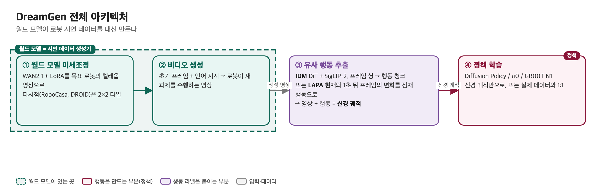{ width="820" }

    - **비디오 월드 모델:** WAN2.1을 LoRA로 목표 로봇의 텔레옵 영상에 적응시킨다. 다시점 데이터셋(RoboCasa, DROID)은 카메라 시점을 2×2 격자로 타일링한다.
    - **유사 행동 추출기:** 두 가지 중 하나를 쓴다. 역동역학 모델(IDM)은 SigLIP-2 시각 인코더를 가진 diffusion transformer로 프레임 쌍에서 행동 청크를 예측하고, LAPA 잠재 행동 모델은 현재 프레임과 1초 뒤 프레임의 변화를 인코딩한다.
    - **정책:** Diffusion Policy, π0, GR00T N1 같은 일반 정책을 그대로 쓴다.

    **3. 학습 과정**

    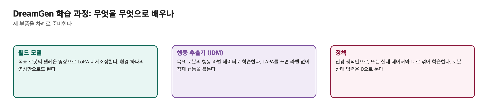{ width="820" }

    - **월드 모델:** 목표 로봇의 텔레옵 영상으로 LoRA 미세조정한다.
    - **행동 추출기:** IDM은 목표 로봇의 행동 라벨 데이터로 학습한다. LAPA를 쓰면 라벨 없이 잠재 행동을 뽑는다.
    - **정책:** 생성한 신경 궤적만으로, 또는 실제 데이터와 1:1로 섞어 학습한다. 로봇 상태 입력은 0으로 둔다.

    **4. 추론 과정**

    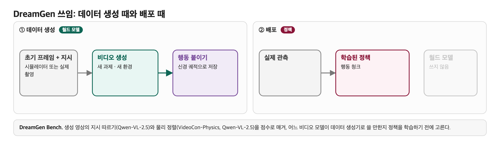{ width="820" }

    - **데이터 생성:** 초기 프레임(시뮬레이터에서 가져오거나 실제로 촬영)과 언어 지시로 영상을 만들고, 행동 추출기로 행동을 붙여 신경 궤적을 쌓는다.
    - **배포:** 학습된 정책만 돌린다. 월드 모델과 행동 추출기는 쓰지 않는다.
    - **DreamGen Bench:** 생성 영상의 지시 따르기(Qwen-VL-2.5)와 물리 정렬(VideoCon-Physics, Qwen-VL-2.5)을 점수로 매겨, 어느 비디오 모델이 데이터 생성기로 쓸 만한지 정책 학습 전에 고른다.

    **5. 월드 모델의 역할**

    | 위치 | 예측 대상 | 학습에서 하는 일 | 추론에서 하는 일 |
    | :-- | :-- | :-- | :-- |
    | 정책 바깥의 데이터 생성기 | 로봇이 새 과제를 수행하는 영상 | 생성 영상이 행동 라벨과 함께 정책의 학습 데이터가 된다 | 쓰이지 않는다 |

    - 월드 모델이 정책 학습의 데이터 공급원이다. 1-3절의 세 능력 중 data amplification을 가장 직접적으로 구현한다.

    **6. 핵심 기술과 독창성**

    - **신경 궤적:** 영상에 유사 행동을 붙여 시연처럼 쓴다. → 시뮬레이션에서 신경 궤적 수를 늘릴수록 성능이 꾸준히 올랐고, 신경 궤적만으로도 정책이 과제를 일부 수행했다. 실제 로봇 세 종류에서는 과제당 실제 궤적 십여 개에 신경 궤적을 더해 성공률이 올랐다.
    - **비디오 모델의 일반화 활용:** 환경 하나로만 미세조정한 비디오 모델로 새 동작과 새 환경의 영상을 만든다. → pick-and-place만 배운 정책이 본 적 없는 동작과 완전히 새 환경에서도 과제를 수행했다.
    - **DreamGen Bench:** 벤치마크 점수가 다운스트림 성능과 양의 상관을 보였다.
    - **한계:** 생성 영상의 물리 오류와 행동 추출 오차가 학습 데이터에 그대로 들어가고, 로봇 상태 없이 학습해 상태 정보가 중요한 과제에는 불리하다.

### 5-2. 행동 제어 가능: 명령한 대로 움직이는 미래

**둘째 단계는 상상한 감독에서 명시적 제어 가능성으로 초점을 옮긴다.** 질문이 "그럴듯한 미래 비디오를 만들 수 있나"에서 "생성된 미래가 명령한 행동 시퀀스를 조작 추론과 제어에 쓸 만큼 정밀하게 따르나"로 바뀐다. 행동 개입에 충실하게 반응하지 않는 롤아웃은 아무리 그럴듯해도 쓸모가 제한되기 때문이다.

- **프레임 단위 행동 조건화 (Frame-level Action Conditioning):** 로봇 조작을 궤적에서 비디오로 가는 문제로 정식화하고, Transformer 블록마다 행동별 조건을 넣어 개별 행동과 해당 프레임의 정렬을 강화한다. 예: IRASim(대표 모델 ⑫).
- **장기·접촉 상호작용 (Long-horizon & Contact-rich Interaction):** 장기 다과제 조작의 의미·시간 일관성을 지키거나, 팔과 물체의 결합 운동을 함께 모델링해 접촉이 많은 상호작용의 충실도를 높인다. 예: RoboEnvision, RoboMaster.
- **정책 연동 롤아웃 (Policy-in-the-loop Rollout):** 다시점 공동 예측, 프레임 단위 행동 제어, 메모리 기반 장기 생성을 결합해 예측한 미래가 정책 평가와 표적 개선을 모두 뒷받침하게 하거나, 행동 조건부 다시점 생성기를 데이터 엔진이자 평가기로 쓴다. 예: Ctrl-World, EnerVerse-AC.
- **상호작용 안정성과 실행 가능성 정렬 (Interaction Stability & Executability Alignment):** 고주파·장기 정책 조건부 상호작용을 안정적으로 생성하거나, 역동역학 보상으로 post-training해 시각적으로 그럴듯한 롤아웃과 실행 가능한 행동 사이의 간극을 좁힌다. 예: Interactive World Simulator, EVA.
- **바뀐 기준:** 로봇 비디오 월드 모델의 충실도가 사실성만이 아니라 행동 충실도, 제어 가능한 상호작용, 폐루프 결정에의 유용성으로 측정되기 시작한다.

???+ note "대표 모델 ⑫ IRASim (Zhu et al., 2025): 행동 하나에 프레임 하나를 맞추는 프레임 단위 조건화"
    **1. 문제와 핵심 아이디어**

    - **문제:** 행동 조건부 영상 생성이 그럴듯해도, 영상이 명령한 행동을 프레임 단위로 정확히 따르지 않으면 계획이나 평가에 쓸 수 없다.
    - **핵심 아이디어:** 로봇 조작을 "궤적을 주면 그 궤적을 실행하는 영상을 만드는" 문제로 정식화하고, 행동 조건을 비디오 전체가 아니라 프레임마다 건다.

    **2. 전체 아키텍처**

    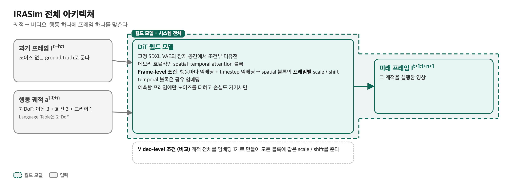{ width="820" }

    - **정식화:** 과거 프레임 $I_{t-h:t}$와 행동 $a_{t:t+n}$에서 미래 프레임 $I_{t+1:t+n+1}$을 예측한다. 팔 행동은 이동 3, 회전 3, 그리퍼 1의 7자유도이고, Language-Table은 2자유도다.
    - **DiT 월드 모델:** 고정 SDXL VAE의 잠재 공간에서 도는 조건부 디퓨전 모델이다. backbone은 메모리 효율적인 spatial-temporal attention을 가진 Diffusion Transformer다.
    - **Frame-level 조건(제안):** 행동마다 임베딩을 만들고 timestep 임베딩을 더해 spatial 블록의 프레임별 scale과 shift를 만든다. temporal 블록은 공유 임베딩을 쓴다.
    - **Video-level 조건(비교):** 궤적 전체를 임베딩 하나로 만들어 모든 블록에 같은 scale과 shift를 준다.

    **3. 학습 과정**

    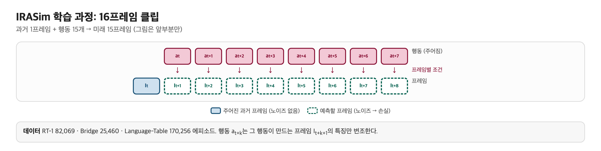{ width="820" }

    - RT-1 82,069 에피소드, Bridge 25,460 에피소드, Language-Table 170,256 에피소드로 학습한다.
    - 샘플은 16프레임 클립이다. 과거 프레임 1장과 행동 15개로 다음 15프레임을 예측한다.
    - 과거 프레임은 노이즈 없는 ground truth로 두고, 예측할 프레임에만 노이즈를 더하며 손실도 거기서만 계산한다.

    **4. 추론 과정**

    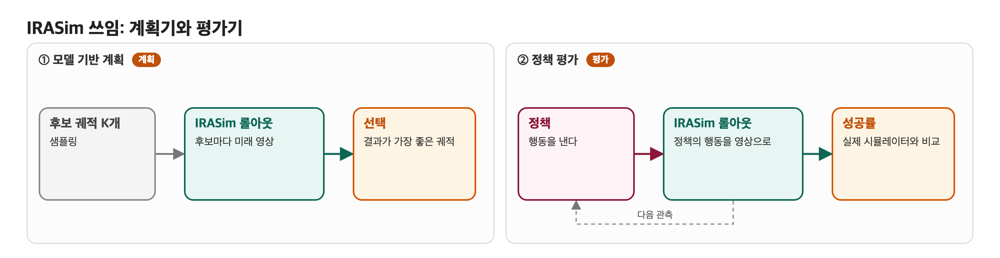{ width="820" }

    - **계획:** 후보 궤적을 여러 개 샘플링해 각각을 IRASim으로 굴리고, 예측 결과가 가장 좋은 궤적을 고른다.
    - **정책 평가:** 정책을 IRASim 안에서 실행해 성공률을 잰다.

    **5. 월드 모델의 역할**

    | 위치 | 예측 대상 | 학습에서 하는 일 | 추론에서 하는 일 |
    | :-- | :-- | :-- | :-- |
    | 월드 모델 자체가 시스템 (정책 바깥의 시뮬레이터) | 주어진 행동 궤적을 실행한 미래 영상 | 로봇 궤적 데이터로 행동 충실도를 학습한다 | 후보 궤적을 비교하는 계획기와, 정책을 돌려 보는 평가기로 쓰인다 |

    - 정책이 없는 순수 월드 모델이다. 행동에 충실하기만 하면 그대로 4-2절의 평가기와 계획기가 될 수 있음을 보였다.

    **6. 핵심 기술과 독창성**

    - **프레임 단위 행동 조건:** 행동과 프레임을 1:1로 묶는다. → 세 데이터셋 모두에서 video-level 조건과 기존 비디오 디퓨전 베이스라인보다 생성 오차가 줄고 화질이 올랐다.
    - **예측 프레임에만 노이즈와 손실:** 과거를 다시 그리지 않아 모델 용량을 미래 예측에 쓴다.
    - **계획기로서의 쓰임:** Push-T에서 후보 궤적을 시뮬레이션해 고르는 것만으로 목표 도달 정확도가 크게 올랐다.
    - **평가기로서의 쓰임:** LIBERO 정책들의 IRASim 안 성공률이 MuJoCo 시뮬레이터의 성공률과 거의 일치했다.
    - **한계:** 프레임마다 행동이 있어야 하므로 행동 라벨 없는 영상은 쓸 수 없고, 디퓨전 생성이라 롤아웃이 느리다.

### 5-3. 구조 인식: 마스크, 기하, 다시점을 조건으로

**셋째 단계는 저차원 행동 시퀀스만이 아니라 마스크, 기하, 시점, 정체성 단서 같은 더 풍부한 중간 구조를 조건으로 넣어 접촉 관계와 장면 구조를 보존한다.** 모델이 그럴듯한 움직임을 합성하는 데 그치지 않고 명시적 상호작용 구조를 지키도록 요구할 때 로봇 비디오 생성이 훨씬 유용해진다는 직관이다.

- **상호작용 궤적 조건화 (Interaction-trajectory Conditioning):** 먼저 행위자와 물체의 상호작용 궤적을 예측한 뒤 그 궤적을 조건으로 비디오를 생성해, 조밀한 마스크 없이도 상호작용 결과를 제어한다. 예: Mask2IV.
- **4D 기하 표현 (4D Geometric Representation):** 표현 공간을 2D 비디오에서 RGB, 깊이, 법선 위의 4D embodied 월드 모델로 넓혀 공간 일관성을 높이고 역동역학과 정책 학습을 강화한다. 예: TesserAct.
- **다시점 정체성 일관성 (Multi-view Identity Consistency):** 시각 정체성 프롬프팅으로 시간적으로 일관된 다시점 영상을 만들어 조작 데이터 증강에 쓴다. 예: RoboVIP.
- **심볼릭 구조 (Symbolic Structure):** 영상 대신 술어와 물체 관계의 전이를 예측한다. 픽셀보다 압축되고 구성적인 구조를 조건이자 예측 대상으로 쓴다는 점에서 이 단계의 방법들과 목표가 같다. 예: VisualPredicator, ExoPredicator.

### 5-4. 기반 모델: 비디오 backbone을 재사용 가능한 월드 모델로

**넷째 단계는 로봇 비디오 월드 모델을 대규모 비디오 backbone을 적응시켜 만든 범용 상호작용 예측기로 다시 해석한다.** 비디오 생성이 더 이상 다운스트림 증강 도구가 아니라 시뮬레이션, 계획, 평가, 대규모 로봇 데이터 생산을 위한 재사용 가능한 기반층이 된다.

- **사전학습 비디오 모델의 월드 모델화 (Video-to-World Conversion):** 로봇 월드 모델을 처음부터 학습하는 대신, 사전학습 비디오 디퓨전 모델을 행동 조건부 롤아웃에 맞는 상호작용 월드 모델로 체계적으로 변환한다. 예: Vid2World.
- **범용 월드 모델 플랫폼 (World Model Platforms):** 비디오 월드 모델링과 행동 디코딩을 통합한 조작 플랫폼, 그리고 재사용 가능한 world backbone을 공개하는 흐름이다. 예: Genie Envisioner, Cosmos Predict 2.5([Cosmos](cosmos.md)의 후속), UnifoLM-WMA-0.
- **사람 영상 사전학습과 잠재 행동 (Human-video Pretraining with Latent Actions):** 대규모 사람 1인칭 영상으로 사전학습하고, 프레임 사이 변화를 잠재 행동으로 삼아 라벨 없는 사람 상호작용과 로봇 제어를 잇는다. [Genie](genie.md)가 행동 라벨 없는 게임 영상에서 잠재 행동을 배운 방식을 로봇 조작에 적용한 것이다. 예: DreamDojo.
- **상호작용 데이터 스케일링과 데이터 엔진 (Interaction-data Scaling & Data Engines):** 물리 직관은 수동적인 비디오 관찰만으로 얻을 수 없다며 방대한 로봇 상호작용 궤적으로 대규모 월드 모델을 학습하거나, 제어 가능한 비디오 분기와 물리 기반 3D 분기를 결합해 데이터 엔진으로 쓰거나, 물리 정렬과 행동 제어 가능성을 겨냥한 기반 모델을 만든다. 예: WoW, GigaWorld-0, ABot-PhysWorld.

### 5-5. 정리: 남은 병목은 실행 가능한 미래

**남은 병목은 사실적인 미래가 아니라, 행동과 인과적으로 맞고 오래 가도 물리적으로 자기일관적이며 실행 가능한 미래다.** 서베이가 네 단계를 거쳐 짚는 핵심 과제는 다섯 가지다.

- 로봇 행동과 인과적으로 정렬될 것
- 긴 시간 동안 물리·운동학적으로 자기일관적일 것
- 시점과 embodiment에 걸쳐 일관될 것
- 상호작용 아래에서 안정적일 것
- 실제 정책 개선을 뒷받침할 만큼 실행 가능할 것

6절은 이 조건을 중심으로 세 관점을 한데 모아 정리한다.

??? note "원문 6절: 내비게이션과 자율주행으로의 확장 (발표에서는 생략)"
    **내비게이션.** 심한 부분 관측 아래에서 아직 보이지 않는 공간, 물체, 경로를 추론하는 추상화로 월드 모델을 쓴다. 반응형 다음 걸음 결정 대신 행동 조건부 미래 관측을 상상하고, 미래를 반영한 계획 상태를 만들고, 상상 궤적에서 가치 신호를 뽑는다.

    - **보이지 않는 관측의 예측:** Pathdreamer는 아직 방문하지 않은 실내 시점의 360° RGB·깊이·의미 관측을 생성해, 상상 관측으로 계획하면 실제 미래 관측으로 계획하는 것과의 격차를 크게 줄일 수 있음을 보였다.
    - **지시 조건부 상상:** VISTA는 imagine-and-align 전략을, VISTAv2는 후보 행동 아래 1인칭 미래를 굴려 온라인 가치 지도로 투영하는 내비게이션 월드 모델을 제안했다.
    - **제어 가능한 비디오 예측기:** NWM은 제어 가능한 비디오 생성을 내비게이션 월드 모델로 정식화하고, SparseVideoNav는 조밀한 장기 롤아웃을 희소 미래 생성으로 바꿔 배포를 빠르게 하며, EgoWM은 인터넷 규모 비디오 디퓨전 모델을 가벼운 조건화로 행동 조건부 1인칭 월드 모델로 바꾼다.
    - **교훈:** 월드 모델의 가치는 사실성보다 숨은 미래 구조를 계획, 궤적 순위, 가치 추정에 쓸 수 있는 형태로 드러내는 데 있다.

    **자율주행.** 월드 모델이 인지, 예측, 계획, 시뮬레이션을 점점 하나로 묶는다. 조작보다 장기 예측, 다중 에이전트 상호작용, 구조화된 기하, 안전이 중요한 계획에 대한 요구가 강해서, 주행 월드 모델은 이미지, 다시점, occupancy, 압축 잠재 공간에서 미래로 변하는 장면 표현을 배워 계획이나 end-to-end 결정에 쓴다.

    - **압축·구조화 상태:** MILE은 기하 귀납 편향을 가진 잠재 동역학 모델을, OccWorld는 3D occupancy 공간에서 자차 움직임과 장면 변화를 계획에 맞는 형태로 표현했다.
    - **생성형 월드 모델:** [GAIA-1](gaia-1.md)은 주행 월드 모델링을 비디오·텍스트·행동 토큰의 멀티모달 시퀀스 모델링으로, DriveDreamer는 구조 제약을 둔 디퓨전으로 실제 주행 데이터의 복잡한 교통 변화를 담았다.
    - **계획 지향과 통합:** Drive-WM은 제어 가능한 다시점 미래 비디오와 이미지 기반 보상으로 더 안전한 궤적을 고르고, UniDWM은 구조·동역학 인식 잠재 세계 표현을 인지·예측·계획의 통합 기반으로 삼으며, DriveWorld-VLA는 잠재 세계 상태를 계획기의 결정 상태로 써서 픽셀 롤아웃 없이 행동 조건부 상상으로 제어를 안내한다.
    - **스케일링과 조종:** DriveVLA-W0은 월드 모델링을 통한 미래 이미지 예측이 저차원 행동 감독만으로는 얻을 수 없는 조밀한 자기 감독을 주어 end-to-end 주행 VLA의 스케일링을 돕는다고 보고하고, SteerVLA는 고수준 VLM을 의미적 월드 모델로 보고 long-tail 주행 상황에서 저수준 VLA 정책을 조종한다.
    - **공통 직관:** 안전한 주행은 현재 장면 인식만이 아니라 자차 행동과 주변 교통 아래에서 장면이 어떻게 변할지에 대한 추론을 요구한다.

---

<!-- 발표: 43:30 시작, 2분 30초 + 토론. 마지막 절. 표를 위에서부터 한 줄씩 짚고, 표 아래 세 항목으로 마무리한다. -->

## 6. 정리: 세 관점이 모이는 곳

**세 관점은 한 결론으로 모인다. 로봇에게 쓸모 있는 월드 모델은 그럴듯한 영상이 아니라, 행동에 따라 달라지는 실행 가능한 미래를 예측한다.**

| 관점 | 월드 모델의 자리 | 오늘 본 대표 모델 | 정리 |
| :-- | :-- | :-- | :-- |
| 3절 정책 안에서 | 정책의 일부 | ① UniPi, ② VPP, ③ UVA, ④ Cosmos Policy, ⑤ Motus, ⑥ WorldVLA, ⑦ VLA-JEPA | 미래 영상을 끝까지 그리는 분리형에서 잠재 공간 예측까지, 예측이 정책 안으로 깊이 들어올수록 추론 때 그리는 미래는 줄어든다 |
| 4절 정책 바깥에서 | 정책이 연습하는 환경, 정책을 채점하는 평가기 | ⑧ WMPO, ⑨ WoVR, ⑩ WorldEval | 시뮬레이터가 행동의 결과를 얼마나 충실히 따르는지가 학습과 평가의 품질을 정한다 |
| 5절 비디오 월드 모델 자체 | 데이터 생성기, 시뮬레이터, 재사용 가능한 기반층 | ⑪ DreamGen, ⑫ IRASim | 묻는 질문이 그럴듯한 미래에서 명령한 행동을 따르는 미래로, 다시 여러 용도에 재사용하는 기반층으로 옮겨 간다 |

- **공통 흐름:** 월드 모델은 보조 예측기에서 로봇 학습과 결정 루프의 중심으로 들어오고 있다(2-1절).
- **공통 조건:** 어느 쪽이든 행동과 인과적으로 맞는 미래를 내야 한다. 그렇지 않으면 정책은 틀린 미래에서 행동을 읽고(3-1절), 강화학습은 오염된 보상으로 배우고(⑨ WoVR), 평가기는 오염된 신호로 순위를 매긴다(4-2절). 5-5절이 남은 병목을 실행 가능한 미래로 꼽은 이유다.
- **열린 질문:** 픽셀, 잠재 표현, 심볼 가운데 어떤 예측 기반이 제어에 가장 효과적인지는 서베이도 결론을 내리지 않는다. 비디오 backbone이 같은 규모의 VLM보다 일관되게 낫다는 증거도 아직 없다(3-2절).

---

## 부록: 분류별 전체 방법 목록

??? note "3절 World Model for Policy 전체 목록 (원문 Table 1)"
    | 패러다임 | 방법 | 추론 시 미래 생성 | Backbone | 결합 |
    | :-- | :-- | :-- | :--: | :-- |
    | IDM-style | UniPi | 명시적 비디오 롤아웃 | VGM | Decoupled |
    | | VidMan | 명시적 비디오 롤아웃 | VGM | Decoupled |
    | | Vidar | 명시적 비디오 롤아웃 | VGM | Decoupled |
    | | Gen2Act | 명시적 사람 비디오 롤아웃 | VGM | Decoupled |
    | | VPP | 잠재 예측 특징 | VGM | Decoupled |
    | | Video2Act | 잠재 예측 특징 | VGM | Decoupled |
    | | MimicVideo | 잠재 시각 계획 | VGM | Decoupled |
    | | TC-IDM | 구조화된 실행 계획 | VGM | Decoupled |
    | | LVP | 시각 계획 | VGM | Decoupled |
    | | Say-Dream-ACT | 비디오 프롬프트 | VGM | Decoupled |
    | Single-backbone | UVA | 공동 잠재 예측 | VGM | Shared backbone |
    | | UWA | 공동 디퓨전 과정 | VGM | Shared backbone |
    | | VideoVLA | 공동 비디오 롤아웃 | VGM | Shared backbone |
    | | VideoPolicy | 비디오 정책 기반 | VGM | Shared backbone |
    | | Cosmos Policy | 행동·상태·가치 병렬 출력 | VGM | Shared backbone |
    | | DreamZero | 청크 단위 공동 롤아웃 | VGM | Shared backbone |
    | | UD-VLA | 동기 디노이징 | VGM | Shared backbone |
    | | GigaWorld-Policy | 선택적 시각 분기 | VGM | Shared backbone |
    | MoE / MoT | GE-Act | 잠재 시각 안내 | VGM | Expert fusion |
    | | Motus | 전문가 롤아웃 | VGM | MoT fusion |
    | | LingBot-VA | 시각 예측 문맥 | VGM | MoT fusion |
    | | BagelVLA | 1-step 시각 foresight | VGM | MoT fusion |
    | | Fast-WAM | 학습 때 비디오, 추론 때 생략 | VGM | MoT fusion |
    | | LDA-1B | 잠재 동역학만 | VGM | Expert fusion |
    | | FRAPPE | 잠재 표현 정렬 | VGM | Parallel experts |
    | | DiT4DiT | 잠재 비디오 안내 | VGM | Expert fusion |
    | Unified VLA | GR-1 | 미래 이미지 예측 | UMM | Joint co-training |
    | | UP-VLA | 미래 이미지 예측 | UMM | Joint co-training |
    | | WorldVLA | 미래 이미지(주로 학습 때) | UMM | Joint co-training |
    | | DreamVLA | 구조화된 세계 지식 | UMM | Joint co-training |
    | | UniVLA | 잠재 월드 모델링 | UMM | Joint co-training |
    | | CoWVLA | 잠재 동역학 | UMM | Joint co-training |
    | | F1 | 시각 foresight | UMM | Unified MoT |
    | | InternVLA-A1 | 잠재 foresight | UMM | Unified MoT |
    | | HALO | 시각 하위 목표 예측 | UMM | Unified multi-expert |
    | | TriVLA | 에피소드 동역학 | UMM | Multi-system |
    | Latent-space WM | FLARE | 잠재 정렬 | MLLM | Latent internalization |
    | | VLA-JEPA | 잠재 타깃 예측 | MLLM | Latent internalization |
    | | JEPA-VLA | 예측 임베딩 | MLLM | Latent internalization |
    | | WoG | 미래 조건만 | MLLM | Latent internalization |
    | | DIAL | 잠재 시각 foresight | MLLM | Latent internalization |

??? note "4절 World Model as Simulator 전체 목록"
    - **RL 1단계 (월드 모델 안에서 RL):** UniSim, World-Env, VLA-RFT, DiWA, World4RL, WorldGym(World-Gymnast), PlayWorld, RehearseVLA, WMPO, ProphRL, RISE, GigaBrain-0.5M\*
    - **RL 2단계 (월드 모델과 함께 RL, co-evolution):** World-VLA-Loop, VLAW, WoVR
    - **평가 ① 롤아웃 기반 후보 평가:** GPC, IRASim, World-in-World, DreamPlan
    - **평가 ② MPC 전이 동역학:** TD-MPC2, LeWorldModel
    - **평가 ③ 정책 평가기:** Evaluating Gemini Robotics Policies in a Veo World Simulator, WorldEval, WorldArena
    - **평가 ④ 피드백 헤드:** World-Env, VLA-RFT, World-VLA-Loop, RISE
    - **인접 방향 (잠재 예측·계획):** V-JEPA 2, V-JEPA 2.1, LeWorldModel
    - **신뢰성 경고:** Ctrl-World (action-faithful 롤아웃), WoVR (환각이 평가 신호를 오염)

??? note "5절 Robotic Video World Model 전체 목록 (원문 Table 2)"
    | 그룹 | 방법 | Task-cond. | Action-cond. | Structure-aware | Foundation-scale | 주 용도 |
    | :-- | :-- | :--: | :--: | :--: | :--: | :--: |
    | Imagination-based | UniPi | ✓ | – | – | ✓ | Plan. |
    | | Video Language Planning | ✓ | – | – | ✓ | Plan. |
    | | Dreamitate | – | – | – | ✓ | Plan. |
    | | RoboDreamer | ✓ | – | – | – | Plan. |
    | | ManipDreamer | ✓ | – | ✓ | – | Plan. |
    | | DreMa | – | ✓ | ✓ | – | Data |
    | | PhysWorld | ✓ | – | ✓ | – | Plan. |
    | | DreamGen | ✓ | – | – | ✓ | Data |
    | Action-controllable | IRASim | – | ✓ | – | – | Plan. |
    | | RoboEnvision | ✓ | – | – | – | Plan. |
    | | RoboMaster | – | ✓ | ✓ | – | Data |
    | | Ctrl-World | – | ✓ | ✓ | – | Eval. |
    | | EnerVerse-AC | – | ✓ | ✓ | – | Eval. |
    | | Interactive World Simulator | – | ✓ | – | – | Sim. |
    | | EVA | ✓ | – | – | – | Eval. |
    | Structure-aware | Mask2IV | ✓ | – | ✓ | – | Data |
    | | TesserAct | ✓ | – | ✓ | – | Sup. |
    | | RoboVIP | ✓ | – | ✓ | – | Data |
    | Foundation video WM | Vid2World | – | ✓ | – | ✓ | Sim. |
    | | Genie Envisioner | ✓ | ✓ | – | ✓ | Sim. |
    | | DreamDojo | – | ✓ | – | ✓ | Sim. |
    | | WoW | – | – | – | ✓ | Plan. |
    | | UnifoLM-WMA-0 | ✓ | ✓ | – | – | Sim. |
    | | Cosmos Predict 2.5 | ✓ | – | – | ✓ | Sim. |
    | | GigaWorld-0 | – | – | ✓ | ✓ | Data |
    | | ABot-PhysWorld | – | ✓ | – | ✓ | Sim. |

??? note "LIBERO 결과 전체와 다른 벤치마크 (원문 Table 5·6)"
    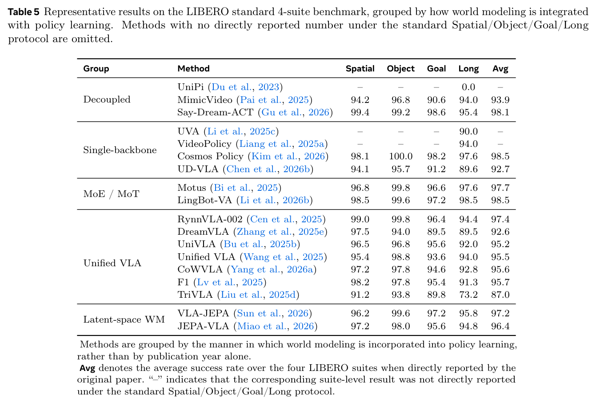{ width="700" }

    *Table 5. LIBERO 표준 4-suite 결과를 월드 모델링 결합 방식별로 묶은 표 (source: 원문 Table 5)*

    원문 Table 6은 RoboTwin 2.0(RT-A 단순 설정 / RT-B 무작위화 설정), CALVIN(ABCD / ABCDD 프로토콜), SIMPLER 계열(Google Robot / WidowX / 기타)을 모은다.

    - **RoboTwin:** LingBot-VA 92.9 / 91.6, InternVLA-A1 89.4 / 87.0, Motus 88.7 / 87.0이 앞선다.
    - **CALVIN ABCD:** DreamVLA 4.44, Unified VLA 4.41, BagelVLA 4.41, TriVLA 4.37, VPP 4.33. **ABCDD:** UD-VLA 4.64, Unified VLA 4.63.
    - **SIMPLER WidowX:** CoWVLA 76.0, Unified VLA 69.8, WoG 63.5, UD-VLA 62.5.
    - 설정과 embodiment가 제각각이라 엄격한 순위보다 벤치마크 간 변동을 보는 용도로 적합하다.

## 참고 자료

- [World Model for Robot Learning: A Comprehensive Survey (arXiv 2605.00080)](https://arxiv.org/abs/2605.00080)
- [프로젝트 페이지](https://ntumars.github.io/wm-robot-survey/)
- [Awesome-World-Model-for-Robotics-Policy (GitHub)](https://github.com/NTUMARS/Awesome-World-Model-for-Robotics-Policy)
- [Hello, World Models 시즌 1 리뷰](season1-review.md)
- 대표 모델로 다룬 논문: [UniPi](https://arxiv.org/abs/2302.00111), [VPP](https://arxiv.org/abs/2412.14803), [UVA](https://arxiv.org/abs/2503.00200), [Cosmos Policy](https://arxiv.org/abs/2601.16163), [Motus](https://arxiv.org/abs/2512.13030), [WorldVLA](https://arxiv.org/abs/2506.21539), [VLA-JEPA](https://arxiv.org/abs/2602.10098), [WMPO](https://arxiv.org/abs/2511.09515), [WoVR](https://arxiv.org/abs/2602.13977), [WorldEval](https://arxiv.org/abs/2505.19017), [DreamGen](https://arxiv.org/abs/2505.12705), [IRASim](https://arxiv.org/abs/2406.14540)
- 본문에서 다룬 그 밖의 대표 논문: [GR-1](https://arxiv.org/abs/2312.13139), [LingBot-VA](https://arxiv.org/abs/2601.21998), [Fast-WAM](https://arxiv.org/abs/2603.16666), [JEPA-VLA](https://arxiv.org/abs/2602.11832), [World-Env](https://arxiv.org/abs/2509.24948), [VLA-RFT](https://arxiv.org/abs/2510.00406), [Ctrl-World](https://arxiv.org/abs/2510.10125), [Dreamitate](https://arxiv.org/abs/2406.16862), [TesserAct](https://arxiv.org/abs/2504.20995), [Cosmos Predict 2.5](https://arxiv.org/abs/2511.00062), [DreamDojo](https://arxiv.org/abs/2602.06949), [WorldArena](https://arxiv.org/abs/2602.08971)
